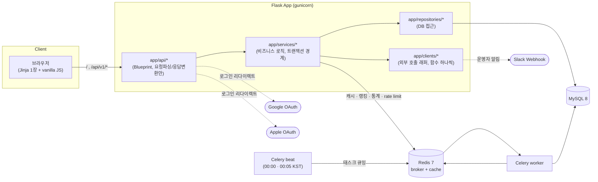

# 오늘의 초성 (chosung-daily)

하루에 한 문제, 초성을 보고 단어를 맞추는 웹 게임의 백엔드. Flask로 만든
이직용 포트폴리오 프로젝트다 — Java/Spring, TypeScript/NestJS로 6년차
백엔드를 하다가 Flask를 처음 써보면서, 설계 판단마다 "Spring이었다면 어떻게
했을지"를 비교하며 진행했다. Spring 개념 대응표는
[`docs/spring-to-flask.md`](docs/spring-to-flask.md) 참고.

## 기술 스택

- Python 3.12, uv (의존성/가상환경)
- Flask 3 (app factory), Flask-SQLAlchemy, Flask-Migrate(Alembic)
- pydantic v2 (요청 검증·응답 직렬화)
- MySQL 8, Redis 7
- Celery + Celery Beat (broker: Redis)
- Authlib (구글/애플 OAuth 로그인)
- gunicorn, Docker Compose
- pytest(실제 MySQL/Redis 통합 테스트 위주), ruff, k6

## 아키텍처



레이어 구조(Spring의 controller/service/repository/entity에 대응):

```
app/
├── api/            # Blueprint. 요청 파싱, 응답 변환만
├── schemas/        # pydantic 요청/응답 모델 (DTO)
├── services/        # 비즈니스 로직, 트랜잭션 경계
├── repositories/    # DB 접근
├── models/          # SQLAlchemy 모델 (Entity)
├── tasks/           # Celery 태스크 (얇은 어댑터)
├── clients/         # 외부 provider 호출 래퍼 (provider 하나 = 모듈 하나)
├── csrf.py          # 웹 폼 CSRF 토큰 발급 + 검증 데코레이터
├── errors.py        # 도메인 예외 + errorhandler
└── cli.py           # flask 커맨드 (시드, 퍼즐 스케줄링, 책 검색, 알림 테스트)
web/                  # Jinja 템플릿 1장 + vanilla JS
```

## API 목록

| 메서드 | 경로 | 설명 | 인증 |
|---|---|---|---|
| GET | `/health` | 헬스체크 | - |
| GET | `/` | 게임 화면 (Jinja) | - |
| POST | `/api/v1/guests` | 게스트 토큰 발급 | - |
| GET | `/api/v1/puzzles/today` | 오늘의 퍼즐(초성/글자수/카테고리/남은시도/상태/힌트), 정답 미포함 | Bearer |
| POST | `/api/v1/puzzles/today/guesses` | 정답 제출 → 판정/피드백/남은시도/(종료 시)정답 | Bearer |
| GET | `/api/v1/puzzles/today/stats` | 시도 횟수별 정답자 비율 | Bearer |
| GET | `/api/v1/puzzles/today/leaderboard?limit=20` | 랭킹(적은 시도 우선, 같으면 빨리 푼 순) | Bearer |
| GET | `/api/v1/me/stats` | 내 streak · 최대streak · 누적 정답 | Bearer |
| POST | `/api/v1/session/sync` | 이 브라우저=이 게스트를 세션 쿠키에 동기화 (로그인 전 필수) | Bearer |
| GET | `/api/v1/auth/<provider>/login` | 구글/애플 로그인 시작 (리다이렉트) | 세션 쿠키 |
| GET | `/api/v1/auth/<provider>/callback` | OAuth 콜백, 계정 연결 후 `/?login_token=`으로 리다이렉트 | 세션 쿠키 |

에러 응답은 전부 `{code, message}` + 적절한 HTTP status로 통일 (아래 "에러 응답" 참고).

## 실행 방법

```bash
cp .env.example .env
docker compose up -d --build
curl http://localhost:8000/health
```

로컬에서 직접 실행:

```bash
uv sync
uv run pytest
uv run ruff check .
```

단어 시드 / 퍼즐 스케줄링:

```bash
uv run flask seed-words data/seed_words.csv
uv run flask schedule-puzzles --days 30
uv run flask search-books "데미안" --add 0   # 카카오/알라딘 API 키 필요 (.env)
uv run flask notify-operator-test           # 운영자 Slack 알림 도착 확인 (SLACK_WEBHOOK_URL)
```

## 설계 판단

> 아래 `트랜잭션 경계`~`퍼즐 카테고리 비중` 은 초기 구현 때 쓴 항목이다. 스토어 출시
> 작업부터는 **티켓 번호를 붙인 `### NN. 제목`** 으로 이 절 끝에 덧붙인다 — 티켓이
> 병렬로 돌아가서, 같은 자리를 고치면 충돌한다.

### 트랜잭션 경계

**서비스 레이어의 함수 하나 = 커밋 하나.** `app/services/*.py`의 각 함수는 그 안에서 일어나는
모든 DB 변경(여러 테이블, 여러 행)을 끝에서 `db.session.commit()` 한 번으로 묶는다. 중간에
실패하면 그 함수가 만든 변경은 전부 롤백된다 — "하루치만 반영되고 나머지는 빠진" 반쪼가리
상태를 피하려는 목적. Spring의 서비스 메서드 `@Transactional` 기본 동작(메서드 하나 = 트랜잭션
하나)과 같은 결.

API/CLI(`app/api`, `app/cli.py`)는 서비스 함수를 호출만 하고 직접 `db.session`을 만지지 않는다.
예: `schedule_puzzles(days=30)`는 30일치를 전부 배정하거나, 중간에 에러가 나면 이번 실행에서
새로 만든 배정을 전부 롤백한다 (기존에 이미 있던 날짜는 건드리지 않음).

### 동시성: 정답 제출

같은 게스트가 정답을 동시에 두 번 보내도 `Attempt.attempt_no`가 꼬이거나 `GuestStats`의
streak/solved_count가 두 번 올라가면 안 된다. `app/services/guess_service.py`의
`submit_guess`는 가장 먼저 `GuestStats` 행에 `SELECT ... FOR UPDATE`를 건다
(`app/repositories/guest_stats_repository.py`). 같은 게스트의 두 요청 중 뒤에 도착한
쪽은 이 잠금에서 블락되고, 앞 요청이 커밋(또는 롤백)해야 풀린다 — 그래서 attempts를
다시 읽을 때는 항상 앞 요청의 변경까지 반영된 최신 상태를 본다.

`unique(guest_id, puzzle_id, attempt_no)` 제약(DB 레벨 재시도 방식)도 attempt_no 중복은
막아주지만, "이미 정답을 맞췄는지"를 재확인하는 타이밍에 따라 streak 이중 증가까지
완전히 막는다고 보장하기 어려워서 주 메커니즘으로는 고르지 않았다. 이 unique 제약은
혹시 FOR UPDATE 경로를 안 타는 변경이 생겨도 DB가 마지막으로 막아주는 보험으로 남겨뒀다.

**실제로 겪은 함정**: MySQL 기본 격리수준(REPEATABLE READ)에서는 트랜잭션 안의 일반
`SELECT`가 "이 트랜잭션이 맨 처음 뭔가를 읽은 시점"의 스냅샷을 계속 본다. `FOR UPDATE`로
잠금을 걸고 기다려서 받아도, 그 뒤에 나오는 일반 `SELECT`(예: 이 게스트의 attempts 조회)는
잠금을 받은 시점이 아니라 그 스냅샷을 써서 — 방금 다른 트랜잭션이 커밋한 데이터를 못
보는 문제가 실제로 재현됐다 (`tests/test_concurrency.py`가 처음엔 이 문제로 실패했었음).
`app/config.py`의 `SQLALCHEMY_ENGINE_OPTIONS`에 `isolation_level: READ COMMITTED`를
추가해서 모든 문장이 항상 최신 커밋을 보게 해 해결했다. Spring/JPA로 치면
`@Lock(LockModeType.PESSIMISTIC_WRITE)` + 트랜잭션 격리수준을 `READ_COMMITTED`로
낮추는 것과 같은 조합.

### 에러 응답

`app/errors.py`의 `AppError`를 상속하는 도메인 예외를 쓰고, `{code, message}` JSON +
적절한 HTTP status로 통일한다 (Spring의 `@ControllerAdvice` + `@ExceptionHandler` 대응).
정의된 코드: `UNAUTHORIZED`(401, 토큰 없음/무효), `VALIDATION_ERROR`(400, 요청 값 자체가
잘못됨 — 예: 정답과 길이가 다른 guess), `NOT_FOUND`(404), `NO_PUZZLE_TODAY`(404, 오늘
퍼즐이 아직 스케줄 안 됨), `ALREADY_FINISHED`(409, 이미 끝난 퍼즐에 또 제출),
`RATE_LIMITED`(429, 분당 제출 횟수 초과), `ACCOUNT_ALREADY_LINKED`(409, 이미 다른
계정이 연결된 게스트), `OAUTH_PROVIDER_UNAVAILABLE`(503, 콘솔 등록 전인 로그인 방식).

### Redis: 캐시 / 랭킹 / 통계 / rate limit

**캐시-어사이드 범위를 "단어 정보"로만 제한했다.** `puzzle:{date}`에 캐시하는 건
`chosung`/`answer`/`hint`/`category`처럼 그날 모든 유저에게 똑같은 값뿐이다.
`attempts_left`/`status`/힌트 공개 여부처럼 게스트마다 다른 값은 절대 캐시하지 않고
항상 DB에서 그 게스트의 attempts를 다시 읽는다 — 안 그러면 한 게스트의 진행 상태가
캐시를 통해 다른 게스트에게 새어나간다. `app/services/puzzle_cache.py`의 `CachedPuzzle`/
`CachedWord`는 `DailyPuzzle`/`Word` ORM과 같은 속성을 노출하는 덕 타이핑으로, 호출부
(`puzzle_service`, `guess_service`)가 캐시 히트/미스를 분기할 필요가 없게 한다. 지금
규모에선 이 구조로 충분하다고 판단했지만, 나중에 `Word`에 필드가 추가되는데 `CachedWord`를
깜빡하고 안 늘리면 캐시 히트 경로에서만 조용히 구버전 데이터가 나가는 위험이 있다 —
캐시 레이어가 더 커지면 `typing.Protocol`로 계약을 명시하는 게 안전하다.

**리더보드 정렬**: "적은 시도 우선, 같으면 빨리 푼 순"을 `lb:{date}` Sorted Set 하나의
점수로 인코딩한다 — `score = attempt_no * 86400 + 자정부터 걸린 초`. 시도 횟수 차이가
걸린 시간(최대 86399초) 차이보다 항상 크기 때문에, ZSET 기본 오름차순 그대로 원하는
순서가 나온다(REV 불필요).

**통계**: `stats:{date}` Hash에 `HINCRBY`로 "1"~"5"(그 시도 횟수에 맞춘 정답)와 "fail"을
누적한다. DB(`DailyStats`)로의 배치 반영은 Celery Beat가 매일 00:05 KST에 한다.

**rate limit은 고정 윈도우(fixed window)다.** 게스트가 "처음" 요청한 시점부터 60초
단위로 카운터가 리셋된다 — 슬라이딩 윈도우보다 구현이 단순하지만, 윈도우 경계에서
짧은 순간(예: 59.9초에 10번 + 60.1초에 또 10번) 분당 10회보다 더 통과할 수 있다. rate
limit의 목적이 "악의적 스팸 방지"라 이 정도 오차는 감수하기로 했다(`app/api/rate_limit.py`
에 근거 기록).

**Redis 장애 격리**: `app/utils/redis_safe.py`의 `safe_redis_call` 하나를 모든 Redis
호출(캐시/통계/랭킹/rate limit)이 거친다. Redis가 없거나 장애면 조용히 `default`를
돌려주고 호출부는 평소처럼 DB 경로로 계속 간다 — "Redis 장애 시 게임 자체(조회/제출)는
DB로 동작하고, 랭킹·통계만 실패"가 이 한 함수로 전부 구현된다. rate limit도 "제출"의
일부로 보고 fail-open(장애 시 그냥 통과)시켰다. `docs/perf.md`에서 Redis를 아예 내리고
부하 테스트를 돌려서 이 폴백이 실제로 동작하는 것까지 확인했다.

### Celery Beat: 자정 퍼즐 생성 / 00:05 통계 배치

**태스크의 실제 로직은 서비스 레이어에, Celery는 얇은 어댑터로.**
`app/services/puzzle_maintenance_service.py`에 평범한 함수 두 개
(`ensure_today_puzzle_and_warm_cache`, `flush_daily_stats_for_yesterday`)로 로직을
두고, `celery_app.py`/`app/tasks/scheduled.py`는 그 함수를 호출만 한다. 이렇게 나눈
이유는 테스트 가능성 때문이다 — Celery 태스크는 `-A celery_app.celery`로 뜰 자기만의
Flask 앱이 필요한데, pytest의 테스트 앱과 그 앱은 설정(DB/Redis)이 다르다. 서비스
함수로 로직을 빼두면 pytest가 테스트 앱 컨텍스트 안에서 그 함수를 직접 불러 검증할 수
있고(`tests/test_puzzle_maintenance.py`), Celery 쪽은 "배선(태스크 이름, Beat
스케줄, 타임존)만 맞는지"를 가볍게 확인한다(`tests/test_celery_wiring.py`).

**"매일 자정 자동 실행"은 설정값과 스케줄러 계산까지만 확인했다.** `celery.conf.timezone
= "Asia/Seoul"`로 Beat의 crontab이 KST 기준으로 해석되게 했고, `crontab(...).
remaining_estimate(now)`로 다음 실행 예정 시각을 직접 계산해서 23:59:59/00:04:59
(KST)가 나오는 것까지 확인했다 — 이건 Beat가 내부적으로 쓰는 것과 같은 계산 함수라
단순히 설정값을 읽는 것보다는 신뢰도가 높지만, 실제로 자정을 넘기며 beat 컨테이너가
태스크를 큐에 넣는 순간을 지켜본 건 아니다. `celery call`로 두 태스크를 수동
트리거해서 워커가 정상 처리하는 것(태스크 로직 자체의 정확성)은 확인했지만, 이
둘은 서로 다른 수준의 증거라는 걸 구분해 둔다.

### 계정 연결 (구글/애플 OAuth)

원래 스펙(Phase 1~8)엔 없던 기능이다. 게스트 토큰이 브라우저 localStorage에만
있어서 기기를 바꾸면 기록이 끊기는 문제 때문에, 구글/애플 계정에 게스트를
연결해서 어느 기기에서 로그인해도 같은 기록으로 이어지게 하는 기능을 추가했다.
처음엔 카카오 로그인으로 만들었다가, "구글이랑 애플만 하자"는 결정으로 바꿨다
— 책 검색(`flask search-books`)에 쓰는 카카오 REST API 키와는 완전히 별개다.
아직 구글/애플 개발자 콘솔에 실제 앱을 등록 안 해서(`GOOGLE_CLIENT_ID` 등이
비어있으면 `app/extensions.py`의 `init_oauth`가 그 provider를 아예 등록 안 하고
503을 돌려줌) 실제 로그인 왕복은 한 번도 못 해봤다 — 등록 후 가장 먼저
확인해야 할 지점. 애플은 client_secret이 고정값이 아니라 `APPLE_PRIVATE_KEY`로
서명한 JWT라(`_apple_client_secret`), 구글보다 설정값이 하나 더 필요하다
(`.env.example` 참고). Apple Developer Program 멤버십은 이미 BuildUrPalace(iOS
출시작) 때 가입해둬서 추가 비용 없이 Services ID만 새로 만들면 된다.

**설계**: `Account` 테이블(게스트 1명당 계정 0~1개, `unique(provider,
provider_user_id)`)로 Guest를 건드리지 않고 위에 얹었다. 같은 provider 계정으로
다른 기기에서 로그인하면 기존에 연결된 게스트로 "전환"되고(처음 보는 provider
계정이면 지금 쓰던 게스트에 새로 연결), 이미 다른 provider가 연결된 게스트는
추가 연결을 거부한다(1게스트:1계정, `app/services/account_service.py`).

**진짜로 겪은 보안 버그 (로그인 CSRF)**: 처음 구현은 `/auth/<provider>/login`이
"어느 게스트에 연결할지"를 쿼리파라미터(`?token=<게스트 토큰>`)로 받았다.
문제는 그 파라미터를 아무나 원하는 값으로 채워서 링크를 만들 수 있다는
것 — 공격자가 **자기** 게스트 토큰을 넣은 로그인 링크를 피해자에게 보내고,
이미 구글/애플에 로그인돼 있는 피해자가 그 링크를 눌러 동의 화면만 넘기면,
피해자의 진짜 계정이 **공격자의 게스트**에 영구 연결돼버린다(unique 제약 때문에
한 번 묶이면 피해자가 나중에 자기 기기에서 다시 로그인해도 계속 공격자
게스트로 "전환"됨). 지금은 익명 게임 기록이라 피해가 제한적이지만, 나중에
결제/구독을 이 Account에 붙이기로 돼 있어서 그대로 뒀으면 계정 탈취급 문제가
될 뻔했다(보안 리뷰로 발견, 실제 콘솔 등록 전에 수정함).

고친 방법: "현재 브라우저가 어느 게스트인지"를 더 이상 클라이언트가 주는
값으로 안 믿는다. 대신 `POST /api/v1/session/sync`(Authorization 헤더로
인증)를 프론트가 페이지 로드마다 호출해서, Flask의 서명된 세션 쿠키
(`SESSION_COOKIE_SAMESITE=Lax`)에 `current_guest_id`를 심어두고,
`/auth/<provider>/login`은 그 쿠키만 본다. 공격자가 보낸 링크를 피해자가
눌러도 그 요청엔 피해자 자신의 세션 쿠키가 실리지, 공격자 것은 못 실린다
(SameSite 쿠키는 다른 사이트/출처에서 강제로 못 심음). `tests/test_oauth_routes.py`
의 `test_login_csrf_cannot_be_forged_via_query_param`이 이 수정을 검증한다.

**진짜로 겪은 버그 하나 더 (멀티 앱 오염, redis와 같은 패턴 재발)**: Authlib의
`OAuth()` 객체를 db/migrate처럼 "라이브러리가 앱별로 알아서 관리해준다"고
믿고 모듈 전역 하나로 썼는데, Authlib 소스를 보면 등록된 클라이언트가
**인스턴스 자신**에 영구 캐싱돼서 redis_client 때와 똑같은 문제였다(여러 Flask
앱이 같은 프로세스에 있으면 먼저 등록한 설정이 고정됨). 앱마다 새
`OAuth()` 인스턴스를 만들어서 `app.extensions`에 저장하는, redis 때와 동일한
해법으로 고쳤다. `tests/test_extensions_isolation.py`에 redis/OAuth 둘 다
회귀 테스트를 남겨뒀다 — 같은 실수를 또 하지 않으려고.

### 퍼즐 카테고리 비중 (book_title은 일요일만)

실제로 플레이해보고 나온 피드백: 책 제목이 일반 단어랑 비슷한 빈도로 섞이니까 안
읽어본 사람한텐 그냥 모르는 단어고, 여러 단어짜리 제목은 초성도 길어서 체감
난이도가 들쭉날쭉했다. `app/services/puzzle_schedule_service.py`의 `_pick_word`가
날짜의 요일을 보고 "오늘 원하는 카테고리"를 먼저 정한다 — 일요일(`BOOK_TITLE_WEEKDAY
= 6`)만 책 제목을 후보로 넣고, 나머지 요일은 일반 단어만 본다. 원하는 카테고리에
후보가 없으면(예: 일요일인데 최근에 안 쓴 책 제목이 없음) 카테고리 제한을 풀고
다시 찾아서, 빈 날짜가 생기진 않는다.

### 19. prod 프로젝트명 유지 이유 (compose 파라미터화)

같은 NAS 에서 prod 와 develop 을 동시에 돌리려고 `docker-compose.prod.yml` 에서
고정 `container_name` 과 최상위 `name:` 을 지우고, 호스트 포트·env 파일을
`${APP_PORT}`·`${ENV_FILE:-.env}` 로 뺐다. 프로젝트명은 `-p` 로 준다.

여기서 바꾸지 **않은** 게 하나 있다 — prod 의 compose 프로젝트명은 기존
`chosung-daily-prod` 를 그대로 쓴다. compose 의 named volume 실제 이름은
`<프로젝트명>_<볼륨키>` 라서, 프로젝트명을 "더 깔끔하게" 바꾸는 순간 기존
`chosung-daily-prod_mysql-data` 가 아니라 **빈 볼륨이 새로 생겨서 붙는다**.
서비스는 정상적으로 뜨고 `/health` 도 ok 인데 DB 만 비어 있어서, 퍼즐 기록과
게스트 토큰이 전부 날아간 것처럼 보인다(데이터는 옛 볼륨에 남아 있지만 아무도
안 본다). 이름 한 줄이 데이터 손실처럼 보이는 사고로 이어지는 구조라, 이름은
건드리지 않고 `docs/RELEASE.md` 첫 배포 체크에 "NAS 의 실제 프로젝트명·볼륨명
확인 후 `up`" 을 넣었다.

같은 이유로 `.env`/`.env.develop` 에 `COMPOSE_PROJECT_NAME` 을 넣어 둔다.
compose 는 프로젝트 디렉터리의 `.env` 를 자동으로 읽기 때문에, 누가 `-p` 를 빼고
`docker compose -f docker-compose.prod.yml up -d` 만 쳐도 디렉터리 이름에서
프로젝트명을 추측하지 않고 같은 프로젝트(= 같은 볼륨)에 붙는다.

### 01. 외부 호출 래퍼와 도메인 판정 함수의 분리

외부 provider(Slack, Apple, App Store, Play, Google Books) 호출은 `app/clients/<provider>.py`
의 **함수 하나**로만 둔다. 그 함수는 요청을 보내고 결과를 돌려주는 일만 하고, "이 상태면
광고를 끌 수 있는가", "어떤 문구로 알릴 것인가" 같은 판단은 `app/services/` 의 순수 함수에
남긴다.

이렇게 자른 이유는 테스트 경계다. provider 호출을 서비스 함수 안에 섞어두면 구독 권한 판정
하나를 확인하려고 매번 네트워크를 가짜로 만들어야 하고, 그 가짜가 실제 응답과 달라지는 순간
테스트가 거짓 초록이 된다. 래퍼가 함수 하나면 테스트는 **그 함수만** monkeypatch 하고
(`tests/test_operator_alert_service.py`), 판정 로직은 입력 → 출력으로 직접 검증된다
(네트워크 없음). 래퍼 자체의 테스트는 "실패해도 예외를 안 올리는가" 같은 경계 동작만 본다
(`tests/test_slack_client.py`).

### 01. Slack Webhook 선택 근거

운영자 알림(단어 잔량 부족, 퍼즐 배정 실패, 백업 실패)은 **Slack Incoming Webhook** 으로
보낸다. 받는 사람이 운영자 한 명이라 수신자 관리가 필요 없고, Webhook 은 URL 하나를 `.env`
에 넣으면 끝나서 OAuth 토큰·스코프·갱신이 없다. 이메일(SMTP)은 발신 도메인·스팸 평판을
챙겨야 하고, 봇 토큰 방식은 앱 등록·권한 승인 단계가 늘어난다 — 알림 하나에 그만한 설정을
들일 이유가 없다.

대신 Webhook 은 "URL 을 아는 사람은 누구나 그 채널에 글을 쓸 수 있는" 비밀값이라
`SLACK_WEBHOOK_URL` 은 커밋하지 않고 `.env.example` 에 빈 칸으로만 둔다. 값이 비어 있으면
`app/clients/slack.py` 가 전송을 건너뛰기 때문에 개발·테스트에서는 아무 설정 없이 돌아가고,
운영자는 값을 넣은 뒤 `uv run flask notify-operator-test` 로 도착을 한 번 확인한다.

전송 실패는 **호출자에게 예외를 올리지 않고 경고 로그만 남긴다**(타임아웃 3초). 호출자가
자정 퍼즐 배정이나 매일 백업이라, Slack 이 죽었다고 그 작업이 깨지면 알림을 붙인 쪽이
손해다 — Redis 장애 때 게임을 DB 로 계속 돌리는 것과 같은 판단이다.

그 경고 로그에는 **예외 타입과 HTTP 상태 코드만** 넣는다. `requests` 예외는 메시지
(`... for url: <URL>`)와 traceback 양쪽에 요청 URL 을 담는데, 여기서 URL 은 곧 비밀값이다 —
`exc_info=True` 로 두면 운영 실패 한 번에 Webhook 비밀이 로그 수집기로 복제되고, 로그는
회수할 수 없다. 노출 회귀는 `tests/test_slack_client.py` 가 가짜 응답에 URL 을 붙여서 잡는다.

### 01. CSRF 토큰 방식

웹 폼(계정 삭제, 운영자 화면)은 쿠키 세션만으로 인증하므로, 다른 사이트가 만든 POST 에도
쿠키가 실려서 "본인 의도 없이 삭제" 가 가능하다. 그래서 `app/csrf.py` 가 폼을 그릴 때 세션에
**1회용 토큰**(`secrets.token_urlsafe(32)`)을 심고, `@csrf_protected` 가 폼 hidden 값과
비교해 다르면 403 `FORBIDDEN` 을 낸다.

`SameSite` 쿠키만으로 막지 않는 이유가 있다. 애플 로그인 콜백이 cross-site top-level POST
(`response_mode=form_post`)로 들어와서 프로덕션 세션 쿠키가 `SameSite=None` 으로 풀려 있다
(`app/config.py` 의 `ProductionConfig`). 즉 이 서비스에서는 쿠키 속성이 CSRF 방어선이 못 된다.

토큰은 Flask-WTF 같은 확장을 붙이지 않고 직접 만들었다. 필요한 건 "세션에 난수를 심고
폼 값과 상수 시간 비교" 뿐이고, 폼 검증·필드 렌더링까지 딸려오는 확장을 들이면 면접에서
설명할 코드보다 설명할 라이브러리 동작이 많아진다.

설계상 세 가지를 의도적으로 정했다.

- **"1회용" 은 세션이 아니라 Redis 가 보장한다.** Flask 의 기본 세션은 서명된 쿠키라서 상태가
  전부 클라이언트에 있다. `session.pop` 은 응답 `Set-Cookie` 를 바꿀 뿐이라, 브라우저나
  중간 프록시가 들고 있던 **옛 쿠키를 그대로 다시 보내면 세션 안의 토큰이 되살아난다**
  (새로고침 연타·더블 클릭이 만드는 동시 제출은 애초에 전부 같은 옛 쿠키를 들고 온다).
  그래서 검증을 통과한 토큰은 해시를 키로 `SET csrf:used:<sha256> NX` 로 Redis 에
  기록한다 — `NX` 가 왕복 한 번의 원자적 연산이라 동시 제출 중 하나만 통과한다. TTL 은
  `PERMANENT_SESSION_LIFETIME`: Flask 가 세션 쿠키를 풀 때 이 값을 `max_age` 로 검사하므로
  그보다 오래된 쿠키는 애초에 세션이 안 열리고, 소비 기록을 더 들고 있을 이유가 없다.
  기록을 못 남기면(Redis 없음·장애) 통과시키지 않고 403 이다 — 랭킹·통계와 달리 여기서는
  "실행 못 함" 보다 **"계정 삭제가 두 번 실행됨"** 이 비싸서 폴백하지 않는다.
- **성공한 토큰만 폐기한다.** 틀린 값을 던진 요청이 세션 토큰을 지워버리면, 아무나 잘못된
  POST 를 한 번 보내서 사용자가 열어둔 폼을 무효화할 수 있다. 검증을 통과한 다음에만 토큰을
  버려서, 새로고침 재전송(같은 삭제가 두 번)은 막고 실패 요청은 폼을 건드리지 않는다.
- **비교는 bytes 로 한다.** `secrets.compare_digest` 는 비 ASCII 문자가 든 `str` 을 받으면
  `TypeError` 를 낸다 — 한글이 섞인 아무 값을 폼에 넣으면 403 이어야 할 요청이 500 이 된다.
  양쪽을 `encode()` 해서 넘긴다.

## 부하 테스트 요약

자정 트래픽 스파이크(0→50 VU, `GET /puzzles/today` + 30% `POST .../guesses`)로
캐시 적용 전/후를 비교했다. 캐시는 코드를 안 건드리고 Redis 컨테이너를 내려서
"미적용" 상태를 만들었다 — Redis 장애 폴백이 실제로 동작하는지도 같이 확인한
셈이다.

| 지표 | 캐시 미적용 | 캐시 적용 | 개선 |
|---|---|---|---|
| 전체 `http_req_duration` p95 | 65.31ms | 21.66ms | 약 3.0배 |
| `GET /puzzles/today` p95 | 62.39ms | 19.76ms | 약 3.2배 |
| `POST .../guesses` p95 | 69.53ms | 24.28ms | 약 2.9배 |
| 에러율 | 0% | 0% | - |

50 VU·분당 10회 rate limit·게스트별 `FOR UPDATE` 락이 같이 걸린 상태에서도
에러 0%였다. 방법론, RPS가 거의 안 변한 이유(닫힌 모델 테스트의 한계) 등
자세한 내용과 원본 수치는 [`docs/perf.md`](docs/perf.md) 참고.

## 알려진 제한사항 / 남은 작업

- **구글/애플 OAuth 미등록**: 개발자 콘솔에 앱을 아직 안 만들어서 실제 로그인
  왕복을 못 해봤다 (`.env`에 `GOOGLE_CLIENT_ID`/`APPLE_*` 채우면 바로 켜짐). 구글은
  `http://localhost:8000/...`를 리디렉션 URI로 공식 지원해서 로컬에서 바로
  테스트할 수 있지만, **애플은 Return URL이 HTTPS + 실제 등록된 도메인이어야
  해서 `localhost`를 아예 못 쓴다**(ngrok/Cloudflare Tunnel로 임시 터널을 뚫지
  않는 이상). 구글만 먼저 로컬로 테스트할 수도 있었지만, 두 provider를 다른
  방식으로 다루지 않으려고 **구글도 애플과 똑같이 실제 배포(NAS) 도메인이
  생긴 뒤에 같이 등록·테스트하기로 함** — 그때까지 OAuth 로그인은 코드만
  준비된 상태로 둔다.
- **애플 client_secret(JWT)은 앱 시작 시점에 한 번만 만든다**(`_apple_client_secret`,
  유효기간 150일). 재배포나 재시작 없이 앱 프로세스가 150일보다 오래 떠 있으면
  애플 로그인만 조용히 실패하기 시작한다 — 지금은 주기적 재배포로 자연스럽게
  갱신되는 걸 전제로 둔 단순화고, 그 전제가 깨지면(예: 오래 안 건드리고 방치)
  Beat 태스크로 주기적 재발급하는 식으로 바꿔야 한다.
- **책 검색 API 키: 카카오만 발급, 알라딘은 보류**: `flask search-books`가
  알라딘 쪽은 TTBKey 없이는 빈 결과만 돌려준다(의도적으로 나중으로 미룸).
  카카오 쪽은 실제로 테스트 완료 — `add_word_from_book`에 중복 체크가 없어서
  같은 책을 `--add`로 두 번 넣으면 Word가 중복 생기는 버그를 그 과정에서
  발견해 고쳤다(`seed_words_from_csv`와 같은 (answer, category) 기준 중복
  방지). 다만 **철자/띄어쓰기가 다르면 다른 단어로 취급**한다 — 예를 들어
  수동 시드 CSV의 "어린왕자"와 카카오 API가 주는 실제 제목 "어린 왕자"(띄어쓰기
  있음)는 서로 다른 Word로 남는다. 코드 버그는 아니고 단어 풀을 수동 시드와
  API 등록을 섞어 쓸 때 생기는 콘텐츠 큐레이션 이슈라, 자동으로 고치진
  않았다 — 등록 전에 `flask search-books`로 먼저 검색해서 철자를 확인하는
  걸 권장.
- **rate limit 고정 윈도우**: 분당 10회가 윈도우 경계에서 최대 2배까지 샐 수
  있음 (의도된 단순화, 위 "Redis" 절 참고).
- **k6 테스트는 닫힌 모델**이라 RPS가 아니라 지연시간 비교에만 쓸 수 있음
  (`docs/perf.md` 참고).
