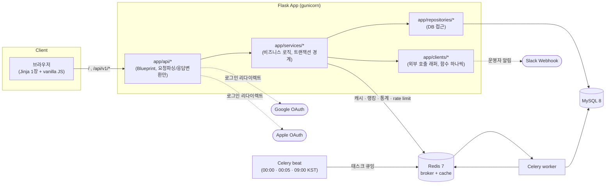

# 오늘의 초성 (chosung-daily)

하루에 한 문제, 초성을 보고 단어를 맞추는 웹 게임의 백엔드. Flask로 만든
이직용 포트폴리오 프로젝트다 — Java/Spring, TypeScript/NestJS로 6년차
백엔드를 하다가 Flask를 처음 써보면서, 설계 판단마다 "Spring이었다면 어떻게
했을지"를 비교하며 진행했다. Spring 개념 대응표는
[`docs/spring-to-flask.md`](docs/spring-to-flask.md) 참고.

## 기술 스택

- Python 3.12, uv (의존성/가상환경)
- Flask 3 (app factory), Flask-SQLAlchemy, Flask-Migrate(Alembic)
- pydantic v2 (요청 검증·응답 직렬화)
- MySQL 8, Redis 7
- Celery + Celery Beat (broker: Redis)
- Authlib (구글/애플 OAuth 로그인)
- gunicorn, Docker Compose
- pytest(실제 MySQL/Redis 통합 테스트 위주), ruff, k6
- Flutter 3.38 + Riverpod (앱 `mobile/`, 티켓 22~33). 아래 "설계 판단 > 22" 참고

## 아키텍처



레이어 구조(Spring의 controller/service/repository/entity에 대응):

```
app/
├── api/            # Blueprint. 요청 파싱, 응답 변환만
├── schemas/        # pydantic 요청/응답 모델 (DTO)
├── services/        # 비즈니스 로직, 트랜잭션 경계
├── repositories/    # DB 접근
├── models/          # SQLAlchemy 모델 (Entity)
├── tasks/           # Celery 태스크 (얇은 어댑터)
├── clients/         # 외부 provider 호출 래퍼 (provider 하나 = 모듈 하나)
├── csrf.py          # 웹 폼 CSRF 토큰 발급 + 검증 데코레이터
├── errors.py        # 도메인 예외 + errorhandler
└── cli.py           # flask 커맨드 (시드, 퍼즐 스케줄링, 책 검색, 알림 테스트)
web/                  # Jinja 템플릿 1장 + vanilla JS
```

## API 목록

| 메서드 | 경로 | 설명 | 인증 |
|---|---|---|---|
| GET | `/health` | 헬스체크 (DB 실패 503, Redis 실패 200 + `degraded`) | - |
| GET | `/` | 게임 화면 (Jinja) | - |
| POST | `/api/v1/guests` | 게스트 토큰 발급 (`{puzzle_language?}`, 기본 `ko`) | - |
| PATCH | `/api/v1/me` | 퍼즐 언어 선호 변경 (`{puzzle_language}`) → `{puzzle_language}` | Bearer |
| GET | `/api/v1/puzzles/today` | 게스트 선호 언어의 오늘 퍼즐(`puzzle_id`/`language`/`mask`/`length`/`chosung`/카테고리/남은시도/`attempts`/`hint_unlocked`/상태/힌트), 정답 미포함 | Bearer |
| POST | `/api/v1/puzzles/today/guesses` | 정답 제출 (`{puzzle_id, guess}`) → 판정/피드백/남은시도/(종료 시)정답, 퍼즐 불일치 409 `PUZZLE_CHANGED` | Bearer |
| GET | `/api/v1/puzzles/today/stats?language=` | 시도 횟수별 정답자 비율 (언어별, 기본 게스트 선호) | Bearer |
| GET | `/api/v1/puzzles/today/leaderboard?language=&limit=20` | 랭킹(적은 시도 우선, 같으면 빨리 푼 순, 언어별) → `entries [{rank, anon_tag, attempts, seconds, is_me}]` + `me {rank, attempts, seconds} \| null`(21위 밖이어도 내 순위) | Bearer |
| GET | `/api/v1/me/stats` | 내 퍼즐 언어 · streak · 최대streak · 누적 정답 | Bearer |
| GET | `/api/v1/me/history?days=7` | 최근 N일(KST, 상한 31) 퍼즐 언어별 결과 → `[{date, results: {ko, en}}]`, 각 값 `success\|fail\|in_progress\|none` | Bearer |
| POST | `/api/v1/session/sync` | 이 브라우저=이 게스트를 세션 쿠키에 동기화 (로그인 전 필수) | Bearer |
| GET | `/api/v1/auth/<provider>/login` | 구글/애플 로그인 시작 (리다이렉트) | 세션 쿠키 |
| GET | `/api/v1/auth/<provider>/callback` | OAuth 콜백, 계정 연결 후 `/?login_token=`으로 리다이렉트 | 세션 쿠키 |
| POST | `/api/v1/auth/token-exchange` | 앱 네이티브 로그인 id_token 교환 → 계정 연결/전환 후 `{token}` | Bearer |
| GET | `/api/v1/config` | 앱 설정(최소 앱 버전·점검·지원 언어·스토어 링크), 60초 캐시 | - |
| GET | `/privacy` | 개인정보처리방침 (Jinja, ko/en — `?lang=` 또는 Accept-Language) | - |
| GET | `/terms` | 이용약관 (Jinja, ko/en — `?lang=` 또는 Accept-Language) | - |
| POST | `/api/v1/subscriptions/verify` | 스토어 영수증 검증 → 구독 upsert → `entitlement {active, until, status, source, next_check_at}` | Bearer |
| POST | `/api/v1/puzzles/today/hint-unlock` | 힌트 미리 보기 (`{puzzle_id}`) → `{hint}`, 퍼즐당 1회 · 시도 미소비, 끝난 퍼즐 409 `ALREADY_FINISHED` / 이미 열림 409 `HINT_ALREADY_UNLOCKED` / 퍼즐 불일치 409 `PUZZLE_CHANGED` | Bearer |
| GET | `/admin/` | 운영자 단어 목록 (언어·카테고리·검색어 필터, 페이지네이션) | S + 운영자 |
| GET/POST | `/admin/words/new`, `/admin/words` | 단어 추가 폼 / 저장 | S + 운영자 (+ POST CSRF) |
| GET/POST | `/admin/words/<id>/edit`, `/admin/words/<id>` | 단어 수정 폼 / 저장 (`mask` 재계산) | S + 운영자 (+ POST CSRF) |
| POST | `/admin/words/<id>/delete` | 단어 삭제 (퍼즐에 배정된 단어는 거부) | S + 운영자 + CSRF |
| GET/POST | `/admin/words/import` | CSV 업로드 폼 / 적재 + 행별 결과 표 | S + 운영자 (+ POST CSRF) |
| DELETE | `/api/v1/me` | 계정·기록 전체 삭제(한 커밋) → 204, 애플 계정이면 애플 연결도 철회 | Bearer |
| GET | `/account/delete` | 계정 삭제 확인 페이지 (Jinja, ko/en) — 세션 없으면 안내 + 운영자 메일. Play Data safety 삭제 URL | 세션 쿠키(선택) |
| POST | `/account/delete` | 확인 폼 제출 → 삭제 후 `/?deleted=1` 리다이렉트, 세션 없음 401 / CSRF 불일치 403 `FORBIDDEN` | 세션 쿠키 + CSRF |
| GET | `/api/v1/me/stats` | (티켓 13) 위 응답에 `entitlement {active, until, status, source, next_check_at}` 추가 — `active\|grace\|hold` 구독은 `last_verified_at + 1h`(만료 ±24h 안은 5분) 가 지났으면 스토어 재조회 후 응답, `next_check_at = last_verified_at + 1h` | Bearer |
| GET | `/admin/schedule?language=` | 언어별 30일 배정표 + 언어별 단어 잔량(14일치 미만 경고) | S + 운영자 |
| GET/POST | `/admin/schedule/<date>/replace` | 그 날짜의 단어 교체 폼 / 적용 (캐시 무효화, 시도 있는 날짜·지난 날짜 거부) | S + 운영자 (+ POST CSRF) |
| GET/POST | `/admin/settings` | 점검 모드·최소 앱 버전 폼 / 저장 (`/config` 캐시 무효화) | S + 운영자 (+ POST CSRF) |
| GET/POST | `/admin/books?q=` | Google Books 영어 제목 검색 / 고른 책을 en `book_title` 단어로 추가 | S + 운영자 (+ POST CSRF) |

에러 응답은 전부 `{code, message}` + 적절한 HTTP status로 통일 (아래 "에러 응답" 참고).

## 실행 방법

```bash
cp .env.example .env
docker compose up -d --build
curl http://localhost:8000/health
```

로컬에서 직접 실행:

```bash
uv sync
uv run pytest
uv run ruff check .
```

`tests/test_migrations.py` 는 `flask db upgrade/downgrade` 를 **별도 DB** 에서 돌린다
(conftest 의 `create_all` 경로로는 마이그레이션 파일이 검증되지 않는다). 테스트 유저에게
`CREATE DATABASE` 권한이 없어서 한 번은 관리자로 만들어 줘야 한다 — 이름은 테스트 DB 이름
+ `_migrations` 이고, `TEST_MIGRATION_DATABASE_URL` 로 바꿀 수 있다:

```bash
docker compose exec mysql mysql -uroot -proot -e "
  CREATE DATABASE IF NOT EXISTS chosung_daily_test_migrations CHARACTER SET utf8mb4;
  GRANT ALL PRIVILEGES ON \`chosung_daily_test_migrations\`.* TO 'chosung'@'%';"
```

단어 시드 / 퍼즐 스케줄링:

```bash
uv run flask seed-words data/seed_words.csv
uv run flask schedule-puzzles --language ko --days 30   # 언어마다 따로 돌린다 (기본 ko)
uv run flask schedule-puzzles --language en --days 30
uv run flask search-books "데미안" --add 0   # 카카오/알라딘 API 키 필요 (.env)
uv run flask notify-operator-test           # 운영자 Slack 알림 도착 확인 (SLACK_WEBHOOK_URL)
```

## E2E (웹 브라우저)

pytest 는 Flask 테스트 클라이언트까지고, `tests/test_web_js.py` 는 번들을 node 로만
돌린다. 그 둘이 못 보는 것 — **사람이 실제 브라우저에서 눌러 가는 한 판** — 을 보는 게
이 E2E 다(티켓 42). mock 서버를 쓰지 않는다: Flask(gunicorn) + MySQL + Redis +
Celery worker/beat 를 전용 스키마로 띄우고, Playwright(Chromium)가 접근성 라벨·보이는
텍스트로 화면을 누른다.

```bash
scripts/e2e_web.sh                          # 한 판 전부 (데스크톱 1280 + 모바일 390)
scripts/e2e_web.sh --project=desktop-1280   # 뷰포트 하나만
scripts/e2e_web.sh specs/01-first-visit.spec.mjs
E2E_KEEP=1 scripts/e2e_web.sh ...           # 끝나고 스택을 남긴다 (디버깅)
```

`scripts/e2e_web.sh` 가 매번 **DB 를 새로 만든다**(down → up → seed → 테스트 → down).
처음 한 번은 Playwright 와 Chromium 을 받는다(~90MB, `tests/e2e/web/node_modules` 와
`~/Library/Caches/ms-playwright`; 둘 다 레포에 안 들어간다).

**소요 시간(실측, M 시리즈 맥)**: 스택 기동 ~25초 · 시드 ~5초 · 시나리오 **48개**
(뷰포트 2개 × 24개 — 스펙 10개 파일을 ko·en 으로, 운영자 화면만 ko 전용) 1분~2분 30초 ·
정리 ~5초 — **전체 2~3분.** 머신 부하에 따라 브라우저 쪽이 두 배까지 벌어진다
(실측 1.1분 / 1.2분 / 2.2분 / 2.5분).

스택만 따로 쓰려면(티켓 43·44 의 앱 E2E 도 같은 스크립트를 쓴다):

```bash
scripts/e2e_stack.sh up            # DB 생성 + 마이그레이션 + 프로세스 기동
scripts/e2e_stack.sh seed          # 단어·퍼즐·운영자 계정 (멱등)
scripts/e2e_stack.sh advance-day   # "하루 지났다" 를 데이터로 만든다
scripts/e2e_stack.sh status
scripts/e2e_stack.sh down          # 프로세스 종료 + DB drop + Redis flush
```

- **쓰는 자원**: MySQL 스키마 `chosung_daily_e2e_t42`(없으면 만들고 `down` 에서 지운다),
  Redis DB **4**, 포트 **5042**(스토어 링크 있음)·**5142**(없음).
  앱을 두 번 띄우는 이유는 "스토어 링크가 비면 배너·CTA 를 아예 안 그린다" 를 브라우저에서
  보려면 설정이 다른 인스턴스가 필요해서다. `E2E_TICKET=43` 처럼 바꾸면 DB 이름과 포트가
  갈리고, Redis 번호는 아래 배정표에서 온다(`scripts/e2e/env.sh`).
- **Redis DB 번호는 티켓마다 배정표에 적혀 있다**(`scripts/e2e/env.sh` 의
  `e2e_redis_db_for_ticket`): 0 로컬 개발 · 1 pytest 기본 · **4 E2E 티켓 42** ·
  5 pytest 티켓 42 · 6 pytest 티켓 46 · 12 E2E 티켓 44 · 13 E2E 티켓 43 ·
  14 E2E 티켓 46. Redis 키에는 스키마 구분이 없어서
  두 스택이 한 번호를 쓰면 `puzzle:` 캐시가 남의 퍼즐을 내보내고 `lb:`·`stats:` 가 섞이며
  한쪽의 `down`(flushdb)이 상대의 실행 중 상태를 지운다. 그래서 **표에 없는 티켓 번호로는
  스택이 뜨지 않는다** — 새 티켓은 `env.sh` 에 한 줄을 더하거나 `E2E_REDIS_DB` 를 직접 준다.
- **시간**: 서버는 KST 벽시계를 그대로 쓴다 — 앱에 테스트용 시계 주입구를 만들지 않기로
  했다(코디네이터 결정 2026-10-15). 그래서 ① 하루를 넘길 때는 저장된 날짜를 하루 되돌리고
  (`scripts/e2e/advance_day.py`: `daily_puzzle.puzzle_date`·`guest_stats.last_solved_date`·
  `daily_stats`·Redis `lb:`/`stats:` 키) ② **KST 자정 ±10분이면 `up`/`seed` 가 거부한다**
  (실행 중에 "오늘" 이 바뀌면 연속 기록·퍼즐 날짜 검증이 거짓 실패한다).
- **정답을 아는 방법**: 자정 배정은 무작위라 테스트가 정답을 알 수 없다. 시드가 오늘부터
  5일치의 (날짜, 언어)별 단어를 못박고 `e2e-artifacts/seed-manifest.json` 으로 넘긴다
  (연속 기록 시나리오가 한 판마다 하루를 넘기고 그게 ko·en × 뷰포트 2개 = 4번이다) —
  테스트는 그 파일만 읽고 DB 를 훑지 않는다. 단어 출처는 `data/seed_words.csv`(ko)와
  `scripts/e2e/words_en.csv`(en, E2E 전용)뿐이다. `data/word-candidates/` 는 읽지 않는다 —
  실제 출시 정답이 테스트 로그로 샌다.
- **외부 서비스에 닿지 않는다**: 실제 결제·실제 OAuth 로그인·실제 푸시·실제 Slack 알림을
  하지 않는다. 운영자 로그인은 시드가 만든 "계정이 이미 연결된" 게스트의 백업 코드를
  복원 화면에 넣어 대신한다(실제 구글 왕복은 `docs/RELEASE.md` 실기기 체크리스트).
- **산출물**: `e2e-artifacts/web/<시나리오>/<뷰포트>/` 에 단계별 스크린샷 + `steps.log` +
  `axe-*.json`, 전체 리포트는 `e2e-artifacts/web/report/`. 전부 gitignore 다 —
  스크린샷에 게스트 토큰·백업 코드가 찍히고 접근 로그에 원격 IP 가 남는다.
  `--reporter=line` 처럼 리포터를 직접 넘기면 설정의 html/json 리포터가 **대체되어**
  `report/results.json` 이 갱신되지 않는다(남아 있는 파일은 이전 판 것이다).
- **실패를 숨기지 않는다**: 재시도(`retries`)가 0 이고, 찾은 앱 결함은 테스트를 느슨하게
  고치는 대신 `expect.soft` + 결함 ID 주석으로 남긴다 — 테스트는 계속 실패하고(결함이
  보인다) 그 시나리오의 나머지는 끝까지 돈다. 결함 목록은 `review/impl-evidence-42.md`.

## 법적 문서 (`/privacy`, `/terms`)

스토어 심사·구독 화면·Play Data safety 양식이 전부 이 두 URL 을 가리킨다. 한국어·영어가
`?lang=ko|en` 으로 고정되고, `?lang=` 이 없으면 `Accept-Language`, 그것도 없으면 한국어다
(`app/utils/ui_language.py`).

| | |
|---|---|
| 라우트 | `app/web.py` (`privacy`, `terms`) |
| 본문 | `web/templates/legal/{privacy,terms}.{ko,en}.html` — 언어마다 파일 하나 |
| 공통 틀 | `web/templates/legal/_layout.html` (내비·푸터 문구만 언어별로 고름) |
| 사업자 정보 조각 | `web/templates/legal/_business_info.html` — 두 문서(와 티켓 18 의 메인 푸터)가 같은 조각을 `include`. 표시 범위를 한 곳에서만 정한다 |
| 법 기준 체크리스트 | [`docs/legal-checklist.md`](docs/legal-checklist.md) — 조문 → 요구 내용 → 문서 절 id → 확인 테스트. `tests/test_legal_checklist.py` 가 표를 파싱해 양방향으로 지킨다 |
| 스타일 | `web/static/tokens.css` (공용 디자인 토큰) + `web/static/legal.css` (문서 레이아웃) |
| 시행일 | `app/web.py` 의 `LEGAL_EFFECTIVE_DATE` |
| 연락처·사업자 정보 | 설정값 `LEGAL_CONTACT_EMAIL`, `LEGAL_BUSINESS_*`, `LEGAL_PRIVACY_OFFICER` (`app/config.py`). 값이 있는 항목만 "운영자 정보" 블록에 렌더 — 출시 전 채울 값은 `docs/RELEASE.md` "### 09."·"### 16." |

**갱신 책임은 운영자(= 프로젝트 주인)에게 있다.** 아래가 바뀌면 두 언어 본문을 **같은
커밋에서** 고치고 `LEGAL_EFFECTIVE_DATE` 를 올린다 — 한쪽 언어만 고쳐진 문서가 나가면
심사에서 걸린다.

- 수집 항목이 늘거나 줄 때 (새 외부 SDK, 새 저장 컬럼)
- **앱이 게스트 토큰을 두는 자리가 바뀔 때** (`mobile/lib/guest/guest_token_store.dart` —
  방침 `#automatic-collection` 의 "기기 보안 저장소" 항목이 iOS 키체인·Android 암호화
  저장소와 "iOS 는 앱을 지워도 남는다" 를 적고 있다. 저장소나 계정 삭제의 토큰 처리가
  바뀌면 `tests/test_legal_checklist.py` 가 먼저 깨진다 — 티켓 47)
- 제3자·수탁업체가 바뀔 때 (Google, Apple, AdMob, Firebase Analytics, Sentry)
- 보유 기간이 바뀔 때 (예: `BACKUP_RETENTION_DAYS` 를 14일에서 바꾸면 방침의 14일도 고친다)
- 구독 상품·가격·해지 경로가 바뀔 때
- EULA 선택이 바뀔 때 (**2026-10-14 결정: Apple 표준 EULA 유지** — 미정 9 해소, 약관 `#eula`)
- 사업자·통신판매업 등록이 끝났을 때 (`LEGAL_BUSINESS_*` 를 `.env` 에 채운다 — 본문 수정은 없다)
- **관련 법·스토어 정책이 개정될 때** (개인정보 보호법·시행령, 전자상거래법, Apple App Review
  3.1.2(a), Google Play 구독 정책 — `docs/legal-checklist.md` 의 근거 칸을 먼저 고치고,
  그 행이 가리키는 절을 두 언어에서 같이 고친다)

`tests/test_legal_pages.py` 가 "필수 공시 문구가 두 언어 본문에 있는지" 를,
`tests/test_legal_checklist.py` 가 "체크리스트의 모든 절이 ko·en 에 같은 순서로 있는지" 를
지키니, 항목을 지우면 테스트가 먼저 깨진다. 절을 새로 만들면 체크리스트에도 행을 넣어야
한다(본문에만 있는 절도 실패로 잡는다). 삭제 페이지(`/account/delete`)가 "지운다" 고 적은
항목 이름은 방침 `#collection` 절의 부분집합이어야 한다.

## 운영: 백업 / 복구

prod·develop compose 에 `backup` 서비스가 돌면서 매일 **04:00 KST** 에 MySQL 을
덤프한다. 자세한 NAS 설정·리허설 절차는 `docs/RELEASE.md`.

| | |
|---|---|
| 덤프 위치 | 호스트 `${BACKUP_DIR}`(기본 `./backups`) ← 컨테이너 `/backups` bind mount |
| 파일 이름 | `chosung_daily-YYYYmmdd-HHMMSS.sql.gz.enc` (mysqldump + gzip + 공개키 암호화) |
| 보존 | 14일치 (`BACKUP_RETENTION_DAYS`, 오늘 것까지 14개) |
| 실패 알림 | `SLACK_WEBHOOK_URL` 로 POST (비워두면 알림만 생략) |

```bash
# 지금 한 번 백업 (04:00 을 기다리지 않고)
docker compose -f docker-compose.prod.yml -p chosung-daily-prod --env-file .env \
  exec backup /scripts/backup.sh

# 복구 — 되돌릴 수 없다. 덤프 시점 이후의 행은 사라진다. -k 는 복호화 개인키.
./scripts/restore.sh -k <개인키.pem> <덤프.sql.gz.enc> chosung-daily-prod      # 확인 프롬프트
./scripts/restore.sh -y -k <개인키.pem> <덤프.sql.gz.enc> chosung-daily-prod   # 프롬프트 없이
```

**덤프는 암호화돼 있다.** `mysqldump | gzip | openssl cms -encrypt` 로 공개키(CMS 봉투)
암호화한 `*.sql.gz.enc` 만 남고, 평문 덤프는 임시 파일로도 안 남는다. NAS 에는 공개키
인증서(`BACKUP_ENCRYPTION_CERT_FILE`)만 두고 **복호화 개인키는 NAS 에 두지 않는다** —
복구할 때 `-k` 나 `BACKUP_DECRYPTION_KEY_FILE` 로 그 자리에서 준다. 그래서 NAS 폴더가
뚫려도 덤프 내용은 열리지 않고, 반대로 **개인키를 잃으면 모든 백업이 복구 불가**다. 키
생성·보관·교체 절차는 `docs/RELEASE.md` "### 36.", 공개키 방식을 고른 근거는 아래
"설계 판단 36.". 접속기록(접근 로그 파일)의 회전·보관도 같은 backup 컨테이너가 한다.

`restore.sh` 는 MySQL 에 손대기 전에 `gzip -t` 로 덤프를 통째로 검사하고(깨진
덤프로 DB 를 날리지 않는다), 복원이 끝나면 **Redis 의 파생 키(`puzzle:` 오늘
퍼즐 캐시, `stats:`·`lb:` 카운터)를 직접 지운다**. Redis 는 MySQL 과 같이
되감기지 않아서, 안 지우면 앱이 복원된 DB 대신 복구 전 퍼즐을 계속 내놓는다
(TTL 26시간). 앱·워커를 재시작해도 안 지워진다 — Redis 는 별도 컨테이너다.
celery 브로커 큐와 rate limit 카운터는 DB 와 무관해서 건드리지 않는다.

## 운영: 업타임 모니터

`/health` 를 5분마다 보는 모니터는 [UptimeRobot](https://uptimerobot.com) 에
**사람이 한 번 등록**한다(서버 코드로는 못 하는 일, 스펙 §C.29). 등급별 응답은
아래 "설계 판단 08. 헬스체크 등급" 참고.

- 모니터 타입 **HTTP(s)**, URL `https://<배포 도메인>/health`, 간격 5분
- **"Keyword" 모니터로 `"status": "ok"` 를 보지 않는다.** Redis 만 죽은
  `degraded`(200) 상태에서도 알람이 울려버린다. HTTP 상태코드만 보게 두면
  DB 장애(503)만 알람이 된다 — 등급을 나눈 이유가 이것이다.
- 알림 채널은 운영자 메일. Slack 알림은 서버가 직접 보내는 운영자 알림
  (단어 잔량·배정 실패·백업 실패)과 섞지 않는다.
## 운영: Celery Beat 스케줄

시각은 전부 **KST** 다 (`celery.conf.timezone = "Asia/Seoul"`). 스케줄 정의는
태스크 모듈이 각자 들고 있고(`app/tasks/scheduled.py` 의 `BEAT_SCHEDULE`),
`celery_app.py` 는 모듈을 import 만 한다.

| 시각 (KST) | 태스크 | 하는 일 | 실패하면 |
|---|---|---|---|
| 00:00 | `tasks.ensure_today_puzzle` | 지원 언어(ko·en)를 돌며 오늘 퍼즐을 **언어마다 따로 배정·커밋**하고 `puzzle:{date}:{lang}` 캐시를 채운다 | 그 언어만 건너뛰고 다음 언어 계속 + Slack "퍼즐 배정 실패" |
| 00:05 | `tasks.flush_daily_stats` | 전날 Redis 통계(`stats:{date}:{lang}`)를 언어별로 `DailyStats` 에 반영 | Redis 장애면 예외 → Celery 재시도(최대 5회, backoff) |
| 09:00 | `tasks.notify_low_word_pool` | 언어별 미사용 단어 잔량이 **14일치 미만**이면 Slack 알림 | Slack 전송 실패는 경고 로그만 (`app/clients/slack.py`) |
| 월 09:10 | `tasks.notify_apple_secret_expiry` | 애플 `client_secret`(JWT) 만료가 **7일 안**이면 Slack 알림 (주 1회) | 같음 |
| 09:20 | `tasks.retry_apple_revocations` | 실패한 애플 연결 철회(`apple_revocation_retry`)를 다시 시도하고, 7일 넘긴 행은 폐기 + Slack 알림 | 한 행이 실패해도 나머지 행은 그날 계속 시도 |
| 03:30 | `tasks.recheck_expiring_subscriptions` | `active\|grace\|hold` 중 **만료 3일 이내** 구독을 스토어에 재조회하고, 연속 3회 실패가 쌓인 구독이 있으면 Slack 알림 | 그 구독만 실패 카운터 +1, 나머지는 계속 (저장값 유지) |

잔량 알림을 자정이 아니라 09:00 에 둔 건, 알림이 운영자가 깨어 있는 시간에 와야
그날 안에 `flask seed-words` 로 단어를 채울 수 있어서다. 잔량은 "아직 한 번도
배정된 적 없는 단어 수"로 센다(`app/services/word_pool_service.py`) — 퍼즐이
(날짜, 언어)당 하나라 미사용 단어 하나가 곧 하루치다.

```bash
# 수동 트리거 (워커가 떠 있어야 한다)
uv run celery -A celery_app.celery call tasks.ensure_today_puzzle
uv run celery -A celery_app.celery call tasks.notify_low_word_pool
uv run celery -A celery_app.celery call tasks.notify_apple_secret_expiry
uv run celery -A celery_app.celery call tasks.retry_apple_revocations
uv run celery -A celery_app.celery call tasks.recheck_expiring_subscriptions
```

## 운영: 단어 CSV 업로드 (`/admin`)

운영자 두 명(`ADMIN_EMAILS`)이 구글 로그인 세션으로 `/admin` 에 들어가 단어를
검색·추가·수정·삭제하고, CSV 를 올려 한 번에 채운다. 판정 방식은 아래 "설계 판단 15."
참고. 서버에 SSH 로 들어가 `flask seed-words` 를 치는 대신 쓰는 경로이고, **두 입구가
같은 적재 규칙**(`app/services/word_service.py` `import_word_rows`)을 쓴다.

CSV 는 UTF-8(엑셀은 "CSV UTF-8" 로 저장 — BOM 은 허용한다), 첫 줄이 헤더다:

```csv
language,category,answer,hint
ko,general,지하철역,지하철을 타고 내리는 곳
ko,book_title,데미안,헤르만 헤세의 성장 소설
en,general,mountain range,a line of connected peaks
```

| 열 | 값 | 비고 |
|---|---|---|
| `language` | `ko` / `en` | 비어 있으면 `ko` |
| `category` | `general` / `book_title` | `book_title` 은 일요일 라운드에 쓰인다 |
| `answer` | 정답 | 최대 50자. 가림(`mask`)은 서버가 계산한다 |
| `hint` | 힌트 한 줄 | 최대 200자. 정답을 그대로 쓰지 않는다 |

업로드하면 **행별 결과**(추가 / 중복 / 오류 + 사유 + CSV 줄 번호)가 바로 표로 나온다.
이미 있는 (언어, 카테고리, 정답) 은 중복으로 건너뛰므로 같은 파일을 두 번 올려도
안전하다. 깨진 줄은 그 줄만 건너뛰고 나머지는 들어간다 — 100행 중 1행 때문에 파일을
다시 만들 필요가 없다.

**LLM 으로 단어를 만들 때** 쓰는 프롬프트의 골자(잔량 알림이 오면 이걸 돌린다):

> 한국어 일상 단어 40개를 CSV 로 만들어줘. 헤더는 `language,category,answer,hint`,
> `language` 는 `ko`, `category` 는 `general`. 조건: 2~5글자 명사, 초성만 보고
> 맞힐 수 있을 만큼 일상적인 말(인명·지명·고유명사·유행어 제외), 정답에 공백·기호
> 없음, 힌트는 한 줄이고 **정답 글자를 포함하지 않으며** 뜻·용도·분류로만 설명,
> 40개 서로 중복 없음, 따옴표 없이 쉼표로만 구분.

영어는 `language` 를 `en` 으로, "모음을 가려도 자음 뼈대로 알아볼 수 있는 2~12자
단어, 하이픈·공백은 두 단어까지" 로 바꿔 돌린다. 만든 CSV 는 **그대로 올리지 말고**
업로드 결과의 오류 행을 먼저 본다 — LLM 이 카테고리 이름이나 열 순서를 틀리는 일이
가장 흔하고, 그 줄만 고쳐서 다시 올리면 된다. 책 제목(`book_title`)은 LLM 이 실제로
없는 책을 만들기 쉬워서 `flask search-books` 로 넣는다(실존 확인).

**올리기 전 로컬 검증** — `scripts/check_word_csv.py` 로 같은 파일을 DB 없이 먼저
훑는다. 업로드 화면의 행별 결과는 *DB 에 넣으면서* 나오는 것이라, 150행을 그대로
올리면 깨진 행이 들어가고 **규칙만 어긴 행(힌트에 정답 글자가 섞인 행)은 오류로도
안 잡혀 그냥 퍼즐로 나간다.** 형식·중복은 업로드와 같은 `parse_word_input` 을 쓰고,
위 프롬프트의 생성 규칙(언어별 글자 범위, 힌트 길이, 힌트에 정답이 새는지, 파일 안
중복, `data/seed_words.csv` 와 겹치는지)은 이 스크립트만 본다.

```sh
uv run python scripts/check_word_csv.py data/word-candidates/ko-general-01.csv
# data/word-candidates/ko-general-01.csv: 위반 0건
```

위반이 있으면 `줄번호: 사유`(헤더가 1행 = 스프레드시트 줄 번호 그대로)를 찍고 종료
코드 1 이다. 0건이 된 파일만 `/admin/words/import` 에 올린다.

## 운영: 배정표 · 잔량 · 점검 토글 · 책 검색 (`/admin`)

단어를 채운 뒤에 쓰는 화면들이다. 메뉴는 `배정표` / `책 검색` / `앱 설정`.

**배정표 (`/admin/schedule`)** — 언어 탭(ko/en)으로 **오늘부터 30일**의 배정을 본다.
자정 배정(Celery Beat)이 채우는 창과 같은 30일이라, 비어 있는 날짜는 "자정에 배정"
으로 표시된다. 각 행에 그 날짜의 정답·카테고리·가림(플레이어가 보는 문제)과 요일이
같이 나온다 — 일요일은 책 제목 라운드다.

- `교체` 를 누르면 그 언어의 단어를 검색해 고르는 화면이 뜬다. 고르면 그 날짜에
  배정되고 `puzzle:{date}:{lang}` 캐시가 **바로** 지워진다(안 지우면 TTL 26시간 동안
  옛 단어가 나간다).
- 비어 있는 날짜에서 고르면 `배정`이다 — 자정을 기다리지 않고 미리 박아둘 수 있다.
- **시도가 한 건이라도 있는 날짜는 바꿀 수 없다**(보통 오늘). 이미 제출한 사람의
  시도가 다른 정답과 비교된 기록이라서다. 지난 날짜도 바꿀 수 없다(404).
- 같은 단어가 30일 안에 이미 쓰이면 후보 목록에 `이미 배정됨` 이 붙는다(막지는
  않는다 — 운영자가 일부러 같은 단어를 다시 낼 수도 있다).

**잔량 카드** — 언어별로 "한 번도 배정 안 된 단어 수" = 며칠치다(퍼즐이 날짜·언어당
하나라 개수가 그대로 일수다). 14일치 미만이면 카드 테두리가 destructive 색으로 바뀌고
"CSV 를 올려 채워주세요" 가 붙는다 — Slack 잔량 알림(`notify_low_word_pool`)과 같은
임계값·같은 함수를 쓴다.

**앱 설정 (`/admin/settings`)** — 점검 모드(on/off + 메시지)와 최소 앱 버전(iOS /
Android)을 `app_setting` 테이블에 저장한다. 저장하면 `GET /api/v1/config` 캐시를 바로
지워서 앱이 60초를 기다리지 않는다. 버전은 `1.4.0` 처럼 숫자 셋이어야 하고(앱이
자기 버전과 비교한다), **점검 모드를 켤 때 메시지는 필수**다(앱 점검 화면이 보여줄
문구가 그것뿐이다). 검증에 걸리면 아무것도 저장하지 않고 적던 값을 그대로 다시 그린다.

**책 검색 (`/admin/books`)** — 영어 책 제목을 Google Books 에서 제목으로만
(`intitle:`) 찾아 보여주고, 고른 책을 `en` · `book_title` 단어로 넣는다(가림은 저장할
때 서버가 계산). 힌트는 `저자, 출판사` 로 채우고 둘 다 없으면 `책 제목` 이다.
`GOOGLE_BOOKS_API_KEY` 는 **선택**이다 — 없어도 검색되고, 키를 넣으면 쿼터가 호출 IP
대신 GCP 프로젝트에 붙는다. 한국어 책은 `flask search-books`(카카오·알라딘)를 쓴다.

## 운영: LLM 단어 후보 생성 · 검수 (`/admin/candidates`)

단어 잔량이 줄면 Claude 가 후보를 만들고, **운영자가 승인한 것만** 단어가 된다.
기본은 꺼져 있다 — `.env` 에 `ANTHROPIC_API_KEY` 와 `LLM_WORD_GENERATION_ENABLED=true`
를 넣어야 돈다(이 프로젝트 전용 키를 발급해 쓴다. 다른 프로젝트 키를 돌려쓰지 않는다).

**흐름** — ① 잔량 알림(`notify_low_word_pool`, 14일치 미만)이나 어드민의 `후보 생성`
버튼이 Celery 태스크 `tasks.generate_word_candidates` 를 큐에 넣는다 → ② 태스크가
Claude(`LLM_MODEL`, 기본 `claude-sonnet-5-5`)에게 JSON 스키마로 후보 `LLM_CANDIDATES_PER_CALL`
개(기본 40)를 받는다 → ③ CSV 점검과 **같은 규칙**(`app/services/word_rules.py`: 길이·
문자·힌트 누설·모음 비율·중복)으로 거르고, 통과는 `word_candidate.proposed`, 탈락은
`rejected` + 사유로 남긴다 → ④ 통과 후보가 있으면 **심사 태스크**
`tasks.review_word_candidates(batch_id)` 를 큐에 넣는다 → ⑤ 심사관(`LLM_REVIEW_MODEL`,
비우면 생성 모델)이 배치를 한 번 더 보고 후보마다 approve/reject + 사유(+ 고친 힌트)를
준다. approve 는 운영자 승인과 **같은 경로**(`create_word`)로 단어가 되고 심사자는
`llm:<모델>` 로 남는다; 고친 힌트는 규칙을 통과할 때만 쓴다; 판정이 안 온 후보만 승인
대기로 남는다 → ⑥ Slack 에 생성 요약("후보 N개 · 탈락 M개 · 통과율 · 비용")과 심사
요약("승인 · 거절 · 보류 · 비용")이 간다 → ⑦ 운영자는 `/admin/candidates` 에서 보류분을
처리하고 **최근 처리** 표로 심사관의 판정을 감독한다(잘못 승인된 단어는 단어 목록에서
수정·삭제). `LLM_REVIEW_ENABLED=false` 면 ④⑤ 가 빠지고 전부 운영자 승인이다. 승인 전
후보는 자정 배정이 절대 뽑지 않는다(다른 테이블).

**안전장치** (`run_generation`) — 넷 중 하나라도 걸리면 호출 없이 건너뛴다.

| 장치 | 설정 | 기본 | 걸리면 |
| --- | --- | --- | --- |
| 기능 플래그 | `LLM_WORD_GENERATION_ENABLED` | `false` | 조용히 건너뜀 |
| 승인 대기 상한 | `LLM_MAX_PENDING_CANDIDATES` | 60 (언어당) | 건너뜀 — 먼저 검수 |
| 월 예산 | `LLM_MONTHLY_BUDGET_USD` | 5 | 건너뛰고 Slack 경고 |
| 언어 락 | Redis `llm:wordgen:{lang}` 10분 | — | 같은 언어 중복 실행 방지 |

호출마다(`purpose` = `word_generation` / `word_review`) `llm_call` 에 모델·토큰·비용(USD,
공시 단가로 계산)·지연·결과가 남는다. 월 예산은 두 용도를 합쳐 본다.
429/5xx/타임아웃은 태스크가 백오프로 최대 3회 재시도하고 그래도 실패하면 Slack,
4xx(키 오류 등)는 재시도 없이 바로 Slack 이다. 키 없이 돌리면 설정 오류로 끝난다.

**지표 뽑기** (운영 기록·이력서용) — 통과율과 단어당 비용:

```sql
-- 배치별 통과율
SELECT batch_id, language,
       SUM(status <> 'rejected' OR reviewed_by IS NOT NULL) AS passed_rules,
       COUNT(*) AS total
FROM word_candidate GROUP BY batch_id, language;
-- 승인된 단어 하나당 비용 (USD)
SELECT (SELECT SUM(cost_usd) FROM llm_call WHERE purpose = 'word_generation')
     / NULLIF((SELECT COUNT(*) FROM word_candidate WHERE status = 'approved'), 0);
```

## 설계 판단

> 아래 `트랜잭션 경계`~`퍼즐 카테고리 비중` 은 초기 구현 때 쓴 항목이다. 스토어 출시
> 작업부터는 **티켓 번호를 붙인 `### NN. 제목`** 으로 이 절 끝에 덧붙인다 — 티켓이
> 병렬로 돌아가서, 같은 자리를 고치면 충돌한다.

### 트랜잭션 경계

**서비스 레이어의 함수 하나 = 커밋 하나.** `app/services/*.py`의 각 함수는 그 안에서 일어나는
모든 DB 변경(여러 테이블, 여러 행)을 끝에서 `db.session.commit()` 한 번으로 묶는다. 중간에
실패하면 그 함수가 만든 변경은 전부 롤백된다 — "하루치만 반영되고 나머지는 빠진" 반쪼가리
상태를 피하려는 목적. Spring의 서비스 메서드 `@Transactional` 기본 동작(메서드 하나 = 트랜잭션
하나)과 같은 결.

API/CLI(`app/api`, `app/cli.py`)는 서비스 함수를 호출만 하고 직접 `db.session`을 만지지 않는다.
예: `schedule_puzzles(ko, days=30)`는 그 언어 30일치를 전부 배정하거나, 중간에 에러가 나면 이번 실행에서
새로 만든 배정을 전부 롤백한다 (기존에 이미 있던 날짜는 건드리지 않음).

### 동시성: 정답 제출

같은 게스트가 정답을 동시에 두 번 보내도 `Attempt.attempt_no`가 꼬이거나 `GuestStats`의
streak/solved_count가 두 번 올라가면 안 된다. `app/services/guess_service.py`의
`submit_guess`는 가장 먼저 `GuestStats` 행에 `SELECT ... FOR UPDATE`를 건다
(`app/repositories/guest_stats_repository.py`). 같은 게스트의 두 요청 중 뒤에 도착한
쪽은 이 잠금에서 블락되고, 앞 요청이 커밋(또는 롤백)해야 풀린다 — 그래서 attempts를
다시 읽을 때는 항상 앞 요청의 변경까지 반영된 최신 상태를 본다.

`unique(guest_id, puzzle_id, attempt_no)` 제약(DB 레벨 재시도 방식)도 attempt_no 중복은
막아주지만, "이미 정답을 맞췄는지"를 재확인하는 타이밍에 따라 streak 이중 증가까지
완전히 막는다고 보장하기 어려워서 주 메커니즘으로는 고르지 않았다. 이 unique 제약은
혹시 FOR UPDATE 경로를 안 타는 변경이 생겨도 DB가 마지막으로 막아주는 보험으로 남겨뒀다.

**실제로 겪은 함정**: MySQL 기본 격리수준(REPEATABLE READ)에서는 트랜잭션 안의 일반
`SELECT`가 "이 트랜잭션이 맨 처음 뭔가를 읽은 시점"의 스냅샷을 계속 본다. `FOR UPDATE`로
잠금을 걸고 기다려서 받아도, 그 뒤에 나오는 일반 `SELECT`(예: 이 게스트의 attempts 조회)는
잠금을 받은 시점이 아니라 그 스냅샷을 써서 — 방금 다른 트랜잭션이 커밋한 데이터를 못
보는 문제가 실제로 재현됐다 (`tests/test_concurrency.py`가 처음엔 이 문제로 실패했었음).
`app/config.py`의 `SQLALCHEMY_ENGINE_OPTIONS`에 `isolation_level: READ COMMITTED`를
추가해서 모든 문장이 항상 최신 커밋을 보게 해 해결했다. Spring/JPA로 치면
`@Lock(LockModeType.PESSIMISTIC_WRITE)` + 트랜잭션 격리수준을 `READ_COMMITTED`로
낮추는 것과 같은 조합.

### 에러 응답

`app/errors.py`의 `AppError`를 상속하는 도메인 예외를 쓰고, `{code, message}` JSON +
적절한 HTTP status로 통일한다 (Spring의 `@ControllerAdvice` + `@ExceptionHandler` 대응).
정의된 코드: `UNAUTHORIZED`(401, 토큰 없음/무효), `VALIDATION_ERROR`(400, 요청 값 자체가
잘못됨 — 예: 정답과 길이가 다른 guess), `NOT_FOUND`(404), `NO_PUZZLE_TODAY`(404, 오늘
퍼즐이 아직 스케줄 안 됨), `ALREADY_FINISHED`(409, 이미 끝난 퍼즐에 또 제출),
`RATE_LIMITED`(429, 분당 제출 횟수 초과), `ACCOUNT_ALREADY_LINKED`(409, 이미 다른
계정이 연결된 게스트), `OAUTH_PROVIDER_UNAVAILABLE`(503, 콘솔 등록 전인 로그인 방식).

### Redis: 캐시 / 랭킹 / 통계 / rate limit

**캐시-어사이드 범위를 "단어 정보"로만 제한했다.** `puzzle:{date}:{lang}`에 캐시하는 건
`chosung`/`answer`/`hint`/`category`/`mask`처럼 그날 그 언어의 모든 유저에게 똑같은 값뿐이다.
`attempts_left`/`status`/힌트 공개 여부처럼 게스트마다 다른 값은 절대 캐시하지 않고
항상 DB에서 그 게스트의 attempts를 다시 읽는다 — 안 그러면 한 게스트의 진행 상태가
캐시를 통해 다른 게스트에게 새어나간다. `app/services/puzzle_cache.py`의 `CachedPuzzle`/
`CachedWord`는 `DailyPuzzle`/`Word` ORM과 같은 속성을 노출하는 덕 타이핑으로, 호출부
(`puzzle_service`, `guess_service`)가 캐시 히트/미스를 분기할 필요가 없게 한다. 지금
규모에선 이 구조로 충분하다고 판단했지만, 나중에 `Word`에 필드가 추가되는데 `CachedWord`를
깜빡하고 안 늘리면 캐시 히트 경로에서만 조용히 구버전 데이터가 나가는 위험이 있다 —
캐시 레이어가 더 커지면 `typing.Protocol`로 계약을 명시하는 게 안전하다.

**리더보드 정렬**: "적은 시도 우선, 같으면 빨리 푼 순"을 `lb:{date}:{lang}` Sorted Set 하나의
점수로 인코딩한다 — `score = attempt_no * 86400 + 자정부터 걸린 초`. 시도 횟수 차이가
걸린 시간(최대 86399초) 차이보다 항상 크기 때문에, ZSET 기본 오름차순 그대로 원하는
순서가 나온다(REV 불필요).

**통계**: `stats:{date}:{lang}` Hash에 `HINCRBY`로 "1"~"5"(그 시도 횟수에 맞춘 정답)와 "fail"을
누적한다. DB(`DailyStats`)로의 배치 반영은 Celery Beat가 매일 00:05 KST에 한다.

**rate limit은 고정 윈도우(fixed window)다.** 게스트가 "처음" 요청한 시점부터 60초
단위로 카운터가 리셋된다 — 슬라이딩 윈도우보다 구현이 단순하지만, 윈도우 경계에서
짧은 순간(예: 59.9초에 10번 + 60.1초에 또 10번) 분당 10회보다 더 통과할 수 있다. rate
limit의 목적이 "악의적 스팸 방지"라 이 정도 오차는 감수하기로 했다(`app/api/rate_limit.py`
에 근거 기록).

**Redis 장애 격리**: `app/utils/redis_safe.py`의 `safe_redis_call` 하나를 모든 Redis
호출(캐시/통계/랭킹/rate limit)이 거친다. Redis가 없거나 장애면 조용히 `default`를
돌려주고 호출부는 평소처럼 DB 경로로 계속 간다 — "Redis 장애 시 게임 자체(조회/제출)는
DB로 동작하고, 랭킹·통계만 실패"가 이 한 함수로 전부 구현된다. rate limit도 "제출"의
일부로 보고 fail-open(장애 시 그냥 통과)시켰다. `docs/perf.md`에서 Redis를 아예 내리고
부하 테스트를 돌려서 이 폴백이 실제로 동작하는 것까지 확인했다.

### Celery Beat: 자정 퍼즐 생성 / 00:05 통계 배치

**태스크의 실제 로직은 서비스 레이어에, Celery는 얇은 어댑터로.**
`app/services/puzzle_maintenance_service.py`에 평범한 함수 두 개
(`ensure_today_puzzle_and_warm_cache`, `flush_daily_stats_for_yesterday`)로 로직을
두고, `celery_app.py`/`app/tasks/scheduled.py`는 그 함수를 호출만 한다. 이렇게 나눈
이유는 테스트 가능성 때문이다 — Celery 태스크는 `-A celery_app.celery`로 뜰 자기만의
Flask 앱이 필요한데, pytest의 테스트 앱과 그 앱은 설정(DB/Redis)이 다르다. 서비스
함수로 로직을 빼두면 pytest가 테스트 앱 컨텍스트 안에서 그 함수를 직접 불러 검증할 수
있고(`tests/test_puzzle_maintenance.py`), Celery 쪽은 "배선(태스크 이름, Beat
스케줄, 타임존)만 맞는지"를 가볍게 확인한다(`tests/test_celery_wiring.py`).

**"매일 자정 자동 실행"은 설정값과 스케줄러 계산까지만 확인했다.** `celery.conf.timezone
= "Asia/Seoul"`로 Beat의 crontab이 KST 기준으로 해석되게 했고, `crontab(...).
remaining_estimate(now)`로 다음 실행 예정 시각을 직접 계산해서 23:59:59/00:04:59
(KST)가 나오는 것까지 확인했다 — 이건 Beat가 내부적으로 쓰는 것과 같은 계산 함수라
단순히 설정값을 읽는 것보다는 신뢰도가 높지만, 실제로 자정을 넘기며 beat 컨테이너가
태스크를 큐에 넣는 순간을 지켜본 건 아니다. `celery call`로 두 태스크를 수동
트리거해서 워커가 정상 처리하는 것(태스크 로직 자체의 정확성)은 확인했지만, 이
둘은 서로 다른 수준의 증거라는 걸 구분해 둔다.

### 계정 연결 (구글/애플 OAuth)

원래 스펙(Phase 1~8)엔 없던 기능이다. 게스트 토큰이 브라우저 localStorage에만
있어서 기기를 바꾸면 기록이 끊기는 문제 때문에, 구글/애플 계정에 게스트를
연결해서 어느 기기에서 로그인해도 같은 기록으로 이어지게 하는 기능을 추가했다.
처음엔 카카오 로그인으로 만들었다가, "구글이랑 애플만 하자"는 결정으로 바꿨다
— 책 검색(`flask search-books`)에 쓰는 카카오 REST API 키와는 완전히 별개다.
아직 구글/애플 개발자 콘솔에 실제 앱을 등록 안 해서(`GOOGLE_CLIENT_ID` 등이
비어있으면 `app/extensions.py`의 `init_oauth`가 그 provider를 아예 등록 안 하고
503을 돌려줌) 실제 로그인 왕복은 한 번도 못 해봤다 — 등록 후 가장 먼저
확인해야 할 지점. 애플은 client_secret이 고정값이 아니라 `APPLE_PRIVATE_KEY`로
서명한 JWT라(`_apple_client_secret`), 구글보다 설정값이 하나 더 필요하다
(`.env.example` 참고). Apple Developer Program 멤버십은 이미 BuildUrPalace(iOS
출시작) 때 가입해둬서 추가 비용 없이 Services ID만 새로 만들면 된다.

**설계**: `Account` 테이블(게스트 1명당 계정 0~1개, `unique(provider,
provider_user_id)`)로 Guest를 건드리지 않고 위에 얹었다. 같은 provider 계정으로
다른 기기에서 로그인하면 기존에 연결된 게스트로 "전환"되고(처음 보는 provider
계정이면 지금 쓰던 게스트에 새로 연결), 이미 다른 provider가 연결된 게스트는
추가 연결을 거부한다(1게스트:1계정, `app/services/account_service.py`).

**진짜로 겪은 보안 버그 (로그인 CSRF)**: 처음 구현은 `/auth/<provider>/login`이
"어느 게스트에 연결할지"를 쿼리파라미터(`?token=<게스트 토큰>`)로 받았다.
문제는 그 파라미터를 아무나 원하는 값으로 채워서 링크를 만들 수 있다는
것 — 공격자가 **자기** 게스트 토큰을 넣은 로그인 링크를 피해자에게 보내고,
이미 구글/애플에 로그인돼 있는 피해자가 그 링크를 눌러 동의 화면만 넘기면,
피해자의 진짜 계정이 **공격자의 게스트**에 영구 연결돼버린다(unique 제약 때문에
한 번 묶이면 피해자가 나중에 자기 기기에서 다시 로그인해도 계속 공격자
게스트로 "전환"됨). 지금은 익명 게임 기록이라 피해가 제한적이지만, 나중에
결제/구독을 이 Account에 붙이기로 돼 있어서 그대로 뒀으면 계정 탈취급 문제가
될 뻔했다(보안 리뷰로 발견, 실제 콘솔 등록 전에 수정함).

고친 방법: "현재 브라우저가 어느 게스트인지"를 더 이상 클라이언트가 주는
값으로 안 믿는다. 대신 `POST /api/v1/session/sync`(Authorization 헤더로
인증)를 프론트가 페이지 로드마다 호출해서, Flask의 서명된 세션 쿠키
(`SESSION_COOKIE_SAMESITE=Lax`)에 `current_guest_id`를 심어두고,
`/auth/<provider>/login`은 그 쿠키만 본다. 공격자가 보낸 링크를 피해자가
눌러도 그 요청엔 피해자 자신의 세션 쿠키가 실리지, 공격자 것은 못 실린다
(SameSite 쿠키는 다른 사이트/출처에서 강제로 못 심음). `tests/test_oauth_routes.py`
의 `test_login_csrf_cannot_be_forged_via_query_param`이 이 수정을 검증한다.

**진짜로 겪은 버그 하나 더 (멀티 앱 오염, redis와 같은 패턴 재발)**: Authlib의
`OAuth()` 객체를 db/migrate처럼 "라이브러리가 앱별로 알아서 관리해준다"고
믿고 모듈 전역 하나로 썼는데, Authlib 소스를 보면 등록된 클라이언트가
**인스턴스 자신**에 영구 캐싱돼서 redis_client 때와 똑같은 문제였다(여러 Flask
앱이 같은 프로세스에 있으면 먼저 등록한 설정이 고정됨). 앱마다 새
`OAuth()` 인스턴스를 만들어서 `app.extensions`에 저장하는, redis 때와 동일한
해법으로 고쳤다. `tests/test_extensions_isolation.py`에 redis/OAuth 둘 다
회귀 테스트를 남겨뒀다 — 같은 실수를 또 하지 않으려고.

### 퍼즐 카테고리 비중 (book_title은 일요일만)

실제로 플레이해보고 나온 피드백: 책 제목이 일반 단어랑 비슷한 빈도로 섞이니까 안
읽어본 사람한텐 그냥 모르는 단어고, 여러 단어짜리 제목은 초성도 길어서 체감
난이도가 들쭉날쭉했다. `app/services/puzzle_schedule_service.py`의 `_pick_word`가
날짜의 요일을 보고 "오늘 원하는 카테고리"를 먼저 정한다 — 일요일(`BOOK_TITLE_WEEKDAY
= 6`)만 책 제목을 후보로 넣고, 나머지 요일은 일반 단어만 본다. 원하는 카테고리에
후보가 없으면(예: 일요일인데 최근에 안 쓴 책 제목이 없음) 카테고리 제한을 풀고
다시 찾아서, 빈 날짜가 생기진 않는다.

### 19. prod 프로젝트명 유지 이유 (compose 파라미터화)

같은 NAS 에서 prod 와 develop 을 동시에 돌리려고 `docker-compose.prod.yml` 에서
고정 `container_name` 과 최상위 `name:` 을 지우고, 호스트 포트·env 파일을
`${APP_PORT}`·`${ENV_FILE:-.env}` 로 뺐다. 프로젝트명은 `-p` 로 준다.

여기서 바꾸지 **않은** 게 하나 있다 — prod 의 compose 프로젝트명은 기존
`chosung-daily-prod` 를 그대로 쓴다. compose 의 named volume 실제 이름은
`<프로젝트명>_<볼륨키>` 라서, 프로젝트명을 "더 깔끔하게" 바꾸는 순간 기존
`chosung-daily-prod_mysql-data` 가 아니라 **빈 볼륨이 새로 생겨서 붙는다**.
서비스는 정상적으로 뜨고 `/health` 도 ok 인데 DB 만 비어 있어서, 퍼즐 기록과
게스트 토큰이 전부 날아간 것처럼 보인다(데이터는 옛 볼륨에 남아 있지만 아무도
안 본다). 이름 한 줄이 데이터 손실처럼 보이는 사고로 이어지는 구조라, 이름은
건드리지 않고 `docs/RELEASE.md` 첫 배포 체크에 "NAS 의 실제 프로젝트명·볼륨명
확인 후 `up`" 을 넣었다.

같은 이유로 `.env`/`.env.develop` 에 `COMPOSE_PROJECT_NAME` 을 넣어 둔다.
compose 는 프로젝트 디렉터리의 `.env` 를 자동으로 읽기 때문에, 누가 `-p` 를 빼고
`docker compose -f docker-compose.prod.yml up -d` 만 쳐도 디렉터리 이름에서
프로젝트명을 추측하지 않고 같은 프로젝트(= 같은 볼륨)에 붙는다.

### 01. 외부 호출 래퍼와 도메인 판정 함수의 분리

외부 provider(Slack, Apple, App Store, Play, Google Books) 호출은 `app/clients/<provider>.py`
의 **함수 하나**로만 둔다. 그 함수는 요청을 보내고 결과를 돌려주는 일만 하고, "이 상태면
광고를 끌 수 있는가", "어떤 문구로 알릴 것인가" 같은 판단은 `app/services/` 의 순수 함수에
남긴다.

이렇게 자른 이유는 테스트 경계다. provider 호출을 서비스 함수 안에 섞어두면 구독 권한 판정
하나를 확인하려고 매번 네트워크를 가짜로 만들어야 하고, 그 가짜가 실제 응답과 달라지는 순간
테스트가 거짓 초록이 된다. 래퍼가 함수 하나면 테스트는 **그 함수만** monkeypatch 하고
(`tests/test_operator_alert_service.py`), 판정 로직은 입력 → 출력으로 직접 검증된다
(네트워크 없음). 래퍼 자체의 테스트는 "실패해도 예외를 안 올리는가" 같은 경계 동작만 본다
(`tests/test_slack_client.py`).

### 01. Slack Webhook 선택 근거

운영자 알림(단어 잔량 부족, 퍼즐 배정 실패, 백업 실패)은 **Slack Incoming Webhook** 으로
보낸다. 받는 사람이 운영자 한 명이라 수신자 관리가 필요 없고, Webhook 은 URL 하나를 `.env`
에 넣으면 끝나서 OAuth 토큰·스코프·갱신이 없다. 이메일(SMTP)은 발신 도메인·스팸 평판을
챙겨야 하고, 봇 토큰 방식은 앱 등록·권한 승인 단계가 늘어난다 — 알림 하나에 그만한 설정을
들일 이유가 없다.

대신 Webhook 은 "URL 을 아는 사람은 누구나 그 채널에 글을 쓸 수 있는" 비밀값이라
`SLACK_WEBHOOK_URL` 은 커밋하지 않고 `.env.example` 에 빈 칸으로만 둔다. 값이 비어 있으면
`app/clients/slack.py` 가 전송을 건너뛰기 때문에 개발·테스트에서는 아무 설정 없이 돌아가고,
운영자는 값을 넣은 뒤 `uv run flask notify-operator-test` 로 도착을 한 번 확인한다.

전송 실패는 **호출자에게 예외를 올리지 않고 경고 로그만 남긴다**(타임아웃 3초). 호출자가
자정 퍼즐 배정이나 매일 백업이라, Slack 이 죽었다고 그 작업이 깨지면 알림을 붙인 쪽이
손해다 — Redis 장애 때 게임을 DB 로 계속 돌리는 것과 같은 판단이다.

그 경고 로그에는 **예외 타입과 HTTP 상태 코드만** 넣는다. `requests` 예외는 메시지
(`... for url: <URL>`)와 traceback 양쪽에 요청 URL 을 담는데, 여기서 URL 은 곧 비밀값이다 —
`exc_info=True` 로 두면 운영 실패 한 번에 Webhook 비밀이 로그 수집기로 복제되고, 로그는
회수할 수 없다. 노출 회귀는 `tests/test_slack_client.py` 가 가짜 응답에 URL 을 붙여서 잡는다.

### 01. CSRF 토큰 방식

웹 폼(계정 삭제, 운영자 화면)은 쿠키 세션만으로 인증하므로, 다른 사이트가 만든 POST 에도
쿠키가 실려서 "본인 의도 없이 삭제" 가 가능하다. 그래서 `app/csrf.py` 가 폼을 그릴 때 세션에
**1회용 토큰**(`secrets.token_urlsafe(32)`)을 심고, `@csrf_protected` 가 폼 hidden 값과
비교해 다르면 403 `FORBIDDEN` 을 낸다.

`SameSite` 쿠키만으로 막지 않는 이유가 있다. 애플 로그인 콜백이 cross-site top-level POST
(`response_mode=form_post`)로 들어와서 프로덕션 세션 쿠키가 `SameSite=None` 으로 풀려 있다
(`app/config.py` 의 `ProductionConfig`). 즉 이 서비스에서는 쿠키 속성이 CSRF 방어선이 못 된다.

토큰은 Flask-WTF 같은 확장을 붙이지 않고 직접 만들었다. 필요한 건 "세션에 난수를 심고
폼 값과 상수 시간 비교" 뿐이고, 폼 검증·필드 렌더링까지 딸려오는 확장을 들이면 면접에서
설명할 코드보다 설명할 라이브러리 동작이 많아진다.

설계상 세 가지를 의도적으로 정했다.

- **"1회용" 은 세션이 아니라 Redis 가 보장한다.** Flask 의 기본 세션은 서명된 쿠키라서 상태가
  전부 클라이언트에 있다. `session.pop` 은 응답 `Set-Cookie` 를 바꿀 뿐이라, 브라우저나
  중간 프록시가 들고 있던 **옛 쿠키를 그대로 다시 보내면 세션 안의 토큰이 되살아난다**
  (새로고침 연타·더블 클릭이 만드는 동시 제출은 애초에 전부 같은 옛 쿠키를 들고 온다).
  그래서 검증을 통과한 토큰은 해시를 키로 `SET csrf:used:<sha256> NX` 로 Redis 에
  기록한다 — `NX` 가 왕복 한 번의 원자적 연산이라 동시 제출 중 하나만 통과한다. TTL 은
  `PERMANENT_SESSION_LIFETIME`: Flask 가 세션 쿠키를 풀 때 이 값을 `max_age` 로 검사하므로
  그보다 오래된 쿠키는 애초에 세션이 안 열리고, 소비 기록을 더 들고 있을 이유가 없다.
  기록을 못 남기면(Redis 없음·장애) 통과시키지 않고 403 이다 — 랭킹·통계와 달리 여기서는
  "실행 못 함" 보다 **"계정 삭제가 두 번 실행됨"** 이 비싸서 폴백하지 않는다.
- **성공한 토큰만 폐기한다.** 틀린 값을 던진 요청이 세션 토큰을 지워버리면, 아무나 잘못된
  POST 를 한 번 보내서 사용자가 열어둔 폼을 무효화할 수 있다. 검증을 통과한 다음에만 토큰을
  버려서, 새로고침 재전송(같은 삭제가 두 번)은 막고 실패 요청은 폼을 건드리지 않는다.
- **비교는 bytes 로 한다.** `secrets.compare_digest` 는 비 ASCII 문자가 든 `str` 을 받으면
  `TypeError` 를 낸다 — 한글이 섞인 아무 값을 폼에 넣으면 403 이어야 할 요청이 500 이 된다.
  양쪽을 `encode()` 해서 넘긴다.
### 21. 백업: cron 데몬 대신 sleep 루프, 덤프는 bind mount

백업은 앱이 아니라 **독립 컨테이너**다(`docker-compose.prod.yml` 의 `backup`).
app/worker 가 뻗어 있어도 백업은 돌아야 하고, 반대로 백업 스크립트가 터져도 서비스는
살아 있어야 한다. Celery Beat 안에 넣지 않은 것도 같은 이유다 — Beat 가 죽으면
퍼즐 배정과 백업이 한꺼번에 멈춘다.

이미지는 **`mysql:8` 을 재사용**한다. `mysqldump`·`gzip`·`curl`·GNU `find`·`date` 가
전부 들어 있고, NAS 가 이미 당겨 둔 이미지라 추가로 받을 게 없다(실측으로 확인).

그 안에서 **cron 데몬을 쓰지 않고** `backup-cron.sh` 가 "다음 04:00 까지 자고
일어나서 덤프" 를 반복한다. `mysql:8` 에는 cron 이 없어서 쓰려면 컨테이너가 뜰
때마다 패키지를 받아와야 하고(NAS 의 네트워크에 매번 의존), crond 가 죽으면 백업만
조용히 멈춘다 — 아무 로그도 없이. sleep 루프는 PID 1 이라 죽으면 compose 의
`restart: unless-stopped` 가 바로 다시 띄우고, 컨테이너 로그에 다음 실행 시각이
찍힌다. 시각 계산은 `date -d` 같은 GNU 확장 없이 "하루 안의 초" 로만 해서(KST 는
DST 가 없다) macOS 에서도 같은 스크립트를 테스트할 수 있다.

**덤프만 bind mount 한다.** DB 볼륨은 DSM 의 `/volume1` ACL 때문에 named volume
이어야 하지만(§19), 덤프는 반대로 호스트 폴더에 있어야 백업이다 — 컨테이너와 볼륨이
날아간 상황에서 꺼내야 하니까. `backup` 컨테이너는 root 로 돌아서 mysql(uid 999)을
막던 ACL 문제가 없다.

덤프 옵션은 `--single-transaction`(04:00 에 누가 플레이해도 테이블을 잠그지 않고 한
시점을 뜬다) + `--databases ... --add-drop-database`(덤프 안에 DROP/CREATE DATABASE
가 들어가서 복구가 "그 시점 그대로" 가 된다 — 복구 후에 덤프 이후 행이 남지 않는다).
비밀번호는 `--defaults-extra-file` 로 넘긴다. `-p<비밀번호>` 로 주면 같은 호스트의
`ps` 출력에 그대로 보이고, `restore.sh` 는 아예 비밀번호를 모른다(mysql 컨테이너 안의
env 를 쓴다).

**테스트는 셸 스크립트를 실제로 실행한다**(`tests/test_backup_restore.py`).
`mysqldump`·`curl`·`docker` 만 PATH 앞의 스텁으로 바꿔 인자와 stdin 을 기록하고,
gzip·find·date 는 진짜를 쓴다. 그래서 "gzip 덤프가 떨어지는지", "14일 지난 파일이
지워지는지", "실패하면 Slack 으로 쏘는지", "비밀번호가 명령줄에 안 나오는지" 를
흉내가 아니라 스크립트가 한 일로 본다. 컨테이너를 띄우는 복구 리허설은
`docs/RELEASE.md` "복구 리허설" 절에 실측으로 남겼다.

### 02. 퍼즐 언어 모델 — expand–contract 대신 마이그레이션 1개

단어·오늘의 퍼즐·게스트에 퍼즐 언어(ko/en)를 넣는 변경은 보통 expand–contract 3단계
(새 컬럼 추가 → 양쪽에 쓰기 → 옛 컬럼 제거)로 한다. 여기서는 **마이그레이션 하나 +
코드 변경 하나**로 끝냈다. 이 서비스의 쓰기 트래픽은 운영자 한 명(CLI·관리자 화면)이고
읽기도 하루 한 문제라, 무중단 전환으로 얻는 값보다 "3단계가 다 끝날 때까지 두 스키마를
동시에 지탱하는" 비용이 크다. 전환은 컨테이너 재시작 한 번으로 끝난다.

대신 세 가지를 지켰다.

- **기존 행은 전부 `ko`.** 세 컬럼 모두 `server_default='ko'` 로 추가해서, 마이그레이션이
  도는 순간 기존 데이터가 한국어 퍼즐로 남는다. 코드에도 기본값이 있어 언어를 안 적는
  옛 호출부가 그대로 돈다.
- **`chosung` 컬럼을 지우지 않았다.** 기존 클라이언트가 읽는 응답 필드라서, 모두 `mask`
  로 옮겨간 뒤에 따로 지운다. 여기까지는 "컬럼을 더한다" 뿐이라 되돌리기가 싸다.
- **왕복을 테스트로 묶었다.** `tests/test_migrations.py` 가 별도 DB 에서
  `upgrade → 데이터 삽입 → downgrade → upgrade` 를 `flask db` 서브프로세스로 돌려
  ko 데이터가 그대로 조회되는지 본다. 다른 테스트는 `db.create_all()` 로 스키마를 만들어서
  마이그레이션 파일을 한 줄도 실행하지 않는다 — 그 구멍을 메우는 테스트다.

`daily_puzzle` 의 유니크 키는 `(puzzle_date)` 에서 `(puzzle_date, language)` 로 넓혔다.
자정 배정이 언어별로 따로 돌아서(한 언어가 실패해도 다른 언어는 배정된다) DB 제약도
"날짜당 하나" 가 아니라 "날짜·언어당 하나" 가 맞다. `daily_stats` 도 같은 이유로 PK 를
`(puzzle_date, language)` 로 바꿨다.

### 02. 가림(mask) 포맷 — 언어마다 다른 렌더링 코드를 만들지 않기

한국어는 초성, 영어는 모음 빈칸이라 화면에 찍히는 모양이 다르다. 클라이언트(웹·앱)가
언어별 분기를 갖지 않도록, 서버가 **타일 목록 하나**로 내려준다.

```json
[{"t": "h", "c": ""}, {"t": "r", "c": "P"}, {"t": "s", "c": " "}]
```

- `r` (revealed) 보이는 타일 — `c` 가 그대로 찍힌다 (ko 는 초성, en 은 자음)
- `h` (hidden) 빈 타일 — `c` 는 **항상 빈 문자열**이다
- `s` (separator) 구분자(공백·하이픈) — 타일이 아니라 타일 사이 간격이고, 길이에 안 들어간다

설계상 정한 것들.

- **빈 타일에 정답 글자를 담지 않는다.** `{"t":"h","c":"a"}` 로 내려주면 응답만 열어봐도
  정답이 보인다. 그래서 `c` 는 빈 문자열이고, 테스트가 이걸 직접 지킨다
  (`test_english_hidden_tile_never_carries_the_answer_letter`).
- **구분자를 타일이 아니라 간격으로 뺐다.** `"harry potter"` 의 공백을 빈 타일로 두면
  플레이어가 공백을 입력해야 하는지 헷갈리고 길이도 틀리게 보인다. `length` 는 `s` 를
  제외한 글자 수다.
- **영어는 보이는 글자를 대문자로 통일한다.** 정답 비교가 대소문자를 무시하니 화면도
  통일돼야 한다 — 운영자가 CSV 에 `Apple` 로 넣든 `apple` 로 넣든 같은 문제가 된다.
- **계산은 저장 시 한 번.** `app/utils/mask.py` 의 `build_mask(언어, 정답)` 은 순수 함수고,
  `Word` 의 `before_insert`/`before_update` 이벤트가 결과를 `mask` 컬럼에 넣는다. 단어를
  저장하는 경로가 여러 개(CLI 시드·책 등록·관리자 CRUD)라서, 각 호출부가 가림 계산을
  기억하게 두는 대신 모델 한 곳에 모았다. 응답마다 다시 계산하지 않으니 캐시도 그대로다.

### 03. 연속 기록은 퍼즐 언어와 무관하다

같은 날 ko 와 en 퍼즐이 따로 있으니, "연속 기록(streak)을 언어별로 따로 세는" 선택도
가능했다. 그렇게 하지 않았다. 플레이어가 느끼는 연속 기록은 "매일 들어왔는지" 하나이고,
언어별로 쪼개면 중간에 언어를 바꾼 사람의 기록이 둘로 갈려 둘 다 끊긴 것처럼 보인다.

그래서 `GuestStats` 는 언어 컬럼을 갖지 않고, 정답 기록 함수(`guess_service._record_solve`)
가 이렇게 판정한다.

- `last_solved_date == 오늘` → streak 은 손대지 않는다 (그 날 이미 이어졌다)
- `last_solved_date == 어제` → +1
- 그 밖 → 1 로 리셋

`solved_count` 만 예외로 매번 올린다 — 이건 "푼 퍼즐 수"라서 같은 날 ko·en 을 둘 다
맞추면 2 가 맞다. 이 두 규칙이 한 함수 안에서 갈리는 게 헷갈릴 수 있어서, "같은 날
ko → en 정답" 케이스를 테스트로 박아뒀다
(`tests/test_streak.py::test_solving_both_languages_on_the_same_day_keeps_streak_and_counts_twice`).

### 03. 캐시 키는 언어로 갈리고, rate limit 키는 안 갈린다

퍼즐 캐시 `puzzle:{date}:{lang}`, 통계 `stats:{date}:{lang}`, 리더보드 `lb:{date}:{lang}`
— 같은 날짜에 언어마다 다른 퍼즐이 있으니 캐시·집계는 언어를 키에 넣어야 한다. 안 넣으면
en 플레이어가 ko 퍼즐 캐시를 받아 가고 리더보드가 두 언어의 점수를 섞는다.

반대로 rate limit 키는 `ratelimit:guess:{guest_id}` 로 언어가 없다. 이 카운터의 목적은
"한 사람이 분당 몇 번 제출하는가"(스팸 방지)이고, 언어를 키에 넣으면 언어를 번갈아
바꾸는 것만으로 제한이 두 배가 된다 — 보호 장치에 공짜 우회로를 만드는 셈이다. 언어를
바꿔도 카운터가 이어지는 걸 테스트가 지킨다
(`tests/test_rate_limit.py::test_rate_limit_counter_survives_a_language_change`).

### 03. 언어 인지 응답 — `chosung` 을 어떻게 채우는가

`GET /puzzles/today` 는 신규 클라이언트용 `mask` 와 함께 ko 호환 필드 `chosung` 을
계속 내려준다. ko 는 `Word.chosung` 컬럼의 **현행 값 그대로**다 — 돌고 있는 웹
클라이언트가 보는 문자열이 한 글자도 바뀌지 않아야 한다. en 은 그 컬럼이 자리표시자
(`_____`)뿐이라 쓸 수 없어서, `mask` 의 보이는 글자로 같은 모양의 문자열을 만든다
(`mask_to_text`, 예: `apple` → `_PPL_`). 이 필드를 en 에서 `null` 로 둘 수도 있었지만,
타입이 언어에 따라 바뀌면 옛 클라이언트가 `null` 을 그대로 그려서 깨진다.

`length` 는 `mask` 기준(구분자 제외) 글자 수다 — 같은 응답 안의 `mask` 와 숫자가
안 맞으면 클라이언트가 타일을 몇 개 그릴지 알 수 없다. 제출 쪽 길이 검증(공백·하이픈
제거 후 비교)은 티켓 04 에서 같은 기준으로 합류한다.

통계·리더보드는 `?language=` 로 언어를 명시할 수 있고(기본 게스트 선호), 응답에
`language` 가 들어간다. 퍼즐 조회는 반대로 선호 언어 하나만 돌려준다 — 플레이 중인
퍼즐이 요청 파라미터에 따라 달라지면 "오늘 내 퍼즐" 이라는 개념이 흔들린다.
### 20. 배포 스크립트를 ssh 표준입력으로 흘려보내는 이유

`main`/`develop` 푸시가 NAS 에 자동 배포된다. 워크플로가 NAS 에 붙어서 하는 일은
한 줄이다 — `ssh nas 'bash -s -- prod' < deploy/deploy.sh`.

처음엔 당연히 `ssh nas '/volume1/docker/chosung-daily/deploy/deploy.sh prod'` 였다.
그런데 그 스크립트가 하는 첫 일이 `git pull` 이다. bash 는 스크립트 파일을 한 번에
읽어두지 않고 실행하면서 필요한 만큼 읽기 때문에, **실행 중인 스크립트 파일이 pull
로 바뀌면 bash 가 바뀐 파일의 엉뚱한 바이트 위치에서 다음 명령을 읽는다**. 스크립트
길이가 바뀌는 커밋에서만, 그것도 배포 중에만 터지는 종류의 버그다. 스크립트를
NAS 체크아웃 밖(`/volume1/docker/deploy.sh`)에 따로 설치해 두는 방법도 있지만,
그러면 "레포의 스크립트" 와 "NAS 에서 실제로 도는 스크립트" 가 갈라져서 사람이
복사하는 걸 잊는 순간 조용히 옛 절차로 배포된다.

표준입력으로 보내면 둘 다 안 생긴다. 러너가 읽는 파일은 방금 CI 를 통과한 커밋의
것이고(ssh 로 보낸 뒤로는 NAS 의 git 이 뭘 하든 상관없다), NAS 에는 설치할 것도
없다.

**대신 본문 전체를 `main()` 에 넣고 `main "$@" < /dev/null` 로 부른다.** 표준입력
자리에 스크립트가 들어와 있으면 "스크립트가 입력을 안 받으니 괜찮다" 로 끝나지
않는다 — 자식 프로세스가 그 표준입력을 그대로 물려받기 때문이다. `docker compose
exec -T` 는 `-T` 로 TTY 만 끄고 표준입력은 컨테이너로 흘려보내므로, 마이그레이션
한 줄이 **bash 가 아직 안 읽은 스크립트 뒷부분**(서비스 기동 확인·`/health` 루프)을
통째로 먹는다. bash 는 읽을 게 없어진 자리에서 조용히 0 으로 끝나고, 서비스도
`/health` 도 확인하지 않은 배포가 Actions 에서 초록색이 된다. 명령마다
`< /dev/null` 을 붙이는 대신 본문을 함수로 묶어 한 번에 끊은 건, 나중에 입력을
읽는 명령을 하나 더 추가해도 같은 사고가 다시 안 나게 하기 위해서다. 함수 정의는
bash 가 본문 실행 전에 끝까지 읽으므로 표준입력을 끊어도 안전하다.

같은 이유로 배포 대상은 인자 하나(`prod`/`develop`)로만 받는다. 브랜치·체크아웃
디렉터리·compose 프로젝트명·env 파일이 그 하나에서 갈린다. 호스트 포트는 예외로,
스크립트에 적지 않고 `docker compose port app 5000` 으로 **compose 가 실제로 발행한
포트**를 물어본다 — 포트의 진실은 env 파일의 `APP_PORT` 라서, 스크립트에 8089/8094
을 또 적으면 두 군데가 갈라질 수 있다.

`/health` 200 만 보지 않고 `compose ps` 로 5개 서비스가 다 running 인지 따로
확인한다. `/health` 는 app 컨테이너만 보기 때문에 worker·beat 가 뻗어도 초록색이
나오고, 그러면 퍼즐 배정이 멈춘 걸 며칠 뒤에 알게 된다. 그 200 도 `curl -f` 의
종료 코드로 보지 않고 `-w '%{http_code}'` 로 상태 코드를 직접 비교한다 — `-f` 는
4xx·5xx 에서만 실패해서, `/health` 가 로그인으로 302 리다이렉트되는 설정 사고를
초록색으로 통과시킨다.

**대상과 함께 "CI 를 통과한 커밋 sha" 도 넘긴다.** 러너의 `checkout` 을 `head_sha`
로 맞춰도 그건 러너가 읽는 `deploy.sh` 만 정한다 — NAS 는 자기 git 으로 브랜치를
가져오기 때문에, A 의 CI 로 시작한 배포가 그 사이 올라온 B(아직 CI 중이거나 CI 가
실패한 커밋)를 빌드할 수 있다. 그래서 스크립트가 `git fetch` 뒤에 브랜치 끝이 아직
그 sha 인지 보고, 아니면 배포를 중단한다. B 는 자기 CI 가 통과하면 자기 배포로
올라간다. 반대로 "브랜치가 움직였어도 받은 sha 를 그대로 빌드" 하면, B 가 이미 올라간
뒤에 A 의 배포가 끝나면서 운영이 조용히 옛 커밋으로 되돌아갈 수 있어서 그렇게 하지
않았다.

**그 sha 검사는 스크립트 안에 있으니 신뢰 경계가 못 된다.** 배포 잡을 여는 조건이
`workflow_run` 의 브랜치 이름과 성공 여부뿐이면, `ci.yml` 이 `pull_request` 에서도
도는 탓에 **이름이 `main`/`develop` 인 PR 브랜치의 CI** 도 배포를 연다. 그러면 러너가
그 커밋을 checkout 해서 **그 커밋의 `deploy.sh`** 를 배포 secret 으로 연 NAS 에 흘려
보낸다 — 스크립트 안의 어떤 검사도 같은 PR 이 같이 고칠 수 있으니 소용없다. 그래서
잡의 `if` 에서 **선행 CI 가 이 저장소의 `push` 였는지**(`workflow_run.event == 'push'`,
`head_repository.full_name == github.repository`)를 checkout·secret 사용 전에 본다.
### 10. 앱 로그인은 id_token 교환 (ADR 0002 요약)

웹은 리다이렉트 + 세션 쿠키로 계정을 연결하지만, 앱은 같은 흐름을 WebView 에 태우지
않는다 — 구글이 임베디드 WebView OAuth 를 차단하고, 시스템 브라우저로 열면 위의 로그인
CSRF 방어(세션 쿠키)가 깨져서 PKCE 식 상태 저장을 따로 만들어야 한다. 대신 앱이 네이티브
SDK 로 받은 `id_token` 을 **게스트 Bearer 토큰과 함께** `POST /api/v1/auth/token-exchange`
로 보내고, 서버가 JWKS 로 서명과 `aud` 를 검증한 뒤 웹과 **같은** `link_or_switch_account`
로 연결한다. 연결 요청 자체가 Bearer 로 인증되니 로그인 CSRF 가 구조적으로 성립하지 않는다
— 웹에서 실제로 겪은 그 버그가 앱 경로에는 아예 없다.

**aud 매트릭스**: 서버는 요청만 보고 플랫폼을 알 수 없어서, provider 별로 받아들일 `aud`
집합을 설정으로 고정한다(`app/services/app_login_service.py` 의 `allowed_audiences`).

| provider | 플랫폼 | 앱이 쓰는 값 | 서버가 받는 `aud` | 설정값 |
|---|---|---|---|---|
| google | iOS | iOS 클라이언트 ID | iOS 클라이언트 ID | `GOOGLE_IOS_CLIENT_ID` |
| google | Android | `serverClientId` = 웹 클라이언트 ID | 웹 클라이언트 ID | `GOOGLE_WEB_CLIENT_ID` |
| apple | iOS | `sign_in_with_apple` | 앱 번들 ID | `APPLE_APP_BUNDLE_ID` |
| apple | Android | 지원 안 함 | — | — |

Android 의 구글 클라이언트 ID 는 APK 서명(SHA-1) 검증용이라 `aud` 에 나오지 않는다 —
`serverClientId` 로 넘긴 웹 클라이언트 ID 가 들어온다. 설정값이 비어 있으면 받아들일
`aud` 집합이 빈 집합이 되는데, 이때 검증을 건너뛰지 않고 **거부**한다. 설정 누락이
"아무 토큰이나 통과" 로 조용히 바뀌는 쪽이 훨씬 위험하다. 같은 이유로 허용 알고리즘을
`RS256` 하나로 고정했다(JWKS 는 공개 정보라, 알고리즘을 토큰 헤더에 맡기면 공개키를 HMAC
비밀로 쓴 위조 토큰이 통과한다 — `tests/test_id_token_verify.py` 가 직접 만든 위조 토큰으로
이 둘을 고정한다).

**애플 토큰을 보관하는 이유**: 애플은 계정 삭제 시 연결 철회(revoke)를 요구하는데, revoke
API 가 받는 건 `id_token` 이 아니라 **refresh/access token** 이다. 그래서 앱은 로그인마다
`authorization_code` 도 함께 보내고, 서버가 그걸 애플 토큰 엔드포인트에서 교환해 받은
`refresh_token` 을 `Account.provider_refresh_token` 에 **Fernet 암호화**(SECRET_KEY 파생 키,
`app/utils/crypto.py`)해서 넣는다. 평문으로 두면 DB 유출 한 번이 "애플 계정 연결까지 넘어감"
이 되고, 키를 설정값으로 하나 더 늘리는 대신 SECRET_KEY 에서 파생한다(이 값의 수명은
SECRET_KEY 와 어차피 같다). 발급 client 도 `Account.provider_client_id` 에 같이 남긴다 —
애플 revoke 는 "그 토큰을 발급한 client" 의 자격증명으로만 받아주고, 웹은 Services ID,
앱은 번들 ID 로 발급되기 때문이다. 웹 콜백(`/auth/apple/callback`)도 같은 두 컬럼에 저장해서
삭제 경로가 "웹으로 연결했는지 앱으로 연결했는지" 를 구분할 필요가 없게 했다(실제 revoke
호출은 계정 삭제 티켓).

판단 두 가지를 더 적어둔다.

- **애플인데 `authorization_code` 가 없으면 400 으로 거절한다.** 요청 스키마에서 이 필드가
  선택인 건 구글이 안 보내기 때문이고, 애플에서 빠지면 "연결은 됐는데 나중에 철회할 수단이
  없는 계정" 이 생긴다 — 그건 애플 심사 요구사항(계정 삭제 시 연결 철회)을 못 지키는 상태라
  아예 만들지 않는다.
- **교환으로 받은 `id_token` 의 `sub` 를 앱이 보낸 `id_token` 의 `sub` 와 비교한다.** 안 하면
  남의 `authorization_code` 를 끼워 넣어 그 사람의 refresh token 을 내 계정에 붙일 수 있다.
  교환 응답의 토큰도 앱이 보낸 것과 똑같이 서명·`aud` 를 검증한다.

JWKS 는 provider 가 키를 교체할 때만 바뀌는 공개 정보라 프로세스 안에 1시간 캐시한다.
redis 클라이언트·Authlib 레지스트리와 달리 앱 설정과 무관한 값이어서(어느 Flask 앱이 물어도
같은 공개키) `app.extensions` 가 아니라 모듈 전역에 둬도 "멀티 앱 오염" 이 생기지 않는다.
다만 **캐시에 없는 `kid` 를 보면 TTL 을 기다리지 않고 그 자리에서 공개키를 다시 받는다** —
provider 가 키를 교체하면 새 `kid` 로 서명된 정상 토큰이 들어오는데, 캐시가 따뜻한 프로세스가
TTL 끝까지(최대 1시간) 그 로그인을 전부 거부해버린다. 다시 받아도 없는 `kid`·틀린 서명은 그대로
거부고, 모르는 `kid` 를 박은 토큰으로 provider JWKS 엔드포인트를 때리지 못하게 이 갱신은
provider 당 `JWKS_REFRESH_MIN_INTERVAL_SECONDS`(60초)에 한 번으로 제한한다.

애플 client_secret(JWT)을 만드는 함수는 이 티켓에서 `app/extensions.py` 의
`apple_client_secret(app, client_id)` 로 바뀌었다(웹 Services ID 와 앱 번들 ID 를 모두 서명할 수
있게 인자화 + 공개). 위 "설계 판단"·"알려진 제한사항" 의 기존 항목에 나오는 `_apple_client_secret`
은 같은 함수의 예전 이름이다 — 공유 절은 덧붙이기만 하는 규칙이라 그 줄들은 건드리지 않았다.
### 08. 점검·최소 버전을 서버 설정으로 (`app_setting` + `/api/v1/config`)

스토어에 올라간 앱은 고칠 수가 없다. 서버만 내려야 하는 점검 시간이 생겼거나,
특정 버전 이하에서 더 못 쓰게 막아야 할 때(예: 응답 포맷이 바뀜) **앱을 새로 심사
받지 않고** 끄고 켜야 한다. 그래서 두 값을 코드·환경변수가 아니라 DB 행에 둔다 —
환경변수면 값을 바꿀 때 재배포가 필요하고, 그때 서버가 재시작한다.

- **키·값 테이블 하나**(`app_setting`: `setting_key`, `value`, `updated_at`)로 끝낸다.
  설정이 네 개(최소 버전 iOS/Android, 점검 on/off·메시지)뿐이라 컬럼을 하나씩 가진
  "설정 한 줄 테이블" 을 만들면 항목이 늘 때마다 마이그레이션을 또 해야 한다. 값은
  전부 문자열로 받고 의미(불리언·버전 문자열)는 읽는 쪽인
  `app/services/app_config_service.py` 가 정한다. Spring 의 `@ConfigurationProperties`
  대신 DB 를 보는 셈 — 운영자가 바꿔야 하는 건 코드 설정이 아니다.
- **기본값은 코드에만 둔다.** 마이그레이션이 기본값 행을 심지 않는다. 두 곳에
  기본값이 있으면 어긋나고, 빈 테이블로도 `/config` 가 정상 응답해야 한다. 최소
  버전 기본값은 첫 릴리스인 `1.0.0` 이라 아무도 강제 업데이트에 걸리지 않는다.
- **점검 플래그는 꺼진 쪽으로 기운다.** `value` 가 `"true"`/`"1"` 일 때만 켜고, 그
  밖의 값(빈 문자열·오타)은 전부 꺼진 것으로 읽는다. 실수로 켜져서 전체 유저가
  점검 화면을 보는 쪽이 반대보다 훨씬 비싸다.
- **캐시 60초.** 앱이 시작할 때마다 부르는 엔드포인트라 매번 DB 를 때릴 이유가 없고,
  반대로 점검을 켠 뒤 퍼지는 데 1분 넘게 걸리면 운영자가 답답하다. 캐시는 Redis 고,
  Redis 가 죽으면 DB 에서 다시 만들어 응답한다(아래 "헬스체크 등급" 과 같은 원칙).
- **경로는 `/api/v1/config`, 헬스체크는 루트 `/health`.** 앱이 `API_BASE_URL` 하나로
  모든 JSON API 를 부르니 설정도 같은 prefix 에 둔다. 반면 `/health` 는 앱이 아니라
  배포 스크립트·업타임 모니터가 보는 운영용 엔드포인트라 버전 prefix 없이 루트에
  둔다 — 배포 경로를 바꾸면 모니터 설정도 같이 바꿔야 한다.
- **스토어 링크는 환경변수**(`STORE_URL_IOS`, `STORE_URL_ANDROID`, `APP_STORE_ID`).
  운영자가 수시로 바꾸는 값이 아니고 앱을 올릴 때 한 번 정해지는 값이라 DB 행으로
  둘 이유가 없다. 아직 스토어에 등록 전이면 비어 있고, 그때 응답은 `null` 이다.
  `APP_STORE_ID` 는 웹 Smart App Banner 메타 태그 전용이라 `/config` 응답 필드에는
  넣지 않았다(스펙 §A' 의 응답 필드 네 개를 그대로 지킨다).

### 08. 헬스체크 등급 (503 / 200 + degraded)

업타임 모니터는 "사람을 깨울 상태" 만 실패로 봐야 한다. 이 서비스에서 DB 와 Redis 는
무게가 다르다 — 퍼즐·시도 기록은 DB 에 있어서 DB 가 죽으면 게임 자체가 안 되지만,
Redis 는 캐시·랭킹·통계·rate limit 용이고 전부 폴백이 있다(위 "Redis" 절). 그래서
`/health` 가 둘을 한 덩어리로 묶지 않고 등급을 나눈다.

| 상태 | HTTP | `status` | 뜻 |
|---|---|---|---|
| 정상 | 200 | `ok` | 둘 다 응답 |
| Redis 장애 | 200 | `degraded` | 랭킹·통계는 빈 값, 게임은 DB 로 그대로 돌아감 |
| DB 장애 | 503 | `down` | 퍼즐을 못 읽는다 — 깨워야 한다 |

Redis 장애를 503 으로 올리면 "게임은 되는데 알람이 울리는" 상태가 되고, 반대로 DB
장애를 200 으로 숨기면 모니터가 못 잡는다. `apple_secret_expires_at` 은 애플
client_secret(JWT) 만료 시각 자리로, 요청 경로 갱신을 넣는 티켓에서 채운다(지금은
`null`). 응답 본문에 버전·호스트명 같은 정보는 넣지 않는다 — 인증 없이 열려 있다.

Sentry 는 `SENTRY_DSN` 이 있을 때만 켠다(`app/observability.py`). 초기화 지점을
`create_app()` 한 곳으로 모아 Flask·Celery 통합을 같이 등록했다 — 워커·Beat 도
`celery_app.py` 에서 같은 `create_app()` 을 거치기 때문에, 웹과 워커가 환경·릴리스
태그를 따로 관리하지 않는다.

**Sentry 로 무엇을 보내지 않는지는 `data_collection` 으로 못 박는다.** 처음엔
`send_default_pii=False` 만 명시해두고 "요청 쿠키·바디는 안 따라간다" 고 적었는데,
최종 리뷰에서 그게 틀린 걸 재현으로 잡았다 — 그 옵션은 쿠키·유저 식별자만 끄고 요청
**본문**은 PII 설정과 무관하게 기본 수집이다. OAuth 콜백이 한 번 500 이 나면 애플이
보낸 인증 코드(`code`)와 최초 로그인 `user` JSON(이메일·이름)이 그대로 이벤트에
실린다. 기본 스크러버도 `code`/`user` 는 민감어 목록에 없어서 못 막는다. 그래서
`app/observability.py` 의 `SENTRY_DATA_COLLECTION` 에서 요청 본문·쿼리스트링·쿠키·
유저 식별자(IP)·SQL 바인드 파라미터·Celery task 인자를 범주별로 끈다. 지역 변수도
껐다 — `flask/app.py:wsgi_app` 프레임의 `environ` 에 `?code=...` 와 `HTTP_COOKIE` 가
통째로 들어 있고, 이름 기준 필터는 그 안쪽을 못 본다. 남는 건 예외·스택·소스
컨텍스트·메서드·경로·환경·릴리스다(운영에서 원인 찾기엔 충분했다).

함정: 이런 보장은 `sentry_sdk.init` 인자를 mock 으로 보는 테스트로는 검증이 안 된다.
`tests/test_sentry.py` 뒤쪽은 실제 SDK 를 켜고 Transport 만 메모리로 바꿔서 완성된
이벤트 payload 에 민감값이 없는지 본다. 설정을 손대면 이 테스트가 잡아준다.
### 12. 구독 검증 — 공식 라이브러리, RevenueCat 미사용, `store_key` 멱등

광고 제거 구독의 권한은 서버가 판단한다(ADR 0003). 그 구현에서 정한 것들.

- **스토어 공식 라이브러리를 쓴다.** Apple 은 `app-store-server-library`,
  Google 은 `google-api-python-client` 다. 영수증 검증의 본질은 JWS 서명 체인
  검증과 OAuth 토큰 발급이고, 직접 구현하면 Apple 이 Root CA 를 교체할 때마다
  우리 코드가 깨진다. 설명할 값어치가 있는 건 "검증 결과를 어떻게 해석하고
  저장하느냐" 쪽이라 그 부분만 우리 코드로 남겼다.
- **RevenueCat 같은 구독 백엔드를 쓰지 않는다.** 하루면 붙지만, 상태 정규화와
  권한 판정이 전부 남의 서비스 안으로 들어가서 면접에서 설명할 코드가 없어진다.
  구독 상품이 하나(`adfree_monthly`)뿐이라 직접 다룰 분량도 작다. 대신 스토어
  웹훅(App Store Server Notifications / Play RTDN)을 안 쓰는 값은 치른다 —
  철회 반영이 최대 1시간 늦는다(ADR 0003, 미정 항목 1).
- **멱등의 열쇠는 게스트가 아니라 `store_key` 다.** `unique(store, store_key)`
  하나가 전부다(Apple `originalTransactionId` / Google `purchaseToken`). 앱은
  같은 영수증을 구매 직후·재설치 복원·앱 시작 동기화마다 다시 올리고, 서버
  응답을 받은 뒤에야 구매를 완료 처리하기 때문에 "같은 영수증이 여러 번 온다"
  가 정상 동작이다. 그래서 복원·기기 교체로 다른 게스트가 같은 영수증을
  올리면 행을 새로 만들지 않고 `guest_id` 만 옮긴다.
  - 동시에 두 번 올라오면 둘 다 "행이 없다" 를 보고 둘 다 INSERT 를 시도한다.
    유니크 제약이 한쪽을 막고, 막힌 쪽은 이긴 행을 다시 읽어 갱신으로 돈다
    (`app/services/subscription_service.py` 의 `_save`).
  - `guest_id` 에는 유니크를 걸지 않았다. 애플에서 사고 안드로이드로 옮기면
    한 게스트에 행이 둘인 상태가 실제로 생긴다.
- **외부 호출 래퍼와 상태 매핑을 나눴다**(§01 의 원칙을 구독에 적용).
  `app/clients/app_store.py`·`play.py` 는 네트워크만 타고 타임아웃 3초를 쓴다.
  Apple 숫자 status(1~5)와 Google `SUBSCRIPTION_STATE_*` 를 우리 enum 으로
  옮기는 건 `app/services/subscription_status.py` 의 순수 함수 둘이고, 테스트는
  실제 응답 모양 fixture(`tests/fixtures/store/`)로 그 둘만 때린다.
- **Sandbox 영수증을 프로덕션 서버가 받아들인다.** App Review 심사자는
  프로덕션 빌드에 Sandbox 계정으로 구독을 산다. 그래서 환경을 서버 설정으로
  고정하지 않고 영수증(JWS)의 `environment` 를 따르고, 프로덕션 조회가
  "그런 거래 없음"(4040010/4040005)이면 Sandbox 로 **한 번만** 재조회한다.
- **영수증은 "주인 확인", 저장할 사실은 "상태 조회" 에서 읽는다.** 앱이 올린
  JWS 는 구매 시점에 서명된 거래라 재구독·갱신 뒤에는 만료일이 이미 과거다.
  그래서 영수증으로는 `originalTransactionId` 만 확보하고, 만료일·상품은 상태
  조회 응답의 `signedTransactionInfo`(최신 거래)를 다시 검증해서 쓴다. 둘을
  섞으면 복원 한 번에 유효한 구독의 만료일이 과거로 되돌아간다.
- **스토어 실패는 래퍼 안에서 400/503 으로 갈라 둔다.** 어느 환경에도 없는
  거래(4040010/4040005)만 `RECEIPT_INVALID`(400)이고, 타임아웃·인증 실패·
  Apple 5xx 는 전부 `STORE_UNAVAILABLE`(503)이다. 공식 라이브러리의
  `APIException`·`requests` 예외를 그대로 올리면 앱은 500 만 보고 영수증을
  버려야 할지 다시 올려야 할지 알 수 없다.
- **Google 의 철회(환불)는 `revoked` 가 아니라 `expired` 로 기록된다.**
  Play Developer API v2 응답(`SubscriptionPurchaseV2`)에는 철회 전용 필드가
  없다 — 그 신호는 Voided Purchases API 와 RTDN `SUBSCRIPTION_REVOKED` 에만
  있고 둘 다 아직 도입 전이다(미정 항목 1·14). 응답만 보고 철회를 추측하는
  대신(예: `canceledStateContext.developerInitiatedCancellation` 을 환불로
  읽기) `subscriptionState` 를 그대로 옮기고, 순수 함수에 명시적 `revoked`
  플래그 자리만 뒀다. 환불이 실제로 관측되는 모양은 "만료일이 아직 미래인데
  EXPIRED" 이고, 권한 판정표에서 `expired` 와 `revoked` 는 같은 칸(권한 없음)
  이라 사용자가 보는 결과는 같다.

### 07. 리더보드 익명 표시 — 이메일도 게스트 ID도 안 내려보낸다

리더보드 응답에서 `guest_id` 를 빼고 `display` 문자열만 내려준다. 값은
`"게스트 #" + f"{guest.id % 0x10000:04x}"` — 게스트 ID 를 16진 4자리로 자른
라벨이다(`puzzle_metrics.display_name`).

계정을 연결한 게스트는 이메일을 들고 있어서, 랭킹에 사람을 식별할 수 있는 값을
한 개라도 흘리면 "같은 문제를 푼 사람들과 비교"가 아니라 개인정보 노출이 된다.
그래서 서버가 **표시 문자열까지 만들어서** 보낸다 — 클라이언트에 ID 를 주고
"이렇게 그려라"를 맡기면, 앱·웹·나중에 붙는 클라이언트마다 규칙이 갈리고 ID 원본은
이미 기기에 내려가 있다.

ID 를 그대로 쓰지 않고 `% 0x10000` 으로 자른 건 가입 순서·규모를 노출하지 않기
위해서다(`게스트 #182934` 는 "이 서비스 사용자가 18만 명"을 말해준다). 대신
65536명을 넘으면 표시가 겹친다 — 이 문자열은 식별자가 아니라 "남의 행"과 "내 행"을
갈라 보여주기 위한 라벨이고, 내 행은 `is_me`(서버가 요청자 ID 로 판정)로 따로
표시하기 때문에 충돌이 기능을 깨지 않는다. 해시·솔트로 충돌을 줄일 수도 있었지만,
면접에서 설명해야 하는 코드에 "표시용 라벨"보다 무거운 장치를 들이지 않았다.

> **티켓 38 이 이 절의 "서버가 표시 문자열까지 만든다" 를 뒤집었다.** 서버는
> 언어 중립 태그(`anon_tag: "a3f1"`)만 주고 접두사는 웹·앱이 자기 UI 언어로
> 붙인다 — 이유와 대가는 아래 "38." 에 있다. ID 를 안 내려보낸다는 원칙은 그대로다.

### 07. 내 순위는 페이지가 아니라 ZRANK 로 따로 읽는다

`entries` 는 `ZRANGE 0..limit-1` 로 상위 20개만 읽고, `me` 는 같은 키에
`ZRANK`+`ZSCORE` 를 한 번 더 쳐서 만든다. 23위인 사람에게도 자기 순위를 보여줘야
하는데(US 16b), 그렇다고 전체를 받아와서 내 위치를 찾으면 정답자가 늘수록 응답이
커진다 — ZRANK 는 O(log N) 에 순위 하나만 돌려준다.

`me` 는 "리더보드에 올라가 있는가"로만 갈린다. 아직 못 풀었으면 Sorted Set 에
멤버가 없어서 `ZRANK` 가 `None` 이고 `me` 도 `null` 이다(화면은 "아직 안 풀었어요").
Redis 장애 때도 `safe_redis_call` 이 같은 `None` 을 주니 분기가 하나로 합쳐진다 —
랭킹만 비고 응답은 200 이다("Redis: 캐시 / 랭킹 / 통계 / rate limit" 참고).
내가 상위 20위 안에 있어도 `me` 를 채워 보낸다. 클라이언트가 "`entries` 에서
`is_me` 를 찾아보고 없으면 `me` 를 쓴다"는 분기를 안 만들게 하려는 것이다.

### 07. 최근 7일 기록 — GROUP BY 한 번, 빈 날은 서버가 채운다

`GET /me/history?days=7` 은 날짜 × 언어 격자를 **빠진 칸 없이** 돌려준다. 기록 화면이
7칸(언어별 2줄)을 그리는데 플레이한 날만 오면, 클라이언트가 "없는 날"을 날짜 계산으로
메워야 하고 그 계산이 KST/로컬 타임존 사이에서 틀어진다. 서버가 KST 기준으로
오래된 날짜부터 `days` 개를 만들고, 시도가 없는 칸은 `none` 으로 채운다.

쿼리는 `attempt` ⨝ `daily_puzzle` 을 `(puzzle_date, language)` 로 GROUP BY 해서
**한 번만** 돈다(`attempt_repository.summarize_by_date_and_language`). 날짜마다
조회하면 7일 × 2언어 = 14 쿼리, 상한인 31일이면 62 쿼리다.

결과 분류(`game_rules.day_result`)는 `GET /puzzles/today` 의 status 와 값이 겹치지만
한 칸이 다르다 — 거기선 아직 한 번도 안 낸 상태가 "지금 풀고 있는 퍼즐"이라
`in_progress` 지만, 지난 날을 돌아보는 기록에서 시도 0개는 `none`(미플레이)다.
의미가 다른 분기를 한 함수로 합치지 않고 따로 뒀다.

`days` 가 1..31 밖이면 조용히 자르지 않고 `VALIDATION_ERROR`(400)를 돌려준다.
60일을 요청했는데 31일이 오면, 클라이언트는 그게 상한에 걸린 건지 그 앞엔 기록이
없는 건지 구분할 수 없다.

### 05. 자정 배정은 언어별로 각각 커밋하고, 부분 실패를 허용한다

자정 배정을 "ko·en 을 한 트랜잭션에 묶고 하나라도 실패하면 전부 롤백"으로 만들 수도
있었다. 그렇게 안 한 이유는 **두 언어가 서로의 사고에 연루될 이유가 없어서**다. en
단어 풀이 바닥나는 건 ko 와 아무 상관 없는 운영 사고인데, 전부-아니면-전무로 묶으면
그날 ko 플레이어까지 "오늘의 퍼즐이 없음" 화면을 보게 된다. 그래서
`ensure_today_puzzles_for_all_languages()` 는 언어를 하나씩 돌며
`ensure_today_puzzle_and_warm_cache(language)` 를 부르고, 그 함수 안의
`schedule_puzzles` 가 **언어마다 자기 커밋**을 한다. 한 언어가 예외를 내면 세션을
롤백하고 `notify_operator("퍼즐 배정 실패", ...)` 로 운영자에게 알린 뒤 다음 언어로
넘어간다 — 실패한 언어 목록을 반환값으로도 돌려준다.

여기서 "서비스 레이어의 함수 하나 = 커밋 하나"(위 트랜잭션 경계)와 어긋나 보이지만,
커밋 단위는 여전히 `schedule_puzzles` 한 번이다. 순회 함수는 그 단위를 언어 수만큼
반복하는 바깥 루프일 뿐이고, 부분 실패를 **허용한다는 사실 자체가 도메인 결정**이라
독스트링과 반환값으로 드러냈다.

순회를 Celery 태스크가 아니라 서비스 함수에 둔 것도 같은 이유의 연장이다. 태스크는
자기만의 Flask 앱(`celery_app.py`)을 캡처해서 pytest 가 직접 부를 수 없는데, "en 이
터져도 ko 는 배정된다"는 건 반드시 테스트로 지켜야 하는 동작이다. 태스크에 두면
그 분기가 테스트 밖으로 나간다 — Celery 는 기존 규칙대로 얇은 어댑터로 남겼다
(`tests/test_puzzle_maintenance.py::test_one_language_failing_does_not_block_the_others`).

캐시 워밍은 `safe_redis_call` 뒤에 있어서(`app/services/puzzle_cache.py`) Redis 가
죽어 있어도 배정은 커밋된다 — 플레이어는 DB 경로로 같은 퍼즐을 받는다. 캐시 실패를
배정 실패로 올리면 "Redis 때문에 오늘 퍼즐이 없다"가 되는데, 이건 Redis 장애 정책
("게임 자체는 DB 로 동작")과 정면으로 어긋난다.
### 09. 웹 디자인 토큰 CSS 를 법적 문서 페이지에서 먼저 도입

OVERRIDES 토큰을 CSS 변수로 옮긴 공용 스타일시트(`web/static/tokens.css`)를 **법적 문서
페이지에서 처음 쓴다.** 운영자 페이지(15·16)와 새 메인 페이지(18)가 같은 파일을 재사용한다.

- **왜 법적 페이지가 먼저인가.** 토큰을 쓸 첫 화면이 필요한데, 메인 페이지는 게임 로직이
  얽혀 있어 토큰 도입과 화면 교체가 한 커밋에 섞인다. `/privacy`·`/terms` 는 정적 문서라
  토큰만으로 끝나고, 그래서 "토큰이 실제로 충분한가" 를 게임 화면을 건드리지 않고 검증할
  수 있다. 기존 `web/static/style.css` 는 그대로 뒀다(18 에서 교체).
- **토큰 파일에 요소 규칙을 두지 않았다.** `tokens.css` 는 `:root` 변수와
  `prefers-color-scheme: dark` 재정의만 담는다. 세 페이지가 공유하는 파일이 `body` 나 `h1`
  을 직접 칠하면, 페이지마다 그걸 되돌리는 코드가 생긴다. 페이지 레이아웃은 각자의
  스타일시트(`legal.css`)에.
- **값을 여기서 정하지 않는다.** 색·간격·폰트의 정본은 OVERRIDES 표이고 이 파일은 옮겨
  적은 것뿐이다. `tests/test_token_css.py` 가 표의 라이트/다크 값과 1:1로 비교하니,
  OVERRIDES 를 고치면 테스트가 먼저 깨진다. 그림자 토큰은 아예 없다(OVERRIDES §4: 그림자
  없음) — 금지한 것은 변수조차 만들지 않는 쪽이 지켜진다.
- **brand 오렌지는 밑줄과 포커스 링에만.** 라이트에서 `#EA580C` on `#FAFAF9` 는 3.9:1 로
  AA 미달이라 글자색으로 쓸 수 없다(OVERRIDES §2). 문서 링크는 글자를 `foreground` 로
  두고 `text-decoration-color` 만 brand 로 줬다 — 링크가 눈에 띄면서 대비는 본문과 같다.
- **언어마다 템플릿 파일 하나.** 한 템플릿 안에서 `if` 로 ko/en 본문을 섞으면 어느 언어를
  고쳤는지 diff 에 안 보이고 한쪽만 갱신된 문서가 나간다. 내비·푸터처럼 짧은 틀 문구만
  `_layout.html` 에서 언어별로 고른다 — 번역 프레임워크를 들일 분량이 아니다.
- **`?lang=` 이 Accept-Language 보다 세다.** 스토어 심사자·앱·Data safety 양식이 특정 언어
  문서를 링크로 고정해야 하는데, 브라우저 언어 설정에 따라 다른 문서가 열리면 안 된다.
- **검증은 띄워 놓은 서버 URL 로.** `impeccable detect` 는 Jinja 의 `url_for` 를 못 풀어서
  템플릿 파일을 그냥 스캔하면 CSS 를 못 읽는다(티켓 01 메모). 그래서 개발 서버를 띄우고
  URL 4개(ko/en × 2페이지)에 detect 를 돌린다 — 0건. `review/impl-evidence-09.md` 참고.

### 04. `puzzle_id` 고정과 409 `PUZZLE_CHANGED`

제출(`POST /puzzles/today/guesses`)은 화면에 그린 퍼즐의 `puzzle_id` 를 같이 보낸다.
서버는 그 ID 가 "요청 시점 KST 오늘 × 게스트 현재 언어" 의 퍼즐과 다르면 시도를
소비하지 않고 409 `PUZZLE_CHANGED` 를 돌려준다. 안 보낸 요청도 같은 409 다 —
400 으로 가르면 클라이언트가 분기를 하나 더 들고 있어야 하는데, 할 일은 둘 다
"`GET /puzzles/today` 로 새로고침" 하나뿐이다.

없으면 생기는 문제가 둘이다. (1) 자정을 넘겨 화면을 켜둔 사람이 어제 퍼즐의 답을
제출하면, 서버는 "오늘 퍼즐"에 그 답을 기록해 기회를 하나 날린다. (2) 다른 기기에서
퍼즐 언어를 바꾸면 같은 토큰의 "오늘 내 퍼즐"이 바뀌는데, 옛 화면의 제출이 새 언어
퍼즐의 시도로 들어간다. 어느 쪽도 클라이언트가 혼자 막을 수 없다 — 서버만 "지금의
오늘"을 안다.

검사는 **GuestStats 잠금(`SELECT ... FOR UPDATE`)보다 먼저** 한다. 불일치 요청은
잠금 큐에 끼어들 이유가 없고, 시도 행도 GuestStats 도 건드리지 않고 끝나야 한다
(`tests/test_puzzle_pin_and_attempts.py`). rate limit 카운터는 그 앞 데코레이터에서
이미 올라간다 — 퍼즐이 바뀐 걸 모르고 계속 쏘는 클라이언트도 스팸은 스팸이다.

### 04. 시도 이력을 서버가 돌려주는 이유

`GET /puzzles/today` 가 순서 있는 `attempts: [{guess, feedback}]` 를 돌려주고, 웹·앱은
로컬 저장 이력을 버리고 이걸로 보드를 그린다. 현행 웹은 `localStorage` 에 이력을
쌓는데, 그러면 다른 기기·시크릿 창·앱에서 같은 게스트로 들어왔을 때 남은 기회는
2 인데 보드는 비어 있는 화면이 나온다. 기록의 주인은 게스트(서버)고 기기가 아니다
(`CONTEXT.md` "게스트").

`feedback` 은 저장하지 않고 정답과 다시 비교해서 만든다. 저장하면 같은 비교 규칙이
제출 경로와 조회 경로에 두 벌로 생기고, 규칙이 바뀌는 날(이 티켓이 바로 그런
날이다 — 구분자·대소문자 규칙이 들어왔다) 옛 행만 다른 모양으로 남는다. 다시
계산하면 저장된 `guess` 한 컬럼만 정본이다.

**정답 행도 `feedback` 을 전부 `true` 로 채워 보낸다**(스펙 "미정 항목" 12 를 여기서
확정). 제출 응답은 정답일 때 `feedback: null` 이지만 — 그 순간 클라이언트는 자기가
뭘 보냈는지 알고 "정답" 연출로 넘어간다 — 이력 복원에는 그릴 사람이 없다. 행마다
`null` 검사를 요구하는 대신 "`attempts[].feedback` 은 항상 `length` 길이로 채워져
있다"를 API 약속으로 둔다. 정답 행은 글자가 전부 같으니 자연히 전부 `true` 가 된다.

### 04. 제출 일관성 — 구분자와 대소문자

`normalize_for_compare`(`app/services/game_rules.py`) 하나가 정답과 guess 를 같은
글자열로 만든다: 공백·하이픈 제거, en 은 대문자 통일. 가림이 구분자를 타일이 아니라
타일 사이 간격으로 보여주기 때문에(`app/utils/mask.py`) 플레이어에게 `Harry Potter`·
`harry-potter`·`harrypotter` 는 같은 답이고, 길이 검증도 `feedback` 위치도 전부
`length`(구분자 제외) 기준이어야 앞뒤가 맞는다.

`Attempt.guess` 에도 이 정규화를 거친 글자열을 저장한다 — 보드 한 줄이 `length` 개
타일과 1:1 이 되고, en 보드의 글자가 문제 타일(대문자)과 같은 모양이 된다. 구분자를
다시 끼우는 건 `mask` 의 `s` 위치를 아는 클라이언트 몫이다(스펙 "미정 항목" 13).
길이가 안 맞는 제출은 `VALIDATION_ERROR` 로 **시도를 소비하지 않는다** — 오타로 한
글자 덜 친 걸 기회 소모로 세면 게임이 불친절해진다.

### 11. 애플 secret 요청 경로 갱신 (Beat 재서명 대신)

애플 `client_secret` 은 고정값이 아니라 `.p8` 키로 ES256 서명한 JWT 고, 수명이 최대
6개월이다(여기선 150일). 원래 구현은 앱 시작 시점에 한 번만 서명했는데, 그러면 재배포
없이 프로세스가 150일을 넘기는 순간 **애플 로그인만** 조용히 실패한다 — 퍼즐·랭킹은
멀쩡하니 모니터도 안 울고, 하필 150일 뒤에 깨지니 원인을 찾기도 어렵다.

갱신 방법으로 두 가지를 놓고 골랐다.

| | Beat 가 주기적으로 재서명 | **요청 경로에서 갱신 (선택)** |
|---|---|---|
| 갱신 주체 | Beat 프로세스 하나 | 요청을 받은 프로세스가 자기 것만 |
| 값 전달 | 공유 저장소(Redis/DB)에 써서 워커들이 읽어야 함 | 필요 없음 |
| Beat 가 죽으면 | 전 워커가 같이 만료 | 영향 없음 |
| 워커가 늘면 | 새 워커도 공유 저장소를 봐야 함 | 각자 자기 것 서명 |

**Beat 를 안 쓴 이유는 값을 옮길 곳이 생기기 때문이다.** Beat 가 재서명해도 그 JWT 를
gunicorn 워커들에게 전달하려면 Redis 나 DB 에 넣고 워커가 읽어야 하는데, 그 순간
"자격증명을 저장소에 둔다"는 새 문제(암호화·만료·동시 갱신)가 생긴다. 반면 secret 은
**키만 있으면 아무 프로세스나 똑같이 만들 수 있는 값**이라 공유할 이유가 애초에 없다 —
같은 client 의 secret 을 두 워커가 따로 서명해도 애플 입장에선 둘 다 유효하다. 그래서
각 프로세스가 `app.extensions` 안에서 자기 것만 들고, 만료 7일 전부터 재서명해 교체한다
(`app/extensions.py` 의 `apple_client_secret`). 외부 저장소도 잠금도 없다.

갱신 지점은 `app/api/oauth.py` 의 `_get_client` 다 — `/auth/apple/login` 과
`/auth/apple/callback` 이 둘 다 이 함수를 거치므로, 진입마다 접근자를 통해 Authlib
클라이언트의 `client_secret` 을 유효한 값으로 맞춘다. 토큰 교환 **직전**이 아니라
진입에서 맞추는 게 중요하다: 콜백은 `authorize_access_token()` 안에서 애플에 요청을
보내버리기 때문에, 그 호출 뒤에 교체하면 이미 만료된 secret 으로 한 번 실패한다.
앱(네이티브) 로그인의 토큰 교환 경로도 같은 접근자를 쓴다
(`app/services/app_login_service.py`) — 웹은 Services ID, 앱은 번들 ID 로 서명해야
애플이 받아주니 `client_id` 를 인자로 받고, 계정 삭제 때의 애플 revoke 도 이 공개
함수를 그대로 재사용한다.

**관측(`apple_client_secret_expiries`)은 갱신하지 않는다.** `/health` 의
`apple_secret_expires_at`(두 client 중 더 이른 시각)과 Beat 만료 알림이 이 함수를 보는데,
여기서 갱신까지 하면 "만료 임박"이 관측되는 순간 사라져서 **알림이 영원히 안 울리는
죽은 분기**가 된다. 처음엔 접근자 하나로 둘 다 쓰려다가 이걸 알고 읽기용을 갈랐다.

그래서 Beat 주 1회(월 09:10 KST) 알림의 의미는 "갱신해라"가 아니라 **"갱신이 안 돌고
있다"는 신호**다. 요청 경로 갱신이 정상이면 secret 이 7일 구간에 머무르지 않아 이 알림은
울리지 않는다. 울린다면 그 프로세스에 애플 로그인이 한 건도 안 들어오고 있다는 뜻 —
예를 들어 Beat 자기 자신이 그렇다(Beat 는 요청을 안 받으니 시작 때 서명한 secret 을 그대로
들고 늙는다). 안전망으로서 정확히 그 상태를 운영자에게 보여준다. Slack 메시지에는
client_id 와 만료 시각만 넣고 JWT 자체는 넣지 않는다 — 서명된 자격증명을 알림 채널로
복제하는 셈이 되기 때문이다.

위 "08. 헬스체크 등급" 의 "`apple_secret_expires_at` 은 … 지금은 `null`" 과 "알려진
제한사항" 의 "앱 시작 시점에 한 번만 만든다" 는 이 티켓으로 해소됐다 — 공유 절은
덧붙이기만 하는 규칙(티켓 10 과 같은 이유)이라 그 줄들은 그대로 뒀다.
### 22. Flutter 앱(`mobile/`) — 상태 흐름·SDK 선택·테스트 경계

**상태 흐름.** 앱이 뜨면 `StartupNotifier`(Riverpod `AsyncNotifier`) 하나가
"게스트 토큰 복원·발급 → `GET /api/v1/config` → 분기" 를 순서대로 돈다. 분기
판단은 `planStartup(config, appVersion, isIos)` 라는 순수 함수로 떼어 뒀고(점검이
강제 업데이트보다 먼저 — 점검 중에는 업데이트해도 못 쓴다), `go_router` 의
`redirect` 도 `startupRedirect(상태, 현재 경로)` 라는 순수 함수를 부른다. 그래서
"어느 화면이 떠야 하는가" 는 위젯을 띄우지 않고도 테스트할 수 있다. **게스트
토큰은 ApiClient 안에 숨기지 않고 앱 전역 provider**(`guestTokenProvider`)에 둔다 —
계정 연결·전환(티켓 29)이 토큰을 교체하고 로컬 알림(티켓 30)이 그 변경을 구독해야
하기 때문이다. ApiClient 는 매 요청마다 그 값을 읽어 `Bearer` 로 붙이고, 홈으로
들어갈 때 부르는 `GET /me/stats` 가 401 이면 게스트를 새로 발급해 한 번만 다시
시도한다. Riverpod 3 의 provider 자동 재시도는 꺼 뒀다(`noAutoRetry`) — 네트워크
오류는 인라인 카드 + 재시도 버튼으로 보여주기로 했는데(OVERRIDES §7), 자동
재시도가 켜져 있으면 사용자는 수십 초 동안 스켈레톤만 본다.

**구독 상태 흐름(티켓 32).** 구독에 걸린 상태는 두 개뿐이다 — 서버가 말한 권한
(`entitlementProvider`, 값은 `/subscriptions/verify`·`/me/stats` 응답 그대로)과
이 기기에서 돌고 있는 구매(`purchaseFlowProvider`: 스토어 구매 상태·검증 중
여부·상품). 화면은 그 둘을 직접 조합하지 않고 순수 함수
`subscriptionPhaseFor` 가 만든 `idle/pending/verifying/active/grace/error` 하나를
읽는다(`subscriptionPhaseProvider`) — S5 Paywall 과 S4 구독 카드가 같은 값을 보기
때문에 "카드는 구독 중인데 Paywall 은 구매 버튼" 같은 조합이 생기지 않는다. 구매
흐름은 앱 수명에 매달려 있고(`app.dart` 의 `ref.listen`, 로컬 알림 동기화와 같은
방식) 시작·포그라운드 복귀마다 스토어와 동기화해 끊긴 구매를 다시 올린다.
자세한 건 아래 "32." 절.

**SDK 선택.** 패키지는 "스토어 심사와 직접 닿는 것" 위주로만 넣었다: 상태는
Riverpod, 라우팅은 `go_router`, HTTP 는 `dio`, 토큰은 `flutter_secure_storage`,
문구는 `easy_localization`(ko/en), 관측은 `sentry_flutter` + `firebase_analytics`.
`Hive`·`freezed` 는 쓰지 않는다 — 서버가 상태의 주인이라 로컬 DB 가 필요 없고,
응답 모델이 5개뿐이라 코드 생성이 버는 게 없다. 티켓 목록 밖에서 두 개를 더했고
이유는 이렇다. `package_info_plus` 는 설치된 앱 버전을 읽으려고 넣었다 —
`--dart-define` 으로 버전을 따로 주입하면 `pubspec.yaml` 과 어긋날 수 있고, 강제
업데이트 판정이 틀리면 사용자가 앱에 아예 못 들어온다. `url_launcher` 는 업데이트
화면의 스토어 버튼에 필요하다(설정 화면의 약관·개인정보 링크도 이걸 쓴다).
`in_app_purchase_storekit` 은 `in_app_purchase` 의 전이 의존성이지만 직접 의존성으로도
적었다 — iOS 가 StoreKit 2 로 도는지를 테스트가 직접 확인한다(티켓 32).
Firebase 설정 파일(`google-services.json`, `GoogleService-Info.plist`)은 커밋하지
않고 `.example` 자리표시자만 둔다. **파일이 없으면 Gradle 플러그인을 적용하지
않고 런타임 초기화도 건너뛴다** — 그래야 새로 클론한 로컬과 CI 에서 분석·테스트·
디버그 빌드가 그대로 돌아간다. 다만 설정 파일이 없어도 네이티브 플러그인 자체는
설치 대상이라, **iOS 최소 버전은 `firebase_core`/`firebase_analytics` 의 podspec 이
요구하는 15.0** 으로 맞췄다(13.0 이면 `pod install` 이 의존성을 풀지 못한다).
Podfile·Xcode 세 구성·`AppFrameworkInfo.plist` 가 같은 값이어야 한다. 폰트는 Pretendard 정적 3종(400/600/700)을 번들한다.
가변 폰트 한 파일이 더 작지만, Flutter 는 `fontWeight` 로 **에셋을 고르는** 방식이라
정적 쪽이 `TextStyle` 마다 `fontVariations` 를 쓰지 않아도 된다.
앱 아이콘은 "ㅊ" 대신 **글자 없는 타일 3칸**이다(OVERRIDES §8) — 스토어는 앱당
아이콘이 하나뿐이라 영문 스토어에도 같은 그림이 나가는데 "ㅊ" 은 영어 사용자에게
뜻이 없다. 자세한 건 아래 "35." 절.

**테스트 경계.** 가짜로 바꾸는 건 **서버 경계(`ApiClient`)와 secure storage 두
곳뿐**이고, 나머지(Riverpod provider 그래프, `go_router`, 테마, 위젯)는 실제
코드를 그대로 돌린다. `ApiClient` 인터페이스에는 이 티켓이 실제로 쓰는 세 개
(`POST /guests`, `GET /config`, `GET /me/stats`)만 뒀다 — 안 쓰는 메서드를 미리
선언하면 가짜 구현만 늘고 증명되는 건 없다. 나머지는 그걸 호출하는 티켓이 더한다.
Dio 구현은 가짜 `HttpClientAdapter` 로 "어떤 경로에 무엇을 보냈고 어떤 예외로
바뀌는가" 까지 확인하고(네트워크는 타지 않는다), 시작 분기 3종(점검/업데이트/정상)
·탭 이동·다크 모드·iPad 폭 제한은 앱 트리를 통째로 띄우는 위젯 테스트로 본다.
서버 통합 테스트는 백엔드 쪽 pytest 가 이미 하는 일이라 앱에서 다시 하지 않는다.
여기에 두 가지를 더 지킨다. **시작 순서**(`bootstrapChosungApp`: Firebase →
기기 언어 초기화 → `runApp`)는 그 자체로 테스트한다 — 위젯 테스트는 언어를
고정해서 띄우므로 기기 언어 초기화를 빼먹어도 전부 통과하는데 실제 앱만 첫
프레임에서 죽는다. **네이티브 설정**(iOS 최소 버전, 한국어 앱 이름 리소스)은
Dart 테스트가 `ios/` 설정 파일을 직접 읽어서 지킨다 — analyze·위젯 테스트·
안드로이드 빌드는 iOS 프로젝트 파일을 보지 않는다.

**면접 설명 범위.** 제출하는 코드 전체는 설명할 수 있어야 하지만, **설계 판단 문서로
남기는 Flutter 범위는 이 절의 세 가지 — 상태 흐름 · SDK 선택 · 테스트 경계**다(스펙
Further Notes). 백엔드는 전부 설명 범위다. 이 절 뒤에 붙은 앱 판단은 같은 세 축의
연장이라 여기서 가리키기만 한다.

| 무엇 | 어디 |
|---|---|
| 상태 흐름 — 시작 분기·토큰 provider·구독 phase | 이 절 |
| 상태 흐름 — **권한 재확인 타이머**(사건 셋, 순수 함수 하나, 갱신 자리 하나) | "33." |
| 상태 흐름 — **로컬 알림** 근거와 취소 규칙(서버 푸시 대신 기기 예약) | "30." |
| 상태 흐름 — 폭에 따른 재배치(기기 종류가 아니라 현재 폭) | "24." |
| SDK 선택 — 광고(AdMob·UMP)·결제(`in_app_purchase`) 경계 | "31." · "32." |
| 테스트 경계 — 순수 함수 단위 테스트와 가짜 시계 | "30." · "33." |

세 축으로 묶은 이유는 **앱 코드에서 설명할 가치가 있는 판단이 전부 그 셋 중 하나**라서다.
위젯 트리·테마·문구는 디자인 시스템(OVERRIDES)이 정한 값을 옮긴 것이고, 나머지 복잡도는
서버에 있다 — 앱은 "서버가 말한 것을 어떻게 화면 상태로 바꾸는가" 와 "그걸 무엇으로
증명하는가" 만 결정한다.

### 06. 힌트 미리 보기 공정성 · AdMob SSV 미사용

`POST /api/v1/puzzles/today/hint-unlock {puzzle_id}` 는 3번째 오답 전에 힌트를
연다. 서버는 **보상형 광고를 실제로 봤는지 알 수 없다** — AdMob 서버 사이드 검증
(SSV)을 쓰지 않기로 했다. SSV 를 붙이려면 공개 콜백 엔드포인트 하나(AdMob 이
보내는 `ad_network`·`key_id`·`signature` 를 구글 공개키로 검증)와 "콜백이 먼저
오는가, 클라이언트 호출이 먼저 오는가"를 다루는 대기·재시도 경로가 필요한데, 이
기능으로 막는 부정행위의 이득이 "오늘 한 문제의 힌트"뿐이라 그 복잡도를 살 이유가
없다고 판단했다. 구독자는 어차피 광고 없이 같은 엔드포인트를 부르므로(스펙 §A.5)
"광고를 봤는가"는 서버의 권한 판정 기준도 아니다.

그래서 이 엔드포인트가 지키는 건 **두 가지뿐**이다.

1. **퍼즐당 1회.** `HintUnlock` 의 PK `(guest_id, puzzle_id)` 가 곧 그 규칙이다.
   플래그·카운터 컬럼이 없고 행의 존재가 상태다. 열림은 기기가 아니라 게스트에
   붙으므로 재진입·다른 기기에서도 `GET /puzzles/today` 가 `hint_unlocked: true`
   와 `hint` 를 계속 돌려준다 — 광고를 두 번 보게 만들지 않는다.
2. **시도·순위에 영향 없음.** 시도 행도 `GuestStats` 도 건드리지 않아서 남은
   기회, `solved_count`, 연속 기록, 리더보드 점수(시도 횟수 × 86400 + 걸린 초)가
   전부 그대로다. 힌트를 본 사람과 안 본 사람이 같은 줄로 들어간다
   (`tests/test_hint_unlock.py`).

**`GuestStats FOR UPDATE` 경로를 제출과 공유한다.** 힌트를 여는 데 통계가 필요한
건 아니지만, "끝난 퍼즐인가" 판정이 제출과 같은 잠금 뒤에서 내려져야 한다 —
5번째 제출과 미리 보기가 동시에 들어오면, 잠금이 없을 때 미리 보기가 "아직 4번"
스냅샷을 보고 끝난 퍼즐의 힌트를 팔 수 있다. 같은 잠금을 쓰면 뒤에 선 쪽이 앞
요청의 커밋까지 보고 판정한다(`tests/test_concurrency.py`). 끝난 퍼즐은
`ALREADY_FINISHED` 로 막는데, 그 시점엔 정답을 이미 응답에 실어 보냈기 때문에
광고를 더 보여주는 게 플레이어를 속이는 쪽이 된다.

판단 둘을 더 적어둔다. (1) **3번째 오답으로 힌트가 이미 보이는 상태에서도 호출을
막지 않는다** — 스펙이 세는 에러는 `PUZZLE_CHANGED`·`ALREADY_FINISHED`·
`HINT_ALREADY_UNLOCKED` 셋뿐이고, 네 번째 거절 상태를 만들면 클라이언트가 "지금
광고 버튼을 띄워도 되는가"를 서버 규칙으로 한 번 더 계산해야 한다. 행이 하나
들어가고 끝이라 상태도 더 단순하다. (2) **rate limit 데코레이터를 걸지 않는다** —
제출용 카운터(분당 10회)를 같이 쓰면 광고를 본 사람이 제출 기회를 깎이는 셈이 되고,
첫 호출 이후는 전부 409 라 반복 호출로 늘릴 수 있는 건 조회 한 번뿐이다.

### 15. 운영자 인증 = 기존 OAuth + 이메일 허용 목록

운영자 페이지에 **비밀번호도, 운영자 테이블도, 로그인 화면도 만들지 않았다.** 이미
있는 구글 로그인으로 브라우저 세션을 만들고, 그 세션에 연결된 계정의 이메일이
`ADMIN_EMAILS` 에 있으면 운영자다. 운영자가 두 명(`CONTEXT.md` "운영자")인 서비스에서
권한 모델·초대·비밀번호 재설정을 만드는 건 지킬 코드만 늘린다.

판정 경로는 **세션 `current_guest_id` → Guest → `Account.email ∈ ADMIN_EMAILS`** 다.
세션에 이메일을 넣지 않은 게 중요하다: 세션은 서명된 쿠키(상태가 전부 클라이언트에
있다)라서, 이메일을 거기 담으면 "운영자 판정에 쓰는 값"의 사본이 브라우저에 생긴다.
허용 목록에서 이메일을 빼도 그 쿠키를 들고 있는 브라우저는 계속 통과하게 된다.
게스트 ID 만 담고 이메일은 매 요청 DB 에서 읽으면, 설정이나 계정 연결을 바꾼 순간
다음 요청부터 반영된다.

로그인 안 된 브라우저(세션 없음 / 계정 미연결)는 403 이 아니라 `/` 로 보내 "웹에서
구글 로그인 후 /admin" 을 안내한다. 운영자 페이지가 **직접 로그인을 시작하지 않는**
이유는 현행 OAuth 진입(`GET /api/v1/auth/<provider>/login`)이 Bearer 토큰으로 심은
세션을 전제하기 때문이다(`POST /api/v1/session/sync` — 그 전제가 생긴 이유는 위
"계정 연결" 의 로그인 CSRF 메모). `/admin` 에서 로그인을 시작하려면 그 흐름을
다시 설계해야 하는데, 운영자가 게임 페이지를 한 번 거치면 되는 일이라 안 했다.
허용 목록에 없는 이메일은 403 `FORBIDDEN`(스펙 API 표의 `/admin/*` 행).

`ADMIN_EMAILS` 는 **기본값이 없다.** 개발 기본값으로 운영자 주소를 넣어두면, 설정을
안 한 환경에서 그 주소로 로그인한 누구나 운영자가 된다. 비면 전부 403 이고, 테스트는
픽스처가 명시적으로 넣는다(`tests/conftest.py` `admin_session`). 비교는 양쪽을
소문자로 맞춰서 한다 — 구글이 돌려주는 이메일의 대소문자를 `.env` 에서 맞춰 적게
만들지 않는다.

모든 `/admin` POST 는 "01. CSRF 토큰 방식" 의 데코레이터를 그대로 쓴다 — 쿠키 세션만으로
인증하는 폼이고, 프로덕션에서 `SESSION_COOKIE_SAMESITE` 가 애플 로그인 때문에 `None`
으로 풀려 있어서 쿠키 설정만으로는 다른 사이트가 만든 POST 를 막을 수 없다.

### 15. 운영자 화면의 폭은 디자인 시스템 §10 을 벗어난다

디자인 시스템(OVERRIDES §10)의 웹 규칙은 "중앙 정렬 카드 하나, 481px 이상에서 480px
고정" 이다. 운영자 페이지는 이걸 **의도적으로 지키지 않고** 1040px 까지 쓴다: §10 은
플레이어가 보는 게임·문서 페이지 규칙이고, 운영자 화면은 6열 표(언어·카테고리·정답·
가림·힌트·관리)와 필터 한 줄이 있는 운영 도구라서 480px 에 넣으면 표가 잘려 쓸 수
없다. 색(§2 — brand 는 면 채움 금지)·타이포 스케일(§3)·간격·모서리·44px 터치
타깃(§4)·다크 모드 추종(§9)은 그대로 지키고, 공용 토큰 CSS(09)를 그대로 쓴다.
`tests/test_admin_css.py` 가 "admin.css 에 색 리터럴 없음 / brand 면 채움 없음" 을
막고, `impeccable detect` 는 7개 화면 0건이다(`review/impl-evidence-15.md`).

### 15. 단어 삭제는 막고, CSV 적재 규칙은 한 곳에 둔다

이미 퍼즐로 배정된 단어는 삭제를 거부한다(사유에 배정 날짜를 적어 보여준다). 지우면
그 날짜의 퍼즐이 참조를 잃고, 이미 푼 사람의 시도 이력도 가리킬 단어가 없어진다 —
배정표에서 그 날짜의 단어를 먼저 바꿔야 한다. DB 외래키에 맡기지 않고 서비스에서
먼저 막는 이유는, 운영자에게 보여줄 게 IntegrityError 가 아니라 "며칠에 배정돼 있다"
라는 문장이어야 해서다.

CSV 적재는 **파일이 아니라 행 리스트를 받는 함수**(`import_word_rows`)가 규칙을 들고
있고, 운영자 업로드와 CLI `flask seed-words` 가 둘 다 그걸 쓴다. 인코딩(UTF-8 BOM
허용)과 헤더 검증은 파일을 읽는 호출부의 일이다. 이렇게 갈라두면 중복·검증 규칙
테스트가 임시 파일 없이 돌고(`tests/test_word_service.py`), 입구가 둘인데 규칙이
하나라는 게 코드에서 보인다. 파일 안에서 같은 단어가 두 번 나오는 것도 중복으로
센다 — DB 에 넣기 전이라 조회로는 안 걸려서, 방금 넣은 키를 같은 집합에 더해가며 본다.
### 24. 태블릿 대응 — 기기 종류가 아니라 현재 폭

태블릿 대응은 **"폰 레이아웃 + rail + 폭에 따른 재배치"** 다. 태블릿 전용 화면도,
태블릿 전용 컴포넌트도 만들지 않는다 — 같은 위젯이 폭에 따라 열만 바꿔 앉는다.
판정은 `AppBreakpoint.of(context)` 하나로 모았고 **기기 종류·OS 가 아니라
`MediaQuery` 의 현재 폭**만 본다(compact <600 / medium 600~839 / expanded ≥840).
같은 iPad 가 회전과 Split View 크기 조절로 세 구간을 다 지나가기 때문이다 —
"iPad 인가" 를 물으면 Split View 1/3(약 320dp)에서 폰 레이아웃을 못 돌려준다.
compact 는 하단 탭 바(폰 그대로), medium 이상은 왼쪽 `NavigationRail` 에 같은 3탭·
같은 go_router 경로다. 폭이 바뀔 때 상태가 날아가지 않게 `AdaptiveScaffold` 는
콘텐츠를 `Row` 의 **키가 같은 자리**에 두고 rail 만 넣고 뺀다 — 키가 없으면 자식
개수가 1↔2 로 바뀌는 순간 Element 가 버려져서 입력 중 텍스트와 스크롤 위치가
초기화된다. 그 콘텐츠는 다시 시맨틱스 컨테이너로 감쌌다. 안쪽 go_router 분기
Navigator 의 라우트 배리어가 `BlockSemantics` 를 들고 있어서, 감싸지 않으면
**먼저 그려진 rail 의 시맨틱스가 통째로 지워진다**(스크린 리더가 탭을 못 읽는다 —
위젯 테스트로 재현하고 고쳤다). 22 의 "iPad 중앙 정렬 최대 600px"
래퍼(`MaxWidthBody`)는 `ReadingWidth` 로 바꿨다. 다른 건 **폭을 화면이 정할 수
있다**는 점뿐이다 — 1열은 기본 600, T1 의 힌트 열은 320, T4 의 2열은 480+480 을
쓴다(미정 24 확정: expanded T1 = 600+320 으로 합 920 이하, T4 = 480+480, iPad
Split View 최소 폭 약 320 은 compact 로 떨어뜨린다). 각 화면의 2열 재배치는 화면
티켓 25~32 가 SCREENS "태블릿 레이아웃" T0~T4 대로 한다. 배너 슬롯은 compact 에서
탭 바 아래, medium 이상에서는 **rail 을 제외한 콘텐츠 열 하단**(safe area 위)에
앉고 현재 폭을 `bannerWidth` 로 넘겨준다 — 티켓 31 이 그 폭으로 어댑티브 배너를
로드한다. 예약 높이는 폭 728 미만 50 / 이상 90 인 **잠정값**이다(어댑티브 배너
상한 90dp, 728×90 이 태블릿 표준). 광고 SDK 를 아직 넣지 않아 실제 값을 물어볼 수
없어서, 티켓 31 이 `getCurrentOrientationAnchoredAdaptiveBannerAdSize` 로
대체·검증한다. 시트도 하나로 합쳤다 — `showAdaptiveSheet` 가 compact 에서
바텀시트, medium 이상에서 가운데 다이얼로그(최대 폭 560, 상하 여백 48)를 고르므로
26·29·32 는 폭을 신경 쓰지 않고 내용 위젯만 넘기면 된다.

### 13. 구독 권한 판정표 · 1시간 TTL 재조회 · 웹훅 미도입

구독 행은 "스토어가 마지막으로 말해준 상태" 이고, **광고를 끌지 말지는 그 행을
보고 순수 함수가 판정한다**(`app/services/entitlement.py`). 판정표는 스펙 §A.8
그대로다.

| `status` | 권한 | 조건 |
|---|---|---|
| `active` | 있음 | `expires_at + 24h > now` |
| `grace` | 있음 | `grace_expires_at > now` |
| `hold` | 없음 | — (만료일이 미래여도 없음) |
| `expired` · `revoked` · `replaced` | 없음 | — |

- **24시간 유예는 `active` 에만 준다.** 흡수하려는 건 "갱신은 됐는데 서버가
  아직 모름" 하나뿐이다. 자동 갱신 직후 스토어가 새 만료일을 주기까지 몇 시간이
  걸릴 수 있고, 그 사이에 돈 낸 구독자에게 광고를 띄우면 그게 환불 사유가 된다.
  확인된 철회(`revoked`)·보류(`hold`)에 같은 유예를 주면 반대로 환불한 사용자가
  하루 더 공짜로 쓰는 셈이라, 유예를 상태별로 갈랐다.
- **시각이 비어 있으면 권한도 없다.** "미래까지 유효" 를 증명할 수 없는 행에
  권한을 주면, 스토어 응답이 깨졌을 때 조용히 광고가 꺼진 채로 남는다.
- **판정 함수는 시계를 인자로 받는다.** `now` 를 안에서 읽으면 "유예 3일째",
  "만료 1시간 뒤" 를 테스트하려고 시계를 가로채야 한다. 인자로 받으니
  `tests/test_entitlement.py` 는 DB·Flask·monkeypatch 없이 판정표를 그대로 적는다.

**재조회는 세 경로**다(`app/services/subscription_recheck.py`).

1. `GET /me/stats` — 그 게스트의 `active|grace|hold` 구독 중 `last_verified_at +
   1h` 가 지난 것(**경계 포함**)만 스토어에 다시 묻는다. 앱은 응답의
   `next_check_at`(= `last_verified_at + 1h`)에 타이머를 걸어 다시 부르므로,
   포그라운드 세션에서 철회 반영 지연이 **최대 1시간 + 타이머 오차**다.
   경계를 포함으로 둔 이유: 앱이 `next_check_at` 정각에 호출하는데 서버가 "아직
   1초 모자라다" 로 건너뛰면 그 호출이 통째로 헛돈다(스펙 미정 항목 19).
2. `POST /subscriptions/verify` — 앱이 시작·포그라운드 복귀 때 스토어 구매
   동기화로 받은 영수증을 다시 올리는 경로. TTL 과 무관하게 즉시 반영된다.
   만료 ±24h 밖에서 복구된 결제(예: 만료 이틀 뒤의 재구독)가 이 길로 들어온다.
3. Celery Beat 03:30 — `active|grace|hold` 중 만료 3일 이내를 전부 재조회한다.
   앱을 아예 안 켜는 구독자의 행도 하루 한 번은 확인하는 안전망이라 TTL 을 보지
   않는다. 만료가 한 달 뒤인 구독을 매일 묻지 않는 건, 스토어가 상태를 바꾸는
   시점이 만료·갱신 주변이기 때문이다.

- **만료 ±24h 안에서는 간격이 5분**이다. 스펙 본문은 이 구간을 "상한 없이 매
  호출 재조회" 로 뒀는데, 그러면 포그라운드 앱이 `/me/stats` 를 부르는 만큼
  스토어 API 를 때린다 — 갱신 반영이 최대 5분 늦는 대신 호출 수를 묶었다(스펙
  미정 항목 18 확정). 그 5분 동안에도 24h 유예가 권한을 유지해 주므로 사용자가
  광고를 보지는 않는다. `next_check_at` 에는 이 5분을 싣지 않는다 — 앱이 알아야
  할 건 "다음에 언제 물어보면 되나" 고, 더 촘촘한 간격은 서버 안쪽 상한이다.
- **재조회가 실패하면 저장값을 그대로 둔다.** 타임아웃 3초(래퍼 상수)로 끊고,
  `last_verified_at` 을 올리지 않아서 다음 호출이 바로 다시 시도한다. 스토어
  장애로 돈 낸 구독자의 광고를 켜지 않는 쪽을 택했다. Apple 이 "어느 환경에도
  없는 거래"(400)라고 답한 경우도 같다 — 권한을 뺏는 판단은 스토어가 분명히
  말해준 상태(`revoked`·`expired`·`hold`)로만 한다.
- **연속 실패 3회는 사람 몫이다.** 실패할 때마다 `subscription.recheck_failures`
  를 올리고 성공하면 0으로 되돌린다. Beat 가 한 바퀴 돈 뒤 3회 이상 쌓인 행을
  **한 건의 Slack 알림으로 묶어** 보낸다(구독마다 보내면 설정이 틀어진 날 같은
  메시지로 채널이 덮인다). 알림에 `store_key` 는 넣지 않는다 — 결제 식별자를
  알림 채널로 복제하는 셈이라, 운영자는 행 ID 로 DB 에서 찾는다.
- **겹친 재조회는 권한을 빼는 쪽이 이긴다.** 같은 구독을 두 요청이, 또는
  요청과 Beat 가 동시에 재조회할 수 있다. 스토어 조회는 최대 3초라 그 구간을
  행 잠금으로 묶으면 같은 구독의 다른 요청이 전부 기다리게 되므로, 잠그지 않고
  묻고 **쓰기 직전에 행을 `FOR UPDATE` 로 다시 읽어** 조회 전에 본 값과
  비교한다. 그 사이에 바뀌었으면 **판정표 순수 함수로 두 상태의 권한을 비교해**
  방향으로 가른다 — 새 응답의 권한이 저장된 권한보다 **늘어나면 버리고**(먼저
  출발했지만 늦게 도착한 `active` 가 이미 확인된 철회를 덮으면 환불한 구독의
  광고 제거 권한이 다음 TTL 까지 되살아난다), **같거나 줄어들면 적는다**. 겹침
  때문에 행이 바뀌었다는 사실은 "우리 응답이 더 오래됐다" 의 증거가 못 되므로,
  스토어가 성공으로 알려준 철회·보류·만료는 그대로 반영한다(스펙 §A.8 "철회가
  확인되면 그 응답부터 권한 없음", US 30c). 둘 중 어느 쪽을 버려도 다음
  재조회(≤1시간)나 앱의 영수증 재전송이 뒤따르는데, 되살린 권한만은 환불
  확인을 되돌리는 쪽이라 허용하지 않는다.
- **재조회는 영수증 없이 돈다.** 구매 때 영수증으로 주인을 확인해 `store_key` 를
  받아 적었으니(§12) 다시 확인할 게 없고, Beat 는 앱이 들고 있는 JWS 를 아예 못
  본다. 그래서 Apple 쪽에 `fetch_subscription_status(store_key, environment)` 를
  따로 뒀다 — 환경은 행에 적어둔 값을 쓴다(Sandbox 구매는 계속 Sandbox 다).
  Google 은 `store_key` 가 곧 `purchaseToken` 이라 구매 때와 같은 조회다.
- **스토어 웹훅(App Store Server Notifications / Play RTDN)을 안 쓴다.** 둘 다
  Pub/Sub·엔드포인트 등록 같은 사람 설정이 붙고, 재시도·중복·순서 역전을 우리가
  처리해야 한다. 지금 필요한 건 "구독자 한 명이 환불했을 때 광고가 몇 분 안에
  돌아오나" 이고, 그건 위 1시간 TTL + 앱의 구매 동기화로 이미 만족한다. 구독자가
  실제로 생기면 폴링을 **대체하는 게 아니라 보완하는** 형태로 붙인다(미정 항목 1).
  웹훅부터 깔면 사람 설정과 상태 머신 디버깅에 시간을 쓰는데, 그 코드가 면접에서
  설명할 값으로 폴링보다 특별히 낫지도 않다.
### 25. S1 오늘 화면 — 보드의 정본은 서버, 제출은 응답으로 한 행만 쌓는다

**상태는 `AsyncValue` + sealed 둘로 쪼갰다.** `TodayPuzzleNotifier`(Riverpod
`AsyncNotifier`)가 돌려주는 값은 `TodayPuzzleReady(퍼즐, 인라인 메시지, 제출 중)`
아니면 `TodayNoPuzzle` 둘뿐이고, 로딩과 오류는 `AsyncValue` 가 이미 들고 있는 걸
그대로 쓴다. 상태를 여섯 종(로딩·정상·오류·오프라인·퍼즐 없음·완료)으로 한 enum 에
몰면 "데이터가 있으면서 다시 읽는 중" 같은 조합을 두 곳에서 맞춰야 한다. 화면은
`switch` 한 번으로 고른다. **"퍼즐 없음" 은 오류가 아니다** — 404
`NO_PUZZLE_TODAY` 를 전용 예외로 받아 카운트다운 카드로 보여준다(OVERRIDES §7).
자정 직후 몇 분은 정상 상태라 재시도 버튼과 "다음 퍼즐까지" 가 답이지, 빨간 오류
카드가 답이 아니다. 완료 상태도 따로 두지 않았다 — `puzzle.status` 가 이미 서버가
판정한 값이라 화면은 입력 영역만 "결과 보기" 로 바꾼다.

**제출은 응답으로 보드 한 행을 쌓고, 재조회하지 않는다.** `POST guesses` 응답이
그 행을 그리는 데 필요한 걸 (피드백·남은 기회·힌트·정답) 다 들고 오므로, 같은 값을
받으려고 `GET /puzzles/today` 를 한 번 더 때리면 제출마다 왕복이 2회가 된다.
그래도 **정본은 서버 이력**이다 — 앱을 껐다 켜거나 포그라운드로 돌아오면 `attempts`
로 보드를 통째로 다시 그린다(US 3a). 로컬에 이력을 저장하는 자리는 없다. 정답 행은
서버가 `feedback` 을 null 로 주는데(README "04. 시도 이력…"), 그 한 행은 전부
맞음이라 `applyGuess` 가 `true` 로 채운다 — 조회 경로의 약속("`attempts[].feedback`
은 항상 `length` 길이")과 같은 모양이 된다.

**409 `PUZZLE_CHANGED` 는 재조회 + 인라인 한 줄**이다(US 3b). 시도가 소비되지
않았으므로 보드를 지우지 않고 새 퍼즐을 읽어 "새 퍼즐이 있어요" 를 얹는다. 입력창은
비우지 않는다 — 같은 답을 새 퍼즐에 다시 내볼 수 있어야 한다. 오프라인은 상단
배너 + 입력 잠금, 그 밖의 실패는 인라인 한 줄이고 **토스트는 쓰지 않는다**
(OVERRIDES §7). 토스트는 스쳐 지나가는데 "연결이 없다" 는 연결이 돌아올 때까지
계속 사실이다.

**en 보드는 `mask` 의 `s` 자리에 간격을 다시 끼운다(스펙 "미정 항목" 13 의 규칙).**
서버 `Attempt.guess` 는 구분자를 뺀 글자열이라(README "04. 제출 일관성") 그냥
그리면 `Red Fox` 의 시도 행이 문제 행과 한 칸씩 어긋난다. 문제 행·시도 행·빈 행이
**전부 같은 `mask` 를 걸어가며** 칸을 만들기 때문에(`board_layout.dart`) 세 종류가
자동으로 세로로 맞는다. 같은 규칙을 글자수 카운터도 쓴다 — "0/4" 는 구분자를 뺀
글자 수라 `red fox` 가 7글자로 보이지 않는다.

**다시 읽는 시점은 화면이 아니라 상태가 안다.** 앱 시작(= provider 첫 빌드)과
포그라운드 복귀(`AppLifecycleListener`)에 `GET /puzzles/today` 를 다시 부른다.
복귀 감지를 오늘 탭 위젯에 두지 않은 이유는 복귀 순간 사용자가 순위·기록 탭에 있을
수 있어서다. 알림을 눌러 들어오는 경로(티켓 30)도 같은 `refresh()` 를 재사용한다.
재조회는 스켈레톤으로 돌아가지 않고 조용히 바꿔 끼운다 — 복귀마다 화면이 깜빡이면
멀쩡한 보드를 잃는다.

**태블릿(SCREENS T1)은 같은 위젯이 열만 바꾼다.** expanded(≥840)에서 왼쪽
열(≤600)에 보드·입력, 오른쪽 열(≤320)에 HintCard·"남은 기회" 가 가고, 그 아래
구간은 폰 순서 그대로 1열이다. 타일 크기는 폭이 아니라 글자 수로만 정해져서
태블릿에서도 폰과 같다(확대 금지). **입력 중인 텍스트는 `TextEditingController` 를
레이아웃 분기보다 위(화면 State)에 둬서 지킨다** — Split View 로 폭이 바뀌면
입력창이 다른 열로 옮겨 가 위젯이 다시 만들어질 수 있는데, 컨트롤러가 위에 있으면
새 `TextField` 가 같은 값에 다시 붙는다.

**스크린샷은 골든 파일로 남긴다**(`mobile/test/golden/`). 실기기·시뮬레이터 없이
같은 그림을 다시 만들 수 있어야 뒤 티켓이 바꾼 게 보인다. 테스트가 Pretendard 와
Lucide 를 실제로 불러오므로 글꼴·아이콘까지 목업과 대조할 수 있고, 실제로 이
골든이 결함 두 개를 잡았다 — 주 버튼 글자만 시스템 글꼴로 나오던 것(ButtonStyle 의
`textStyle` 은 `ThemeData.fontFamily` 를 거치지 않는다)과, 카운터를 `Align` 으로
감싸 입력 칸이 0폭이 되던 것. 갱신은 `flutter test test/golden --update-goldens`.


### 14. 계정 삭제 — 한 커밋 · 애플 revoke 재시도

삭제는 되돌릴 수 없는 유일한 기능이라, "어디까지가 한 트랜잭션인가" 와 "실패하면
무엇이 남는가" 를 먼저 정했다.

**1. 삭제 자체는 DB 한 트랜잭션 + 커밋 하나.**
`delete_guest_account`(app/services/account_deletion_service.py) 가 Attempt →
HintUnlock → Subscription → Account → GuestStats → Guest 를 순서대로 지우고 한 번
커밋한다(자식부터 — 순서를 바꾸면 외래 키가 막는다). `DELETE /api/v1/me`(앱)와
웹 `POST /account/delete` 가 **같은 함수**를 부른다: 삭제 범위가 들어온 문으로
갈리면 한쪽만 고쳐진 삭제가 생긴다.

**2. 트랜잭션에 못 들어오는 둘은 커밋 뒤에.** 오늘 리더보드 `ZREM`(Redis)과 애플
연결 철회(외부 HTTP)는 DB 트랜잭션에 참여할 수 없고 되돌릴 수도 없다. 그래서
커밋 **뒤에** 한다 — 이러면 Redis·애플 장애가 플레이어의 삭제를 막지 못한다.
반대 순서(정리 먼저, 커밋 나중)는 "커밋이 실패했는데 순위만 사라진" 상태를 만든다.
대가는 하나 있다: 커밋 직후 Redis 가 죽어 있으면 **오늘** 리더보드에 지워진
게스트의 항목이 남는다(`safe_redis_call` 이 삼킨다). 그 항목은 익명 라벨이고
DB 행이 없어 아무 응답으로도 식별되지 않으며, 리더보드는 오늘 키만 읽어서 다음
날 자동으로 사라진다 — 삭제를 막는 쪽보다 이쪽이 싸다고 판단했다.

**3. 애플 revoke 는 "발급 client" 가 핵심이다.** 애플은 refresh token 을 **그
토큰을 발급한 client 의 자격증명**으로만 철회해 준다. 그래서 `Account` 가
`provider_refresh_token`(Fernet 암호문)과 `provider_client_id`(iOS 연결 = 앱 번들
ID, 웹 연결 = Services ID)를 짝으로 들고 있고, 철회는 그 client_id 로
`apple_client_secret(app, client_id)`(티켓 11 의 공개 접근자)을 받아 쓴다.
`provider_client_id` 가 없으면 아무 client 로 찍어 보내지 않고 건너뛴다 —
애플이 `invalid_client` 로 거절할 뿐이라 재시도 행을 만들 이유도 없다.

**4. 철회 실패는 삭제를 막지 않는다 — `AppleRevocationRetry` 로 미룬다.**
행에는 암호문 토큰과 client_id, 생성 시각만 있고 `guest_id` 가 없다(그 시점에
게스트 행은 이미 없다). 그 행은 **삭제와 같은 커밋**에 들어간다
(`schedule_revocation` → 커밋 → `complete_scheduled_revocation`): 애플 호출이
실패한 **뒤에** 저장하면, 삭제 커밋과 저장 사이에서 DB·프로세스가 죽은 요청이
계정만 지우고 철회 자격증명을 영구히 버린다(게스트 행이 없어 아무도 다시
만들어낼 수 없다). 철회가 성공하면 그 행을 지운다 — 즉 커밋이 둘이다(삭제,
그리고 의무 해제). 대가는 Beat 가 "방금 삭제돼 아직 철회 중인" 행을 집어 올 수
있다는 것뿐이고, 같은 토큰에 철회가 두 번 가도 애플 쪽 결과는 같다. Beat 가 매일 09:20 에 재시도하고, 7일(`RETRY_MAX_AGE`)을
넘긴 행은 **그날 한 번 더 시도해 본 뒤** 실패하면 폐기하고 운영자에게 Slack 으로
알린다. 시도 뒤에 폐기하는 이유: 그래야 알림이 "방금도 안 됐다" 를 뜻하고,
운영자가 애플 콘솔에서 확인할 일이 분명해진다. 알림에 토큰은 넣지 않는다.
7일이 적절한 값인지는 운영 데이터로 다시 본다(스펙 "미정 11") — 고칠 자리는
상수 하나다. 복호화 실패(SECRET_KEY 교체)도 실패로 접는다: 예외로 올리면 삭제
요청이 500 이 되거나 Beat 한 바퀴가 한 행 때문에 멈춘다.

**5. 웹은 세션 + 1회용 CSRF 토큰, GET 은 아무것도 지우지 않는다.**
`/account/delete` 는 Play Data safety 의 "계정 삭제 URL" 이라 심사자·크롤러가 먼저
GET 으로 열어본다 — 그래서 GET 은 확인 폼만 그린다(`tests/test_account_delete_page.py`
가 고정). POST 는 **세션 확인이 CSRF 검증보다 먼저**다: 로그인 안 된 브라우저의
제출은 "폼이 위조됐다"(403)가 아니라 "지울 게 누군지 모른다"(401)이기 때문이다.
세션은 `POST /api/v1/session/sync` 가 심은 `current_guest_id` 를 쓰고, 그 id 가
**지금도 살아 있는지** 매번 확인한다 — 서명 쿠키 세션은 상태가 전부 클라이언트에
있어서 다른 탭이 들고 있던 쿠키는 삭제 후에도 남는다. 거기에 폼은 **그릴 때 본
게스트**(`delete_target_guest_id`)만 지운다: 확인 화면을 띄워 둔 채 다른 탭에서
백업 코드를 복원하거나 계정을 전환하면 세션이 다른 게스트를 가리키는데, CSRF
토큰은 "이 폼을 우리가 그려줬다" 만 증명하고 "누구를 지우는 폼인가" 는 증명하지
않아서 옛 버튼이 멀쩡한 계정을 지워버린다. 대상이 다르면 403 이고 화면을 다시
받아야 한다.

삭제 성공 응답은 `/?deleted=1` 리다이렉트다. 프론트(`web/static/app.js`)가 그
쿼리를 보면 **저장된 토큰이 정말 죽었는지 서버에 먼저 확인하고**(옛 토큰으로
`GET /api/v1/me/history?days=1` → 401) 그때만 localStorage 토큰과 이 기기에 남은
보드 기록을 버리고 새 게스트를 발급받는다 — 토큰만 버리면 새 게스트가 옛 보드를
그대로 그린다. 쿼리파라미터는 신호일 뿐 증거가 아니다: 다른 사이트가 보낸
`/?deleted=1` 링크를 누르기만 해도 같은 분기를 타는데(삭제 POST 의 CSRF 방어를
안 거친다), 계정 연결도 백업 코드도 없는 플레이어에게 그 토큰은 유일한 복구
수단이다. 확인을 못 했으면(오프라인) 아무것도 지우지 않고 신호를 주소창에 남겨
다음 로드에서 다시 확인한다. 동작은 `tests/test_web.py` 가 실제 `app.js` 를 Node
`vm` 에서 실행해 고정한다. 수동 확인 항목은 `docs/RELEASE.md` "### 14." 에 있다.

### 23. 배정표는 읽기만 하고, 교체는 "시도 없음" 에서만 된다

운영자 배정표(`GET /admin/schedule`)는 **쓰기를 하지 않는다**. `schedule_puzzles` 를
불러 빈 날짜를 채우게 하면 운영자가 화면을 열어보는 것만으로 단어 풀이 줄고, 새로고침
한 번이 하루치를 먹는다. 그래서 배정은 자정 Beat 와 교체 폼(POST)만 하고, 조회는
`upcoming_schedule(language, days)` 로 현황만 읽는다. 두 함수는 같은 모듈에서 같은
날짜 창 상수(`SCHEDULE_DAYS = 30`)를 쓴다 — 창이 갈리면 배정표 끝 며칠이 영영
"자정에 배정" 으로 남는다.

교체를 막는 기준은 **날짜가 아니라 시도 유무**다. "오늘은 못 바꾼다" 로 하면 자정
직후(아무도 안 푼 시각)에 기념일 문제로 갈아끼우는 US 54 의 주 용도가 막히고,
"지난 날짜만 막는다" 로 하면 이미 제출한 사람의 시도가 다른 정답과 비교된 기록으로
남는다. 그래서 `Attempt` 가 한 건이라도 있으면 거부하고(사유에 시도 수), 지난 날짜는
배정표 창 밖이라 404 다. 교체는 커밋 뒤에 `puzzle:{date}:{lang}` 를 지운다 — 티켓 15
의 단어 수정과 같은 이유·같은 순서(롤백된 쓰기가 캐시를 날리지 않게).

"시도 없음" 은 **잠금 안에서** 확인한다. 검사와 `word_id` UPDATE 사이에 첫 제출이
커밋되면 둘 다 성공해서 "성공으로 복원된 보드인데 정답 행의 글자가 전부 오답" 이
남는다(리뷰 D-23-1). 그래서 교체는 퍼즐 행을 `FOR UPDATE`(`puzzle_repository.
lock_by_date`)로 잠근 뒤 시도를 세고, 제출은 같은 행을 공유 잠금(`lock_shared_answer`,
`LOCK IN SHARE MODE`)으로 커밋까지 붙잡고 정답이 그대로인지 다시 본다. 어느 쪽이 먼저
와도 뒤에 온 쪽이 멈춘다: 제출이 먼저면 교체가 "시도 1건" 으로 거부되고, 교체가 먼저면
제출이 `PUZZLE_CHANGED` 로 끊긴다. 제출 쪽을 `FOR UPDATE` 로 하지 않은 건 같은 퍼즐을
푸는 사람들이 한 줄로 서게 되기 때문이다 — 공유 잠금은 제출끼리 서로를 막지 않는다.

### 23. 교체 단어는 select 가 아니라 검색으로 고른다

배정표 30행마다 전체 단어 `<select>` 를 그리는 방법을 쓰지 않았다. 단어 풀은 수천 개
규모라(잔량 = 미사용 단어 수) 한 화면에 30벌을 그리면 HTML 이 메가바이트가 되고,
운영자가 실제로 하는 일은 "기념일에 맞는 그 단어 찾기" 라서 어차피 검색이 필요하다.
그래서 `교체` 는 별도 화면으로 가고, 거기서 **단어 목록 검색(`word_service.search_words`)
을 그대로 재사용**한다(언어 필터 고정 + 검색어 + 쪽 넘김). 티켓 15 가 만든 조회를
다시 쓰므로 새 검색 코드가 없다.

### 23. 토글 저장은 `/config` 캐시를 직접 지운다

`GET /api/v1/config` 는 60초 캐시다(티켓 08). 점검 모드를 켜는 순간은 보통 마이그레이션
직전이라 그 60초가 "앱이 아직 들어오는" 시간이 된다. 그래서 `save_operator_settings`
는 네 키를 한 커밋으로 쓴 뒤 `invalidate_app_config_cache()` 로 캐시를 지운다 — 앱은
다음 호출부터 새 설정을 본다. 네 값을 **먼저 전부 검증하고 나서** 쓰는 이유도 같다:
버전 하나가 틀렸는데 점검 모드만 켜지면 운영자가 의도하지 않은 상태가 남는다.

빈 점검 메시지 행은 `/config` 에서 `null` 로 내려보낸다(빈 문자열이면 앱이 빈 말풍선을
그린다). 반대로 점검을 끌 때 메시지 행은 **지우지 않는다** — 다음에 켤 때 같은 문구를
다시 적지 않게.

### 23. Google Books 는 키 없이도 돌고, ko 검색과 섞지 않는다

`clients/google_books.py` 는 호출 한 함수(`search_volumes`)만 들고, 응답을
`BookSearchResult` 로 바꾸는 일은 `book_lookup_service.search_google_books` 가 한다 —
README "01. 외부 호출 래퍼와 도메인 판정 함수의 분리" 와 같은 경계다. 카카오·알라딘은
키가 없으면 빈 결과로 막지만 Google Books 는 **키 없이도 공개 volume 검색이 되므로**
`GOOGLE_BOOKS_API_KEY` 를 선택 설정으로 뒀다(스펙 미정 3). 키는 쿼터를 호출 IP 대신
GCP 프로젝트에 붙이는 역할이다.

영어 소스를 `search_books`(카카오 + 알라딘 합성)에 넣지 않았다 — 그 함수는
`flask search-books` 가 **ko** 단어 풀을 채우는 데 쓰고, 거기에 영어 책이 섞이면 ko
퍼즐에 영어 제목이 들어간다. 운영자 화면은 `search_google_books` 를 따로 부른다.

검색 결과를 단어로 넣을 때는 폼·CSV 와 같은 `parse_word_input` 을 거친다. 부제가 붙은
제목은 50자(정답 컬럼)를 쉽게 넘는데, 그대로 저장하면 MySQL 에러가 운영자에게 500 으로
보인다 — 사유가 있는 거부로 바꿨다(`flask search-books --add` 도 같은 검증을 받는다).

### 17. UI 문자열 사전은 서버가 고르고, 페이지에 한 벌만 심는다

게임 화면 문구는 `app/utils/ui_strings.py` 의 `UI_STRINGS` 한 곳에 있다. 언어는 09 가
만든 공용 `resolve_ui_language`(`?lang=` > `Accept-Language` > ko)로 고르고, 템플릿은
`{{ t.key }}` 로 그리고, JS 는 같은 사전을 페이지에 심긴 인라인 JSON(`#ui-strings`)에서
읽어 `t("key", {…})` 로 쓴다. 법적 문서는 본문이 길어서 언어마다 템플릿 파일을 따로
두지만(위 "09."), 게임 화면은 짧은 문구 수십 개라 사전 한 장이 맞다.

JS 쪽에서 `navigator.language` 를 보지 않는 이유가 셋이다. (1) 서버가 문구를 이미
박아서 내려주면 "한국어로 한 번 그려졌다가 영어로 바뀌는" 깜빡임이 없다. (2)
`<html lang>` 이 처음부터 맞게 나가서 스크린리더·번역기가 헷갈리지 않는다. (3)
**사전을 pytest 로 검증할 수 있다** — 이 프로젝트엔 JS 테스트 러너가 없어서(스펙
"미정 항목" 5: Playwright 보류) 문구가 JS 안에 있으면 번역 누락을 기계로 못 잡는다.
`tests/test_ui_strings.py` 가 양쪽 언어의 키 집합·자리표시자 이름이 같은지, en 에
한글이 남아 있지 않은지, 템플릿·번들이 쓰는 키가 사전에 다 있는지를 본다.

대가는 응답이 언어마다 갈린다는 것이라, `/` 는 `Vary: Accept-Language` 와
`Content-Language` 를 붙인다 — 프록시가 ko 로 그려진 페이지를 en 방문자에게 주면
안 된다.

**UI 언어와 퍼즐 언어는 다른 값이다**(`CONTEXT.md`). UI 언어는 기기 설정, 퍼즐
언어는 칩으로 고르는 문제의 언어다. 다만 **새 게스트의 퍼즐 언어 기본값은 기기
언어**라서, 웹은 `POST /guests` 에 서버가 고른 UI 언어(`<html lang>`)를
`puzzle_language` 로 실어 보낸다.

제출 정규화 한 줄이 클라이언트에도 있다(`normalizeGuess`): 구분자를 지우고 en 은
대문자로 올린다. 판정은 여전히 서버(`normalize_for_compare`)가 하지만, 제출 응답이
정규화된 guess 를 돌려주지 않아서 **보드에 그릴 글자를 클라이언트가 갖고 있어야**
한다. 그래서 정규화한 값을 그대로 보내고 같은 값을 그린다 — 서버가 한 번 더
정규화해도 결과가 같다(멱등). 입력창 길이 제한도 타일 수가 아니라 `mask` 길이
(구분자 포함)로 둬서 `harry-potter` 를 칠 수 있게 했다.

### 17. 보드 복원 — 구분자 자리는 `mask` 가 알려준다 (미정 13 확정)

보드는 서버 `attempts` 로만 그린다(위 "04. 시도 이력을 서버가 돌려주는 이유").
그런데 `Attempt.guess` 와 `feedback` 은 구분자(공백·하이픈)를 **뺀** 글자열이라
(`length` 기준), `Harry Potter` 의 시도 행을 그대로 이어 붙이면 `HARRYPOTTER` 가
된다. 문제 행(`mask`)에는 `s` 타일이 간격으로 들어가 있으니 두 행의 글자가 세로로
안 맞는다.

그래서 **스펙 "미정 항목" 13 을 "클라이언트가 `mask` 의 `s` 위치에 간격을 다시
끼운다"로 확정**했다. `withSeparatorSlots(mask)`(`web/static/app.js`) 하나가 mask
자리마다 "구분자냐, 아니면 몇 번째 글자냐"를 붙여서 돌려주고, 문제 행과 시도 행이
같은 함수를 쓴다 — 두 행의 자리 계산이 갈라지면 바로 어긋나는 종류의 버그다.

서버가 구분자를 끼운 문자열을 내려주는 쪽도 가능했지만, 그러면 `feedback` 배열의
인덱스와 글자 인덱스가 또 갈라진다(`feedback` 은 `s` 제외 1:1 약속이다). 한 군데서
정규화하고 한 군데서 복원하는 쪽이 설명하기 쉽다.

### 17. 퍼즐이 바뀌면 보던 화면을 버린다

제출이 409 `PUZZLE_CHANGED` 면 인라인으로 "새 퍼즐이 있어요"를 띄우고
`reloadPuzzle()` 로 지금의 "오늘 × 내 언어" 퍼즐을 다시 받는다(시도는 소비되지
않았다 — 위 "04. `puzzle_id` 고정"). 같은 `reloadPuzzle()` 을 퍼즐 언어 칩에서도
쓴다: `PATCH /me` 로 선호를 바꾸면 그 순간 "오늘 내 퍼즐"이 통째로 달라진다.

`discardLocalPlayState()` 가 버리는 건 메모리 상태와 DOM, 그리고 옛 버전이 남겨둔
`chosung_history_*` 키다. **토큰(`chosung_token`)과 백업/불러오기 패널은 그대로
둔다** — 백업 코드는 계정 연결의 대안이라 계속 필요하다(`CONTEXT.md` "백업 코드").
계정 전환(`?login_token=`)과 백업 코드 전환에서도 같은 정리를 한다. 전환은 게스트가
바뀌는 일이라 전체 새로고침까지 같이 한다.

### 17. 늦게 온 제출 응답은 버린다

언어 칩은 제출 중에도 눌린다. 제출 POST 의 응답이 느리면 그 사이에 칩 전환(또는
409 재조회·계정·백업 전환)이 끝나 **다른 퍼즐**이 화면에 올라가 있을 수 있다. 그
응답을 그대로 반영하면 새 퍼즐의 보드에 이전 퍼즐의 답이 한 줄 생기고, 남은 기회가
덮어씌워지고, 정답 응답이었다면 새 퍼즐이 이전 퍼즐의 정답으로 "완료" 된다 — 서버
기록은 멀쩡한데 화면과 공유 텍스트만 틀린다.

그래서 `submitGuess` 는 요청을 보낸 퍼즐 ID 를 `requestedPuzzleId` 로 들고 있다가,
응답을 받은 시점에 `state.puzzleId` 가 그 ID 가 아니면 응답을 통째로 버린다(409
재조회도, 오류 안내도 하지 않는다 — 이미 폐기한 퍼즐의 이야기다). 같은 ID 를 요청
본문의 `puzzle_id` 로도 쓴다. 칩을 제출 중에 비활성화하는 쪽은 고르지 않았다 — 자정
경과나 다른 기기의 언어 변경처럼 칩을 안 눌러도 퍼즐이 갈리는 경로가 있어서, 막을
곳은 입력이 아니라 응답 반영 지점이다.

퍼즐 ID 비교만으로는 모자랐다. ko→en→ko 로 돌아오면 ID 는 다시 같아지는데 그 사이
보드는 서버 이력으로 복원돼 있어서, 늦게 온 응답을 반영하면 같은 시도 행이 두 번
보인다. 그래서 상태를 통째로 버릴 때마다 올리는 **세대**(`state.generation`)를 두고,
요청을 보낼 때 집어둔 세대가 응답 반영 시점에도 그대로인지만 본다 — 조회·PATCH·제출이
전부 같은 기준이다.

세대를 **어느 시점에** 보는지도 중요하다. `await fetch()` 가 끝난 시점은 헤더까지고,
본문 읽기(`res.json()`)는 또 하나의 비동기 경계다 — 그 사이에 언어가 바뀌면 fetch
직후에 통과한 검사는 이미 무효다. 그래서 fetch 와 본문 읽기를 `fetchJson()` 한 곳에
묶고, 세대 검사는 **본문을 다 읽은 뒤·상태에 반영하기 직전**에 한 번만 한다. 부른
쪽은 `stale` 만 보면 되니 호출 지점마다 경계를 다시 틀릴 일이 없다.

### 17. 서버 오류 문구는 `code` 로 사전에서 고른다

API 오류 응답의 `message` 는 한국어 한 벌뿐이다(`app/errors.py`) — API 는 기기 언어를
모르고, 앱(Flutter)도 같은 응답을 받는다. 그래서 웹은 `message` 를 화면에 쓰지 않고
`code` 로 UI 사전에서 문구를 고른다(`ERROR_STRING_KEYS`). 사전에 없는 code 는 부른
쪽이 준 기본 문구(`generic_error`·`puzzle_load_failed`)로 눕는다.

`error_guess_length` 만 `{length}` 를 받는데, 그 값은 서버 message 를 파싱하지 않고
화면이 이미 들고 있는 `state.length` 에서 온다. API 를 기기 언어별로 번역하는 쪽은
고르지 않았다 — 그러려면 모든 엔드포인트가 `Accept-Language` 를 받아야 하고, 그건
17 범위가 아니다(스펙 §A.16 은 UI 문구만 ko/en 을 요구한다).


### 26. S2 결과 시트 — 분석 이벤트 표는 한 곳, 공유 텍스트는 웹과 한 벌

**분석 이벤트는 "이름·파라미터를 만드는 순수 함수" 와 "보내는 서비스" 로 갈랐다.**
`analytics_event.dart` 가 이벤트 4개(`puzzle_complete(language, success, attempts)`,
`share`, `paywall_view`, `subscribe_start`)의 **이름과 파라미터를 만드는 유일한
곳**이고, `AnalyticsService` 는 `log(AnalyticsEvent)` 하나만 받는다. 서비스 쪽에
이벤트마다 메서드를 두면 Firebase 구현과 테스트 구현이 각자 이름을 쓸 수 있는데,
한 번 쌓인 이벤트 이름을 바꾸면 콘솔의 과거 데이터와 끊긴다. 지금은 이름 표를
순수 함수 테스트가 통째로 고정한다. `success` 를 bool 이 아니라 `1`/`0` 으로
보내는 건 Firebase 가 파라미터 값으로 String·num 만 받기 때문이다(`logEvent` 가
assert 로 막는다).

**구현은 Firebase 와 no-op 둘, 고르는 건 시작할 때 한 번이다.** Firebase 설정
파일은 커밋하지 않아서(README "22.") 새로 클론한 로컬·CI 는 `Firebase.initializeApp`
을 건너뛴다. 그 빌드에서 `FirebaseAnalytics.instance` 를 읽으면 던지므로, `main` 이
`firebaseBootstrapProvider` 에 초기화 결과를 넣고 `analyticsServiceProvider` 가
그 값으로 구현을 고른다. 호출부(결과 시트·오늘 탭)는 try/catch 를 들지 않는다.

**`puzzle_complete` 는 "제출로 퍼즐이 끝난 순간" 에만 찍는다.** 결과 시트가 열릴
때 찍으면 "결과 보기" 로 다시 열 때마다 중복되고, 다른 기기에서 이미 끝낸 퍼즐을
여는 경로(서버가 처음부터 `finished` 를 주는 경우)에서도 또 찍힌다. 그래서 시트를
띄우는 자리가 아니라 `TodayTab._submit` 의 "이번 응답으로 상태가 finished 가 됐다"
분기에 둔다. 시도 수는 보드 행 수가 아니라 서버가 준 `attempts_left` 로 센다
(`attemptsUsed`) — 공유 텍스트·분포의 내 위치도 같은 값을 쓴다.

**공유 텍스트는 웹과 같은 포맷에 링크 한 줄만 더 붙인다.** 웹
(`web/static/app.js` 의 `buildShareText`)이 이미 "머리글 / 가림 / 결과 / 그리드"
를 쓰고 있어서, 앱이 다른 모양을 쓰면 같은 게임의 공유가 플랫폼마다 달라 보인다.
앱만 마지막에 `https://chosung.dosaem.com/?utm_source=share` 를 붙인다(US 11 —
웹은 자기 주소라 붙일 이유가 없다). 날짜도 웹과 같은 ISO 형식이다. **정답은 넣지
않는다** — 아직 안 푼 사람이 받는 텍스트다. 공유 결과(`ShareResult.status`)는
쓰지 않는다: Android·macOS 는 사용자가 무엇을 골랐는지 알려주지 않아서, 세
플랫폼에서 같은 뜻을 갖는 지점은 "공유 시트를 띄웠다" 까지다.

**분포 막대의 "내 행" 은 brand 가 아니라 `primary-button` 면이다.** SCREENS S2 는
"내 시도 행 brand 색" 이라고 적지만 OVERRIDES §2 가 brand 면 채움을 금지하고
충돌 시 OVERRIDES 가 우선이다(목업 `e2_result` 의 막대도 검정이다). 색만으로
구분하지 않으려고 숫자·비율도 같이 굵게 하고, 스크린 리더엔 "2회 31퍼센트 내
결과" 로 읽힌다. 분포는 시트를 열 때마다 새로 읽는다(`isAutoDispose`) — 하루
동안 계속 바뀌는 값이다. 통계 조회가 실패해도 **시트는 그대로 두고** 그 자리에만
재시도를 둔다(OVERRIDES §7): 공유·순위·카운트다운은 통계와 무관하게 쓸 수 있다.

**태블릿에선 같은 위젯이 다이얼로그로 뜬다.** 폭 판정은 티켓 24 의
`showAdaptiveSheet` 한 곳이고 `ResultSheet` 는 폭을 모른다 — 손잡이만 바텀시트일
때 그린다(다이얼로그는 끌어내릴 방향이 없다). 다이얼로그 면·모서리는
`dialogTheme` 에 바텀시트와 같은 `card` 색으로 넣었다(모서리는 카드값 16) —
같은 내용이 폭에 따라 다른 면으로 보이지 않게.

**카운트다운은 가짜 시계를 받는다.** `PuzzleCountdown` 이 `now` 를 주입받아
오늘 탭의 "퍼즐 없음" 카드와 결과 시트가 같은 타이머를 쓴다. `DateTime.now()` 는
테스트에서도 실제 시각이라 주입이 없으면 "1초 뒤 1초 줄어든다" 를 확인할 수 없고,
골든도 매번 달라진다.

**통계는 결과 퍼즐의 (날짜, 언어)에 묶는다**(수정 라운드 1, D-26-1).
`/puzzles/today/stats` 는 "요청 시점의 오늘" 을 돌려주고 `?language=` 가 없으면
"요청 시점의 게스트 선호 언어" 를 고른다 — 시트는 열 때의 퍼즐 스냅숏을 끝까지
들고 있으니 둘이 어긋날 수 있다(자정을 넘긴 뒤의 재시도, 다른 기기의 언어 변경).
그래서 조회는 `?language=` 로 그 퍼즐의 언어를 못 박고(provider 는 언어 family),
받은 응답의 날짜·언어를 스냅숏과 대조해(`TodayStats.isFor`) 어긋나면 분포를
보류하고 "새 퍼즐이 시작돼…" 한 줄만 보여준다. 오늘의 퍼즐이 **(날짜, 언어) 당
하나**라 이 대조가 곧 `puzzle_id` 대조다(이 응답엔 `puzzle_id` 가 없다). 대조는
`totalSolved == 0` 분기보다 **먼저** 와야 한다 — 안 그러면 내가 맞춘 퍼즐 아래
다른 날 집계가 0 명이라고 "아직 아무도 못 풀었어요" 가 뜬다. 어긋난 경우에
재시도를 안 붙인 건 다시 물어도 같은 새 날짜 집계가 오기 때문이다.
### 27. S3 순위 · S4 내 기록 — 표시 전용 언어 칩, 7일 그리드가 두 언어를 합치는 기준

**퍼즐 언어를 바꾸는 곳은 S4 설정 하나다.** S3 상단의 칩은 "지금 보고 있는
리더보드가 어느 언어인지" 만 말하고 누를 수 없다. 같은 값을 두 화면에서 바꿀 수
있으면 "순위에서 바꾼 언어" 와 "설정의 언어" 중 뭐가 오늘 퍼즐을 고르는지가
화면마다 달라진다. 같은 이유로 **앱은 리더보드를 부를 때 `language` 를 안 보낸다**
— 서버가 게스트 선호 언어로 고른다(`_requested_language`). 앱이 자기가 기억하는
언어를 보내면 `PATCH /me` 직후 한쪽이 옛 값을 보내는 구간이 생긴다.

**7일 그리드는 하루 한 칸이고, 두 언어를 streak 과 같은 기준으로 합친다.**
`GET /me/history` 는 날짜 × 언어 격자를 주지만 화면은 날짜당 점 하나다
(SCREENS T4 "최근 7일 ● ● ○ ● ● ● ○"). 합치는 순서는
`success > in_progress > fail > none`(`mobile/lib/records/history_grid.dart`):
한 언어만 맞춰도 그 날은 이어진 날이고(위 "03. 연속 기록은 퍼즐 언어와 무관하다"),
아직 끝나지 않은 언어가 남아 있으면 실패로 못 박지 않는다. 바로 위 칸의 streak 과
같은 규칙이라야 "현재 12일" 과 점 7개가 서로 다른 말을 하지 않는다. 위
"07. 최근 7일 기록" 의 "(언어별 2줄)" 은 서버가 격자를 빠짐없이 채우는 이유를 적은
문장이고, 앱 화면의 줄 수를 정한 건 아니다 — 화면은 T4 와이어를 따랐다.

**법적 문서 URL 은 `API_BASE_URL` 에서 `/api/v1` 을 떼어 만든다**
(`mobile/lib/settings/legal_links.dart`). 웹과 API 가 같은 Flask 앱이라 호스트가
하나뿐인데 `--dart-define` 을 하나 더 두면 "개발 API + 운영 문서" 같은 조합이
빌드마다 생길 수 있다. `?lang=` 은 앱 UI 언어를 그대로 넘겨 서버의
`resolve_ui_language` 와 같은 기준으로 ko/en 본문을 고르게 한다.

**28~32 가 채울 자리는 비활성 행 + 키로 고정했다.** `RecordsSlot` 의 키 8개
(계정·구독·백업 코드·일일 알림·리마인더·광고 개인정보·하는 법·계정 삭제)가
SCREENS T4 의 열 배치를 코드와 테스트에 박아 둔다 — 뒤 티켓은 "27 이 정한 열"
안에서 자기 위젯만 바꿔 끼우면 되고, 열이 바뀌면
`ranking_records_tablet_test.dart` 가 깨진다.

**제출이 바꾼 화면의 데이터를 그 자리에서 버린다.** 셸이 세 탭을 다 살려 두기
때문에 탭을 다시 열어도 위젯만 다시 보이고 provider 는 그대로다 — 여기서 알려주지
않으면 순위를 먼저 본 사람은 "아직 안 풀었어요", 기록을 먼저 본 사람은 플레이 전
숫자를 앱 재시작까지 계속 본다. 그래서 `TodayPuzzleNotifier` 가 **버리는 범위를
서버가 그 제출로 바꾸는 값에 맞춘다**(`_invalidateGuessReaders`).

- **순위·streak·누적**은 오늘이 끝날 때만(`success`/`fail`). 순위는 푼 사람만
  올라가고 streak·누적도 확정된 결과만 센다.
- **7일 기록**은 하루의 분류가 바뀔 때마다. 서버 `day_result`
  (`app/services/game_rules.py`)가 시도 0개를 `none`, 1~4회 오답을 `in_progress` 로
  세기 때문에 **끝나지 않은 첫 오답도 `미플레이 → 진행 중` 전이를 만든다** — 끝날
  때만 읽으면 기록을 먼저 본 사람은 퍼즐을 끝내기 전까지 진행 중 칸을 못 본다
  (US 16a). 두 번째 오답부터는 같은 `in_progress` 라 다시 읽지 않는다.

streak 이 무효화가 아니라 재조회인 이유는 또 다르다 — 다시 빌드하면 앱 시작 때
읽은 플레이 전 snapshot 으로 돌아간다.

**알려진 제한:** 그 밖의 재조회는 없다. 탭을 다시 눌러도, 포그라운드로 돌아와도
리더보드를 자동으로 다시 읽지 않는다(오늘 퍼즐과 달리 `AppLifecycleListener` 를
걸지 않았다) — 내 순위가 정해지는 시점은 위에서 다루므로, 남은 건 "그 사이 다른
사람이 올라온 순위" 와 자정을 넘긴 경우뿐이고 그건 이번 범위에서 넣지 않았다.


### 28. S6 온보딩 — 권한은 사전 안내 뒤에만, 완료 플래그는 기기 로컬

**권한 프롬프트를 앱 시작에 띄우지 않는다.** 알림도 ATT 도 "왜 필요한지" 를
먼저 보여주고, 사용자가 [알림 켜기] / [계속] 을 누른 뒤에만 OS 프롬프트를
띄운다(`mobile/lib/screens/onboarding_screen.dart`). 두 프롬프트 모두 **한 번
거부당하면 앱 안에서 다시 물을 수 없다** — iOS ATT 는 영구적이고, Android 13+
도 두 번 거부하면 시스템이 요청 자체를 무시한다. 사전 안내는 그 한 번을 쓸지
사용자가 정하게 하는 장치고, 거부하더라도 온보딩은 그대로 다음 장으로 간다
(S4 설정에서 시스템 설정으로 보낼 수 있다 — 티켓 30).

**결과는 Riverpod 상태로만 들고, 정본은 OS 다.**
`notificationPermissionProvider`(티켓 30 이 읽는다)와 `trackingStatusProvider`
(티켓 31 의 광고 게이트가 UMP 와 **별개 입력**으로 읽는다)는 앱을 껐다 켜면
`notDetermined` 로 돌아간다. 권한은 사용자가 시스템 설정에서 언제든 바꿀 수
있어서 앱이 적어 둔 값이 틀릴 수 있고, OS 에 다시 물으면 되는 값을 굳이
디스크에 복제할 이유가 없다. Android 에서 `trackingStatusProvider` 는
`notSupported` 로 시작한다 — 추적 권한이라는 개념 자체가 없다.

**완료 플래그는 `shared_preferences`, 게스트 토큰은 Keychain.** 둘 다 "기기에
남는 값" 이지만 저장소가 다르다. 온보딩 플래그는 비밀이 아니고, 무엇보다
iOS Keychain 은 **앱을 지워도 남는다** — 거기에 두면 지웠다 다시 깐 사람이
온보딩을 영영 못 본다. 서버(게스트 레코드)에 두지 않은 건 "이 기기에서 한 번"
이 이 값의 뜻이기 때문이다. 같은 계정으로 새 기기에 깔면 다시 보는 게 맞다.

**플래그를 읽는 동안에는 아무 데도 보내지 않는다.** `startupRedirect`
(`mobile/lib/routing/app_routes.dart`)는 시작 상태(점검·업데이트)를 먼저 보고,
그 다음 온보딩 플래그를 본다. 플래그가 `AsyncLoading` 이면 스플래시에 머문다 —
기본값을 false 로 깔면 이미 온보딩을 본 사람에게도 첫 장이 한 프레임 번쩍인다.
읽기가 **실패**하면 반대로 홈으로 보낸다. 읽기가 안 되는 기기는 쓰기도 안 될
가능성이 커서 "매 실행마다 온보딩" 이 되고, 규칙은 설정 "하는 법" 에서 언제든
다시 볼 수 있다.

**첫 실행과 "다시 보기" 는 경로를 나눴다**(`/onboarding`, `/how-to`). 화면은
하나지만 끝내는 방식이 다르다 — 첫 실행은 플래그를 쓰고 홈으로 `go` 하고(뒤로
가기로 온보딩에 돌아올 자리를 남기지 않는다), 다시 보기는 설정 위에 얹힌
화면이라 `pop` 만 하고 플래그는 건드리지 않는다. 경로를 하나로 두면 화면이
"지금 이게 다시 보기인가" 를 추측해야 하고, 그 추측은 플래그 값으로밖에 할 수
없는데 그 값은 완료하는 순간 바뀐다. 온보딩 경로를 `AppRoutes.gates` 에 넣지
않은 것도 같은 이유다 — 넣으면 "다 봤다" 가 되는 순간 다시 보기로 열어 둔
화면까지 홈으로 쫓겨난다.

**장 구성은 플랫폼으로만 갈린다**(`onboardingPages(isIos:)`). iOS 는 뒤에 ATT
안내 1장이 더 붙어 4장, Android 는 3장이다. 화면을 띄우지 않고도 확인할 수
있게 순수 함수로 뺐다(스펙 §B.20). 예시 타일도 마찬가지로 순수 함수다
(`onboarding_sample.dart`) — 온보딩이 그 날 퍼즐을 미리 보여주면 정답 글자
수가 새어 나가고, 첫 실행에 네트워크가 느리면 규칙 설명부터 비어 보인다.

**알려진 제한:** UMP 동의 폼은 이 티켓에 없다. 스펙 §B.21 의 순서(ATT →
UMP → 광고 SDK 초기화)에서 ATT 까지만 여기서 하고, 나머지는 티켓 31 이 이
화면이 남긴 `trackingStatusProvider` 값을 받아 잇는다.

### 30. 로컬 알림 — 서버 푸시 대신 기기 예약, 계획은 순수 함수

**서버 푸시(FCM)를 안 쓴다.** 하루 한 번 "오늘 퍼즐 풀었어요?" 와 "아직 안 풀었어요" 는
**기기가 이미 아는 것**(사용자가 고른 시각, 이 기기에서 푼 날짜)만으로 정해진다. 서버가
보내려면 기기마다 푸시 토큰을 받아 보관·갱신하고(토큰은 개인정보 처리 항목이 하나
늘어난다), 사용자 시간대별로 발송 큐를 돌리고, 전송 실패를 재시도해야 한다 — 이 기능이
주는 값에 비해 서버·운영·방침이 전부 늘어난다. 그래서 **서버 변경 0줄**로 간다
(스펙 §A.9). 대가는 하나다: **7일 넘게 앱을 안 열면 리마인더가 멈춘다**(예약을 7일치만
미리 걸어둔다). 앱을 열면 다시 7일치로 채워진다.

**계획은 순수 함수다**(`mobile/lib/notifications/notification_plan.dart`).

```
planNotifications(지금(기기 시간대), 설정{시각, 리마인더 on}, 완료한 KST 날짜 집합)
  → [(id, 발화 시각)] (최대 8개)
```

OS·플러그인·화면 없이 입력 넷으로 결과가 정해지므로, "미주 사용자가 KST 경계에서 푼
날" 같은 경우를 테스트가 전부 적어 둘 수 있다(`test/notifications/notification_plan_test.dart`
17건). 실제 예약은 이 결과를 OS 대기 목록과 **diff** 해서 취소/추가만 한다
(`diffPendingNotifications`) — 매번 전부 지우고 다시 걸면 대기 목록이 비는 순간이 생기고
(그 사이 기기가 꺼지면 알림이 사라진다) OS 호출도 동기화마다 8번씩 늘어난다.

**ID 를 날짜로 만든 이유.** 리마인더 ID 는 발화하는 **로컬 날짜**다(`20261015`). 다시
계산해도 같은 ID 가 나오므로 "이미 걸려 있는 것" 을 알아볼 수 있다. 일일 알림만
`matchDateTimeComponents: time` 으로 매일 반복하고, 리마인더는 **1회성 7개**다 — iOS 의
`time` 반복 트리거는 날짜를 버려서 "오늘 건 끄고 내일 건 남기기" 가 성립하지 않는다.

**다만 ID 만으로는 모자란다 — 발화 시각을 payload 에 적는다.** 플러그인의 대기 목록은
ID·문구·payload 만 돌려주고 발화 시각은 알려주지 않는다. 그런데 리마인더 ID 는 로컬
날짜라서, 비행기에서 내리면 같은 10/15 라도 울릴 **순간**이 달라진다(서울 20:00 예약은
뉴욕에서 07:00 이다). ID 만 보고 "이미 걸려 있다" 로 넘기면 사용자는 엉뚱한 시각에 알림을
받는다. 그래서 예약할 때 발화 순간을 payload(UTC ISO-8601)에 적어 두고, diff 는
**(ID, 순간)** 으로 맞춘다 — 순간이 다르거나 모르는 예약은 다시 건다. 저장소를 하나 더
두지 않는 이유는 그 payload 가 Android·iOS 양쪽 대기 목록에 그대로 실려 돌아오기
때문이다. **일일 알림(고정 ID 1)은 그래도 매번 다시 건다**: 반복 트리거라 적어둔 순간은
첫 발화일 뿐이고, 한 번 울린 뒤에는 과거로 남아 다음 발화와 맞지 않는다
(`zonedSchedule` 은 같은 ID 를 덮어쓰므로 중복이 생기지 않는다).

**취소 판정은 KST 날짜로 한다.** 퍼즐 날짜는 서버가 KST 로 정하는데 알림은 기기 로컬
시각에 뜬다. 뉴욕에서 10/15 20:00 에 뜰 리마인더는 KST 로 **10/16** 퍼즐 것이다. 로컬
날짜로 판정하면 "오늘 풀었는데 저녁에 또 알림" 또는 그 반대가 난다. KST 는 1988년 이후
DST 가 없어서 tz 데이터 없이 고정 +09:00 으로 계산한다(서버 `app/config.py` 의
`ZoneInfo("Asia/Seoul")` 와 같은 값).

**"푼 날짜" 는 기기에 적는다.** US 38 이 "**이 기기에서** 이미 푼 퍼즐" 을 기준으로
말하기도 하고, 알림을 거는 쪽이 기기라서 그 판정도 네트워크 없이 서야 한다(기내 모드로
앱을 켜도 계획은 선다). 서버 기록(`/me/history`)은 정본이지만 여기선 입력이 아니다.
집합의 열쇠는 **날짜 하나**라 두 언어 중 하나만 풀어도 그 날은 완료다(7일 그리드·streak
과 같은 기준). KST 오늘보다 이전 날짜는 버린다 — 앞으로의 리마인더를 끄는 데만 쓰인다.

**동기화 트리거는 한 곳에 모았다**(`NotificationSyncController`). 앱 시작 · 포그라운드
복귀 · 퍼즐 완료 · 알림 탭 · 설정 변경 · **게스트 토큰 교체**(계정 연결·백업 코드 전환,
티켓 29)를 전부 구독해서 같은 `sync()` 를 부른다. 사건마다 "무엇을 취소하고 무엇을 걸지"
를 따로 알 필요가 없다 — 다시 계산해서 diff 하면 끝이다. 티켓 29 의 산출물이 아니라
티켓 22 가 만든 토큰 Provider 만 구독하므로 29 와 순서가 엮이지 않는다. 퍼즐 완료도
`todayPuzzleProvider` 를 구독해서 잡는다 — 제출로 끝난 경우와 **다른 기기에서 푼 날**
(앱을 켜자마자 끝난 보드가 오는 경우)이 같은 길로 들어온다.

**권한의 정본은 OS 다.** 앱을 다시 켜면 이번 실행의 사본은 `notDetermined` 로 시작하므로
(티켓 28), 시작·복귀마다 OS 에 현재 상태를 물어 채운다. 권한이 없으면 계획이 **빈 집합**
이 되고 diff 가 걸려 있던 우리 알림을 전부 취소한다 — 못 뜰 알림을 남겨두면 나중에 권한이
켜질 때 지난 알림이 쏟아진다. 권한을 물어보기 **전**에는 대기 목록을 건드리지 않는다
(그렇지 않으면 시작할 때마다 전부 취소했다가 다시 거는 짓을 한다).

**Android 는 `inexactAllowWhileIdle` 이다.** 정확한 알람 권한(`SCHEDULE_EXACT_ALARM`·
`USE_EXACT_ALARM`)은 매니페스트에 넣지 않는다 — Play 정책이 알람·캘린더 류에만 허용하고,
하루 한 번 알림은 몇 분 늦어도 된다. 대신 `RECEIVE_BOOT_COMPLETED` 와 플러그인의 리시버
둘을 선언한다: 없으면 **Dart 테스트는 다 통과하는데 기기에서 알림만 안 뜨고**, 재부팅 한
번에 대기 알림이 사라진다(`test/config/android_scheduled_notifications_test.dart` 가
지킨다 — 티켓 28 의 desugaring 구멍과 같은 부류).

**알림 기능 전체는 시작 때 플러그인이 떴을 때만 켜진다.** `initializeNotifications()` 가
돌려주는 `NotificationBootstrap.available` 이 꺼져 있으면 아무것도 구독하지 않는다.
플러그인이 없는 환경(위젯 테스트, 미지원 플랫폼)에서 OS 를 부르면 `late` 플랫폼
인스턴스에서 그냥 터지는데, 그걸 알림과 상관없는 화면 테스트가 같이 맞는다. Firebase
초기화 결과를 provider 로 넘기는 것과 같은 방식이다.

**알림 탭은 네이티브 배선이 있어야 들어온다.** iOS 는 `AppDelegate` 에서
`UNUserNotificationCenter.current().delegate = self` 를 걸어야 OS 의 알림 응답이 플러그인
까지 온다 — 플러그인이 이 연결을 앱에 맡긴다. 안 걸면 **예약은 되는데 탭만 안 먹고**
(이전 탭이 그대로 유지된다) 종료 상태 launch 판별도 비어 있는데, Dart 테스트는 탭을 직접
주입하므로 전부 통과한다. Android 의 리시버 선언과 같은 부류의 구멍이라 같은 방식으로
지킨다(`test/config/ios_scheduled_notifications_test.dart`).

**완료 날짜는 시작 read 를 기다린 뒤에 더한다.** 저장소에서 읽는 "이미 푼 날짜" 와 오늘
API 가 알려주는 완료 신호는 서로 도착 순서를 보장하지 않는다. 기다리지 않고 더하면 늦게
돌아온 시작 read 가 방금 적은 날짜를 덮어써서, 이미 푼 날의 리마인더가 다시 걸린다.

**문구는 예약하는 순간에 번역한다.** 알림은 앱이 안 떠 있을 때 뜨므로 그때 언어를 고를
방법이 없다. 앱 시작마다 다시 동기화하니 기기 언어를 바꾸면 다음 실행부터 문구가 따라간다.

**S4 설정.** 시각은 `showAdaptiveSheet`(티켓 24) 안의 30분 단위 목록이다 — 퍼즐 언어
picker 와 같은 모양이라 설정 안에서 조작이 한 가지로 보이고, 스크린 리더가 그냥 읽으며,
폭 744 이상에서는 같은 위젯이 다이얼로그로 뜬다. 분 단위 휠을 쓰지 않은 건 알림 시각에
분 단위 정밀도가 필요 없고, 휠은 터치 타깃·접근성·테스트가 모두 나빠지기 때문이다.
리마인더는 행 전체가 아니라 **스위치만** 누르게 했다 — 행과 스위치가 같은 일을 하면
"껐는데 다시 켜졌다" 가 생긴다.

**의존성 두 개.** `flutter_timezone` 은 기기의 IANA 시간대 **이름**을 읽는다(`timezone`
패키지는 그걸 모른다 — 플랫폼 채널이 필요하다). `app_settings` 는 "시스템 설정에서 켜기"
가 여는 화면이다: iOS 는 `app-settings:` 스킴으로 열리지만 Android 의 앱 알림 설정은
URL 이 아니라 인텐트라 `url_launcher` 로는 못 연다. **7.x 로 고정**했다 — 8·9.x 는 Swift
Package Manager 전용이고 이 프로젝트의 iOS 는 CocoaPods 다.
### 35. 스토어 자산 — 글자 없는 아이콘, 장면을 코드로 둔 스크린샷, 라벨 1:1 대조

**아이콘은 SVG 한 장이 정본이고, PNG 는 거기서 만든다.** 원본은
`mobile/assets/icon/app_icon.svg`(OVERRIDES §8 의 좌표 그대로: 120 뷰박스, 배경
`#FAFAF9`, 타일 30×34 `rx=7` 을 x=12/46/80·y=43)이고,
`mobile/tool/make_app_icon.py` 가 그 `<rect>` 들을 **읽어서** 1024 아이콘·adaptive
전경·Play 등록 자산·30px 확인용 래스터를 그린다. 좌표를 파이썬에 다시 적지 않는
이유는 둘이 갈라지면 아무도 모르기 때문이다 — 지금은 SVG 를 고치고 스크립트를 다시
돌리지 않으면 `mobile/test/store/app_icon_test.dart` 가 "원본과 래스터가 다르다" 로
깨진다. rasterizer(cairosvg 등)를 의존성에 넣지 않은 것도 같은 이유의 반대쪽이다:
도형이 사각형 네 개뿐이라 직접 그리는 쪽이 설치 없이 결과가 고정된다.

**"ㅊ" 을 버린 이유.** 스토어는 앱당 아이콘 하나다(언어별로 다른 아이콘을 낼 수
없다). 영문 스토어 이름은 "Hidden Vowels" 인데 아이콘만 한글 자음이면 영어 사용자
에게는 읽을 수 없는 기호다. 그래서 **가린 칸 하나가 끼어 있는 타일 3칸**이라는,
게임 규칙을 그대로 보여주면서 언어가 없는 모양으로 갔다(사용자 확정 2026-10-14,
OVERRIDES §8·스펙 미정 25).

**가운데 칸만 한 단계 어둡게.** OVERRIDES §8 의 원래 값은 `tile-wrong` 라이트
`#D6D3D1` 인데, 배경 `#FAFAF9` 와의 대비가 **1.43:1** 이라 30px 로 줄이면 가운데
칸이 배경에 녹아 "타일 2칸" 으로 보인다. 한 단계 어두운 `#A8A29E` 로 바꿔
**2.41:1** 로 올렸다(양끝 brand `#EA580C` 는 **3.41:1**). 한 단계 더 어두운
`#78716C`(4.59:1)로 가지 않은 이유는 **그 값이 brand 보다 무겁기 때문**이다 —
가려진 칸이 제일 진해지면 "한 칸이 가려졌다" 가 아니라 "가운데 칸이 주인공" 이
되어 마크의 뜻이 뒤집힌다. 숫자는 WCAG 2.x 상대 휘도 대비비이고,
`app_icon_test.dart` 가 **실제 30×30 래스터의 픽셀**로 다시 재서 brand > 가운데 >
배경 순서와 하한(3:1 / 2:1)을 지킨다. 아이콘은 WCAG 1.4.11 의 적용 대상이 아니지만
(로고·브랜드 마크는 제외), "세 칸이 구분되는가" 를 눈대중으로 적지 않으려고 같은
자를 썼다. **앱 안의 `tile-wrong` 토큰은 `#D6D3D1` 그대로다** — 보드 타일은 28pt+
글자가 대비를 만들고, 바꾸면 목업·골든이 전부 틀어진다.

**스크린샷은 "장면" 을 코드로 두고 테스트와 공유한다.**
`mobile/integration_test/store_screenshot_scenes.dart` 가 5장(홈·결과·순위·내
기록·언어 선택)의 위젯 트리를 만들고, 시뮬레이터에서 찍는
`store_screenshots_test.dart` 와 CI 가 도는 `test/store/store_screenshot_scenes_test.dart`
가 **같은 정의**를 쓴다. `flutter drive` 는 시뮬레이터가 있어야 돌아서 CI(ubuntu)가
못 돌리는데, 장면이 따로 떨어져 있으면 "장면이 비었다 / 태블릿인데 폰 레이아웃이다"
를 스크린샷을 찍으러 가기 전에 잡는다. 태블릿 조건은 티켓의 불합격 기준 그대로다 —
폭 ≥600 에서 `NavigationRail` 이 없으면(= 폰 레이아웃을 가운데 띄운 그림이면)
단언이 먼저 깨져서 **그 그림이 파일로 남지 않는다**. 라이트 모드는 `themeMode` 와
`darkTheme` 양쪽을 라이트로 고정해 강제한다(OVERRIDES §8). 데이터는 `FakeApiClient`
하나뿐이라 서버 없이 결정적이고, 배너 슬롯은 넣지 않았다(구독자에게는 사라지는
영역이고 스토어 그림에 빈 회색 띠를 넣을 이유가 없다).

**장면의 플랫폼은 찍는 기기를 따른다.** 온보딩 장 수가 플랫폼으로 갈리는데
(`onboardingPages`: iOS 는 ATT 안내 1장이 더 붙는다) 장면이 `isIos` 를 `true` 로
박아 두면 Android 에뮬레이터에서 찍어도 iPhone 구성(4장)이 나온다 — Play 는 실제 앱
경험을 보여 주도록 요구한다. 그래서 `storeScreenshotScenes(isIos:)` 를 받고,
시뮬레이터 캡처는 `Platform.isIOS` 를 넘긴다. 에뮬레이터가 없어 iPhone 시뮬레이터로
Play 폰 세트를 대신 찍을 때는 `--dart-define=SHOT_IS_IOS=false` 로 **Android 구성**
으로 찍는다(해상도는 Play 가 안 보고, 우리 캡처에는 OS 상태바가 없다).

**캡처는 "세트" 단위로만 성공한다.** `scripts/store_screenshots.sh` 의 `capture()`
는 `flutter drive` 의 **종료 코드와 장 수를 둘 다** 보고, 5장이 다 나오지 않으면
실패를 돌려주고 기존 세트를 그대로 둔다 — 2장째 장면에서 rail 단언이 깨지면 1장만
생기는데 "0장만 아니면 성공" 으로 보면 새 1장과 과거 4장이 섞인 세트가 올라간다.
성공하면 그 세트가 가진 파일만 지우고 새로 넣는다(iOS deliver 폴더는 기기 3종이
prefix 로 같이 살고, Play 는 기기 유형별 폴더라 폴더째 바꾼다 — 안 그러면 대체
세트와 새 세트가 함께 남아 기기 유형별 8장 제한을 넘는다). 올리는 쪽은
`mobile/tool/verify_store_screenshots.py` 가 먼저 돈다 — 전체 PNG 수가 아니라
**로케일×기기마다 5장**을 세고, Play 세트에 **그 기기 유형의 iOS 온보딩 캡처와
바이트까지 같은 파일**이 있으면 실패시킨다(iOS 에만 있는 ATT 안내 장이 든 그림이다 —
폰은 `iphone69_*`, 태블릿은 `ipad13_*` 와 대조한다). 비교 대상을 온보딩 장으로 좁힌
이유는 나머지 네 장면이 두 플랫폼에서 같은 그림이라 **같은 바이트인 것이 정상**이기
때문이다. **태블릿도 예외가 아니다**: 레이아웃(rail + 2열)은 같은 코드라 같지만
`onboardingPages` 는 화면 폭을 보지 않고 플랫폼 하나로만 갈려서, iPad 캡처를 Play
`tenInchScreenshots` 로 복사하면 폰과 똑같이 ATT 안내 장이 올라간다(최종 리뷰
D-35-8). 그래서 태블릿 세트도 같은 iPad 시뮬레이터에서 `SHOT_IS_IOS=false` 로 한 번 더
찍는다(`play_tablet_set`).
`appstore-metadata.yml` 과 `android/fastlane/Fastfile` 의 `release` lane 이 각각
올리기 전에 이 스크립트를 돌린다.

**스토어 라벨은 세 곳이 한 벌이어야 해서 테스트로 묶었다.** 같은 사실을 방침
(`privacy#collection`·`#overseas`)·ASC 개인정보 라벨(`app_privacy_details.json`)·Play
데이터 보안(`docs/play-data-safety.md`) 세 곳에 적는다. 1:1 대조에서 차이 4건이
나왔고(애플 refresh token·접속기록이 ASC 라벨에 없었다 — 각각
`OTHER_DATA_TYPES`·`OTHER_DIAGNOSTIC_DATA`; AdMob 의 **대략적인 위치**를 두 스토어
에서 모두 빼고 있었다 — `COARSE_LOCATION` / "위치 > 대략적인 위치" 로 더했다;
"앱 사용 이벤트" 는 방침 `#collection` 목록에 없고 `#overseas` 에만 있어 사람 확인
항목으로 남겼다), 대조표와 근거는 `docs/legal-checklist.md` "스토어 라벨" 절,
`tests/test_store_labels.py` 가 세 곳이 갈라지면 깨진다. 접속기록만 `LINKED` 인
이유는 행위자와 원격 IP 가 남기 때문이다 — Sentry 는 요청 본문·IP·식별자를 아예
보내지 않아서 `NOT_LINKED` 다. **"우리 서버에 저장하지 않는다" 는 신고 제외 근거가
아니다** — SDK 가 기기 밖으로 보내면 수집이고 받는 자가 있으면 공유다. 위치 권한을
쓰지 않아도 AdMob 은 광고 요청의 IP 로 위치를 추정한다(방침 `#overseas` AdMob 행이
이미 그렇게 적고 있었다). 정확한 위치만 미수집으로 남는다.

**심사 연락처는 레포에 적지 않는다.** BASELINE 의 `asc-submit.yml` 은 이름·전화
번호·이메일을 워크플로에 박아 뒀는데, 공개 레포라 secret(`ASC_REVIEW_CONTACT_*`)
으로 옮기고 **비어 있으면 그 필드를 보내지 않는다** — 빈 문자열로 PATCH 하면 ASC
콘솔에 사람이 넣어 둔 값이 지워진다. Sandbox 테스터 계정도 같은 이유로 심사 노트에
플레이스홀더만 두고, `demo_user.txt`·`demo_password.txt` 는 만들지 않았다(파일이
있으면 deliver 가 그 값으로 콘솔을 덮어쓴다).

**심사 노트의 주인은 순서로 갈린다.** 노트는 한 칸인데 쓰는 쪽이 둘이다 — 레포
파일과, Sandbox 계정을 넣는 사람. 그래서 **레포 파일은 첫 채움, 콘솔은 그 뒤의
정본**으로 정했다: `asc-submit.yml` 의 Python 스텝은 콘솔 노트를 먼저 읽어
플레이스홀더(`<SANDBOX_TESTER_EMAIL>` 등)가 남아 있거나 비었을 때만 레포 노트를
올리고, 사람이 채운 뒤에는 건드리지 않는다. 그리고 정본 파일 이름을
`review_information/notes.template.txt` 로 뒀다 — `fastlane deliver` 는 그 폴더의
예약 이름(`notes.txt`·`demo_user.txt` 등)을 보면 심사 상세를 **자기가** PATCH 해서
(fastlane 2.232.2 `deliver/lib/deliver/upload_metadata.rb`
`REVIEW_INFORMATION_VALUES`) 그 규칙을 돌아 나간다. 지금은 쓰는 길이 하나다.

## 웹 수동 체크리스트

브라우저에서 손으로 확인하는 목록이다. Playwright 는 안 들였다(스펙 "미정 항목" 5).
`tests/test_web.py` 는 서버 렌더와 번들 계약을, `tests/test_web_js.py` 는 번들을 node
대역에서 실제로 실행해 동작을 본다 — 레이아웃과 실제 HTTP 왕복은 여기 표로 본다.

| # | 확인할 것 | 방법 | 기대 |
|---|---|---|---|
| 1 | 퍼즐 언어 전환 | 칩에서 `English` 클릭 | `PATCH /me` → en 퍼즐로 교체, 보드·결과·힌트가 비워지고 순위/통계도 en 으로 다시 그려짐 |
| 2 | 영어 퍼즐 타일 | en 퍼즐(예: 책 제목 `Harry Potter`) | 모음 자리는 빈 타일, 공백은 타일 사이 간격, 캡션은 구분자 뺀 글자 수 |
| 3 | 새 탭 복원 | 몇 번 제출하고 새 탭에서 `/` 열기 | 보드·남은 기회가 서버 `attempts` 로 그대로 복원됨 (localStorage 를 비워도 같음) |
| 4 | 자정 경과 409 | 탭을 열어둔 채 `DailyPuzzle` 을 다른 날짜/언어로 바꾼 뒤 제출 | "새 퍼즐이 있어요" 인라인 + 새 퍼즐로 자동 재조회, 남은 기회가 안 깎임 |
| 5 | 계정 전환 후 상태 초기화 | 다른 기기에서 같은 계정으로 로그인 → 이 탭에서 다시 로그인 | 새 토큰으로 바뀌고 보드가 그 게스트의 서버 이력으로 다시 그려짐 |
| 6 | 백업 코드 복원 | "내 기록 백업"의 코드를 시크릿 창에 붙여넣고 "불러오기" | 그 게스트로 전환, 잘못된 코드는 인라인 오류 |
| 7 | 리더보드 | 퍼즐을 풀고 순위 섹션 보기 | `게스트 #xxxx` 로만 표시, 내 행 강조, 21위 밖이어도 내 순위 카드가 보임, 아무도 못 풀면 빈 상태 문구 |
| 8 | UI 언어 | 브라우저 언어를 영어로 바꿔 새로고침 (또는 `/?lang=en`) | 모든 문구가 영어, `<html lang="en">`, 퍼즐 언어는 그대로 |
| 9 | 제출 중 언어 전환 | 제출 직후(응답 오기 전) 다른 언어 칩 클릭 — 네트워크를 Slow 3G 로 조이면 쉽다 | 새 퍼즐 보드가 비어 있고 남은 기회가 5/5, 이전 퍼즐의 시도 행이 안 생김 |
| 10 | 영어 UI 의 오류 문구 | `/?lang=en` 에서 글자 수가 틀린 답 제출 | `The answer is N letters.` — 한국어가 섞이지 않음 |
| 11 | 언어 칩 연타 | Slow 3G 로 조이고 `English` 를 두 번 누른 뒤 바로 `한국어` 클릭 | 마지막 선택(ko) 퍼즐이 남고, 새 탭으로 `/` 를 열어도 ko 다 — 이어서 제출해도 "새 퍼즐이 있어요" 가 안 뜬다 |
| 12 | 섹션 토글 | 상단 "순위"·"내 기록" 클릭 | 같은 페이지에서 섹션 하나만 바뀜(주소 그대로), 고른 링크에 brand 밑줄 + 굵게 |
| 13 | 로딩 스켈레톤 | 네트워크를 Slow 3G 로 조이고 새로고침 | 스피너가 아니라 타일 자리·텍스트 줄 스켈레톤, 퍼즐이 오면 걷힘 |
| 14 | 오프라인 | DevTools 에서 Offline 체크 후 새로고침 → 다시 Online | 상단 배너 + 입력·제출 비활성 + 인라인 재시도 카드, Online 으로 바꾸면 배너가 내려가고 퍼즐이 알아서 다시 뜸 |
| 15 | 퍼즐 없음 카운트다운 | 오늘 `DailyPuzzle` 행을 지우고 새로고침 | "곧 새 퍼즐이 올라와요" + KST 자정까지 남은 시간이 1초마다 줄어듦 + [다시 시도] |
| 16 | 앱 CTA · Smart App Banner | `.env` 에 `STORE_URL_IOS`/`STORE_URL_ANDROID`/`APP_STORE_ID` 를 넣고 퍼즐을 끝까지 풀기 | 결과 아래 안내 문구 + 설정한 쪽 배지만, iOS Safari 는 상단 Smart App Banner. 값을 비우면 배지·배너·메타 태그가 전부 사라짐 |
| 17 | 삭제 후 새 게스트 발급 | "내 기록" → 백업 코드 복사 → `/account/delete` 에서 삭제 → `/?deleted=1` 로 돌아옴 | 안내 문구가 뜨고 새 게스트로 보드가 비워짐, 새로고침해도 401 이 안 뜸(옛 토큰을 버렸다는 뜻). 주소창의 `?deleted=1` 은 사라짐 |
| 18 | 다크모드 | OS 를 다크로 바꾸고 새로고침 | 배경·글자·타일·배지가 전부 다크 토큰, 수동 토글은 없음. 기록 스크린샷: `.scratch/store-launch/design/web-shots/` |
| 19 | 공유 텍스트 | 퍼즐을 끝내고 "결과 공유하기" | 클립보드 마지막 줄이 `https://chosung.dosaem.com/?utm_source=share` |
| 20 | 푸터 | 아무 화면에서나 맨 아래 | `/privacy`·`/terms`·`/account/delete` 링크 + "운영자 정보" 블록(법적 문서와 같은 항목) |

### 16. 법적 문서 — 사업자 정보는 설정값으로만, 공개 범위는 사람이 정한다

법 기준 보완(개인정보 보호법 제30조·제28조의8, 전자상거래법 제10조·제13조·제17조,
Apple 3.1.2(a)·Google Play 구독 정책)에서 판단이 갈린 곳은 **값을 어디에 두느냐** 였다.
사업자 정보(상호·대표자·주소·전화·사업자등록번호·통신판매업 신고번호)는 전부
`LEGAL_*` 설정값이고 **코드에 기본값이 없다**. 이유는 둘이다.

1. **공개 레포에 자택 주소·등록번호를 남기지 않는다.** 사업장 소재지가 자택이라, 코드
   기본값으로 넣으면 git 이력에 영구히 남는다. `tests/test_legal_checklist.py::test_repo_has_no_business_registration_number`
   가 템플릿·설정·문서에서 `\d{3}-\d{2}-\d{5}` 패턴을 찾아 실패시킨다.
2. **공개 범위 결정이 코드 변경 없이 된다.** 주소를 어디까지 쓸지는 법 해석이 섞인 사람
   결정이다(전상법 §10①2 는 "영업소 소재지 주소" 를 요구하고 축약 허용 규정이 없다).
   사용자 결정(2026-10-14)은 "시·구까지만 + 상세 주소는 요청 시 이메일로 제공" 이고,
   **코드가 주소를 자르지 않는다** — 사람이 `.env` 에 축약한 값을 넣는다. 자르는 코드를
   두면 "어디까지 자르는가" 가 코드 리뷰 대상이 되고, 값이 길어질 때마다 규칙을 고쳐야
   한다. 전화번호(`LEGAL_BUSINESS_PHONE`)·보호책임자 성명(`LEGAL_PRIVACY_OFFICER`)도
   같은 이유로 "비면 미표시" 자리만 뒀다.

블록 자체는 Jinja 조각 `legal/_business_info.html` 하나다. `/privacy`(책임자·연락처 절
뒤)·`/terms`(하단)·티켓 18 의 메인 푸터가 같은 파일을 `include` 하므로, 표시 범위가 세
곳에서 어긋날 수 없다. `_business_info()` 가 (라벨, 값) 대신 `{key, label, value}` 를
돌려주는 이유도 조각 때문이다 — "주소 행이 렌더됐는가" 를 **언어와 무관하게** 물어야
"상세 주소는 요청 시 제공" 안내를 그 행이 있을 때만 붙일 수 있다.

문서 절 순서는 개인정보보호위원회 작성지침 권장 구성으로 재배열하고, 조문 → 절 id →
테스트를 `docs/legal-checklist.md` 표 하나로 묶었다. 절 id 를 테스트가 **양방향으로**
검사한다: 표에 있는 절이 ko·en 본문에 없으면 실패하고, 본문에만 있는 절(체크리스트에
근거 없이 늘어난 절)도 실패한다. 법은 "빠진 항목" 으로 걸리는데 긴 문서에서 그건 눈으로
안 보여서, 조문 쪽을 먼저 고치게 만드는 장치가 필요했다.

워커는 법률가가 아니다 — 통신판매업 신고 대상 여부, 축약 주소 표시의 적법성, 보호책임자
지정은 사람이 출시 전에 확인할 항목으로 `docs/RELEASE.md` "### 16." 에 체크박스로 남겼다.


### 36. 개인정보 안전성 확보조치 — 공개키 백업 암호화, 두 겹 접속기록, 해시 체인

근거 조문은 **개인정보의 안전성 확보조치 기준**(개인정보보호위원회 고시 제2023-6호)이다.
제8조(접속기록의 보관 및 점검), 제7조(개인정보의 암호화). 조문 → 문서 절 → 테스트 매핑은
`docs/legal-checklist.md` "1-1.", 사람이 할 일은 `docs/RELEASE.md` "### 36.".

**백업 덤프 암호화는 공개키 방식이다 — 대칭키가 아니라.** 백업은 NAS 에서 자동으로 돌기
때문에, 대칭 암호(`openssl enc` + 패스프레이즈)로 하면 그 패스프레이즈가 NAS 의 `.env` 에
있어야 한다. 그러면 "NAS 가 뚫리면 덤프도 열린다" — 암호화를 넣은 이유가 거의 사라진다.
공개키로 하면 NAS 에는 **공개키 인증서만** 두고(`BACKUP_ENCRYPTION_CERT_FILE`) 복호화
개인키는 운영자 비밀번호 관리자와 오프라인 사본에만 둔다. 복구할 때만 그 자리에서 넘긴다
(`scripts/restore.sh -k`). 대가는 **키를 잃으면 모든 백업이 복구 불가**라는 것이고, 그래서
RELEASE 의 키 보관 절차가 경고를 두 번 적는다.

`age` 대신 `openssl cms -encrypt` 를 쓴다. backup 컨테이너는 `mysql:8` 이미지를 재사용하는데
(§21) 그 이미지(Oracle Linux 9)에는 `age` 가 없고 기본 저장소에도 없다 — 넣으려면 전용
이미지를 빌드하거나 컨테이너가 뜰 때마다 바이너리를 받아야 해서, cron 데몬을 안 쓴 것과
같은 이유로 뺐다. 같은 이미지에 OpenSSL 3.5 가 있고 `openssl cms` 가 CMS 봉투 암호화를
스트리밍으로(`-stream`) 해 준다 — 공개키 성질은 그대로다. 그래서 env 이름도 방식에 맞춰
`BACKUP_ENCRYPTION_CERT_FILE` / `BACKUP_DECRYPTION_KEY_FILE` 이다(티켓 문구의
`BACKUP_AGE_*` 와 다름 — 이름이 방식과 어긋나면 나중에 읽는 사람이 헷갈린다).

파이프는 `mysqldump | gzip -c | openssl cms -encrypt` **한 줄**이다. 중간 결과를 파일로
떨어뜨리면 그 순간 평문(또는 평문 압축)이 디스크에 남아서, 지운 뒤에도 "그 시점에 평문이
있었다" 가 된다. 공개키 설정이 없거나 인증서 파일이 없으면 **덤프를 아예 뜨지 않고**
실패하고 Slack 으로 알린다 — 평문으로 조용히 떨어지면 방침 `#destruction` 이 거짓이 된다.

**접속기록은 두 겹이다.** 고시 제8조는 "개인정보처리시스템에 접속한 자" 의 기록을
요구하는데, 한 겹으로 만들면 둘 중 하나가 된다: 모든 요청을 DB 에 쌓으면(퍼즐 조회까지)
점검이 불가능한 양이 되고, 개인정보 처리 행위만 파일로 남기면 "누가·무엇을" 을 집계할
수단이 없다. 그래서 갈랐다.

| 겹 | 대상 | 저장 | 보관·삭제 |
|---|---|---|---|
| 감사 로그 | 개인정보 처리 행위(아래 표) | `access_log` 테이블 (해시 체인) | Beat 매일 04:10 만료 삭제 |
| 접근 로그 | 그 밖의 모든 웹 요청 | `${LOG_DIR}/access.log` (Gunicorn) | backup 컨테이너 cron 이 일 회전·gzip·만료 삭제 |

기록되는 행위는 아래로 고정한다. 코드의 `app/access_log.py` `ACTION_BY_ENDPOINT` 와 이
표가 같은지 `tests/test_access_log.py::test_the_recorded_actions_match_the_readme_table` 이
확인하고, 표의 **각 행위를 실제 요청으로 한 번씩 발생시켜** 행이 남는지도 같은 파일이 본다.

| 행위 | 요청 |
|---|---|
| `admin.word.list` | `GET /admin/` |
| `admin.word.form` | `GET /admin/words/new`, `GET /admin/words/<id>/edit` |
| `admin.word.create` | `POST /admin/words` |
| `admin.word.update` | `POST /admin/words/<id>` |
| `admin.word.delete` | `POST /admin/words/<id>/delete` |
| `admin.csv.form` | `GET /admin/words/import` |
| `admin.csv.import` | `POST /admin/words/import` |
| `admin.schedule.read` | `GET /admin/schedule` |
| `admin.schedule.form` | `GET /admin/schedule/<날짜>/replace` |
| `admin.schedule.replace` | `POST /admin/schedule/<날짜>/replace` |
| `admin.settings.read` | `GET /admin/settings` |
| `admin.settings.save` | `POST /admin/settings` |
| `admin.book.search` | `GET /admin/books` |
| `admin.book.create` | `POST /admin/books` |
| `admin.candidate.list` | `GET /admin/candidates` |
| `admin.candidate.review` | `POST /admin/candidates/review` |
| `admin.candidate.generate` | `POST /admin/candidates/generate` |
| `admin.candidate.review_llm` | `POST /admin/candidates/review-llm` |
| `account.delete` | `DELETE /api/v1/me`, `POST /account/delete` |
| `account.link` | `POST /api/v1/auth/token-exchange`, `GET|POST /api/v1/auth/<provider>/callback` |
| `me.history.read` | `GET /api/v1/me/history` |
| `me.profile.update` | `PATCH /api/v1/me` |

운영자 화면은 **조회까지 전부** 들어 있다 — 운영자가 단어 목록을 여는 것 자체가 개인정보
처리시스템 접속이다. 기록은 라우트 데코레이터가 아니라 `after_request` 훅 한 곳에서 한다.
데코레이터를 붙이면 (a) `admin_required` 가 먼저 403 을 내는 요청은 기록이 안 남는데
**막힌 접근 시도가 점검에서 가장 보고 싶은 기록**이고 (b) 새 `/admin` 라우트에 붙이는 걸
잊으면 조용히 빠진다. 엔드포인트 표로 들고 있으면 라우트가 생길 때 표에 없다는 게 드러난다.
행위자는 인증을 통과시킨 자리에서 `remember_actor` 로 적어 둔다 — 계정 삭제는 그 게스트
행을 지우고 세션도 비워서, 응답 시점에는 누가 지웠는지 알아낼 방법이 없다.

**로그에 비밀값·전체 이메일을 남기지 않는다.** 운영자 이메일은 `h***@dosaem.com` 으로
가리고(운영자가 두 명이라 첫 글자 + 도메인으로 구분된다), 플레이어는 `guest.<id>` 다.
Gunicorn 포맷에서는 Authorization 헤더·쿠키·쿼리스트링을 뺐다 — 지금은 URL 에 비밀값이
안 오지만, 포맷이 `%(r)s`(요청 줄 전체)나 `%(q)s` 를 담고 있으면 나중에 쿼리로 뭔가를
받는 순간 1년 보관되는 파일로 새어 나간다.

**위변조 검출은 SHA-256 해시 체인이다.** 행마다 `hash = sha256(prev_hash + 행 내용)` 을
넣고 `flask access-log verify` 가 처음부터 다시 계산한다. 행 내용이 바뀌면 그 행의 해시가
안 맞고, 중간 행이 지워지면 다음 행의 `prev_hash` 가 안 맞아서 **두 경우가 다 잡힌다**
(고시 제8조 제3항). 모델에 `updated_at` 이 없고 리포지토리에 update/delete 함수도 없다 —
기록 경로 옆에 삭제 함수가 있으면 그게 곧 "지울 수 있는 로그" 다. 만료 삭제만 서비스의
Beat 작업이 한다. 체인은 직렬화돼야 하므로 append 는 MySQL 네임드 락(`GET_LOCK`)으로 한
줄씩 쌓는다 — 직전 행을 `SELECT ... FOR UPDATE` 로 잠그는 방식은 두 군데서 샌다.
테이블이 비어 있으면 잠글 행이 아예 없고, 잠금을 기다리던 쪽이 깨어나도 그 사이 커밋된
새 꼬리는 이미 지나간 인덱스 스캔에 안 들어와서 낡은 `prev_hash` 로 INSERT 한다. 유니크
제약이 체인이 갈라지는 건 막지만, 응답 훅이 예외를 삼키는 만큼 기록 자체가 사라진다
(동시 10건에 7~8건 유실, `tests/test_concurrency.py`). 락은 **전용 연결**에서 잡고
커밋한 **뒤에** 푼다 — 네임드 락은 트랜잭션이 아니라 연결에 붙어 있어서, 기록 세션의
연결로 잡으면 commit 이 그 연결을 풀에 돌려준 뒤 같은 연결로 풀 수 있다는 보장이 없다. 시각은 **초 단위로 끊어서**
해시한다(MySQL `DATETIME` 이 마이크로초를 버려서, 안 끊으면 저장된 행에서 다시 계산한
해시가 달라진다).

**보관 기간 365일은 법정 최소치다.** 고시 제8조 제1항이 1년 이상을 요구하고, 2년 이상은
① 5만명 이상 정보주체 ② 고유식별정보·민감정보 처리 ③ 기간통신사업자인 경우다. 이 서비스는
셋 다 아니다 — 수집 항목에 주민등록번호·여권번호·생체정보 같은 고유식별정보나 사상·건강
같은 민감정보가 없고(방침 `#collection`), 출시 전이라 정보주체도 5만명 미만이다. 그래서
`ACCESS_LOG_RETENTION_DAYS` 기본값이 365 이고, 규모가 커지면 **설정값만** 올린다(코드는
안 고친다 — RELEASE "### 36." 의 체크박스가 고지 문구도 같이 고치게 한다). 만료 삭제를
04:10 에 둔 이유는 04:00 백업보다 뒤여야 한다는 것: 순서가 반대면 그 날 지워진 행이 당일
덤프에만 남아 보관 기간을 넘겨 14일 더 살아 있게 된다.

**접근 로그 회전은 `cp` + 비우기(copytruncate)다.** 앱 컨테이너의 Gunicorn 이 그 파일을
열어둔 채라서 `mv` 로 옮기면 그 뒤 요청이 사라진 inode 로 흘러가고, 다른 컨테이너의
프로세스에 USR1(로그 재열기)을 보낼 수도 없다. 그래서 내용만 복사하고 원본을 0 바이트로
비운다 — 비우는 순간의 요청 한두 건이 섞일 수 있다는 게 알려진 대가다. 회전을 새 컨테이너로
만들지 않고 **이미 매일 도는 backup 컨테이너의 루프**에 붙였다(§21 의 sleep 루프).

**점검은 사람이 한다.** 고시 제8조 제2항이 "월 1회 이상" 점검을 요구하는데, 자동화할 수
있는 건 집계뿐이고 "평소와 다른가" 는 사람 판단이다. `flask access-log report --month
YYYY-MM` 이 행위별 건수·거부 건수·체인 검증 결과를 찍고, 실행·보관은 RELEASE "### 36." 의
월간 체크박스다. `verify` 는 끊긴 게 있으면 **종료 코드가 0 이 아니다** — 눈으로 보는 것
말고 점검 스크립트에서도 쓸 수 있어야 한다.

### 18. 웹 메인 페이지 — 토큰 교체 · 상태 4종 · 섹션 토글 · 앱 CTA

**토큰만 쓰면 다크모드가 공짜다.** 17 까지 메인 페이지는 `style.css` 가 자기 색을 hex 로
들고 있었고(`color-scheme: light` 까지 박아 뒀다), 17 이 새로 만든 요소만 `tokens.css`
변수를 썼다 — 그 상태로 OS 를 다크로 바꾸면 **새 요소만 다크**가 되고 보조 텍스트는
2.6:1 로 떨어진다. 18 은 `style.css` 에서 hex 를 전부 걷어내고(`tests/test_web_design.py::test_style_sheet_has_no_hex_colors_left`
가 다시 들어오는 걸 막는다) 다크 전용 규칙은 **한 줄도 쓰지 않았다**. 변수만 쓰면
`tokens.css` 의 `prefers-color-scheme: dark` 재정의가 그대로 따라오기 때문이다
(OVERRIDES §9: 시스템 추종, 수동 토글 없음). 라이트/다크 렌더는 헤드리스 스크린샷으로
`.scratch/store-launch/design/web-shots/` 에 남겼다.

**클래스 이름을 토큰 이름으로.** 빈 타일은 `tile-empty`, 정답 타일은 `tile-correct`,
주 버튼은 `primary-button` 이다 — 각각 `--color-tile-empty`·`--color-tile-correct`·
`--color-primary-button` 을 쓴다. 이름이 같으면 "이 면이 어느 토큰인가" 를 CSS 를 열지
않고 마크업에서 읽는다. 대신 JS 가 만드는 클래스(`app.js` 의 `renderAttemptRow`)도 같이
바뀌어서, 이름을 바꿀 땐 두 파일을 같이 고쳐야 한다 — 그 값은 "CSS 를 안 열어도 된다"
쪽이 더 크다고 봤다.

**색만으로 피드백을 구분하지 않는다(US 3).** 정답 타일은 굵은 글자 + 모서리 체크,
오답 타일은 취소선이다. 체크는 Lucide `check` 패스를 **마스크**로 쓴다 — 데이터 URI 안에
색을 적으면 그 색이 다크에서 안 바뀌는데, 마스크는 알파만 보므로 색은 `currentColor`
(= `--color-tile-text-on-correct`)가 정한다.

**상태 네 가지가 카드 **하나**를 쓴다.** 스켈레톤·네트워크 오류·퍼즐 없음은 같은 자리를
쓰고, 오류와 "퍼즐 없음" 은 문구와 카운트다운 유무만 다르다. 그래서 상태 카드를 둘로
나누지 않고 `#puzzle-state` 하나에 재시도 버튼 하나를 뒀다 — 카드를 나누면 "지금 어느
카드가 떠 있나" 를 양쪽에서 지워야 하고, 둘이 같이 뜨는 조합이 생긴다. 전환은
`showSkeleton`/`showPuzzleArea`/`showPuzzleState` 세 함수에만 있다.

**오프라인은 `navigator.onLine` 과 요청 실패를 둘 다 본다.** `onLine` 은 "랜선이 꽂혀
있다" 수준이라 죽은 Wi-Fi·캡티브 포털에서도 `true` 고, 반대로 요청 실패는 서버 쪽 문제일
수도 있다. 어느 쪽이든 플레이어가 할 일은 같아서(기다리거나 재시도) 한 배너로 묶었다.
그래서 `fetchJson` 이 네트워크 실패를 던지지 않고 `offline: true` 로 눕힌다 — 던지면
부른 쪽마다 `try` 를 달아야 하고, 안 달면 스켈레톤이 그대로 멈춘 화면이 된다(US 8).
복구 경로는 `online` 이벤트(자동 재조회)와 재시도 버튼 둘 다 둔다.

**카운트다운은 고정 오프셋으로 센다.** KST 는 서머타임이 없어서
`(지금 + 9h) % 24h` 하나로 다음 자정까지를 구할 수 있다(`secondsUntilKstMidnight`).
타임존 라이브러리를 웹에 들일 이유가 없고, 서버의 자정 배정 기준과 같은 값이다(ADR 0001).

**섹션 토글은 링크가 아니라 버튼이다.** 앱의 탭 바 자리를 웹에서는 상단 토글 하나가
대신한다(SCREENS "웹" 절). 주소가 바뀌지 않으므로 `<a href="#...">` 가 아니라 버튼 +
`aria-pressed` 로 뒀다 — 퍼즐 언어 칩과 같은 방식이고, 색·굵기를 못 보는 경우에도 선택이
읽힌다. "내 기록" 에는 계정 연결과 백업 코드만 둔다: 연속 기록 숫자는 머리말의
StreakBadge 가 늘 보여주고 있어 다시 적지 않았고, 앱 S4 의 7일 그리드는 웹에 들이려면
새 조회가 필요해 이 티켓 범위 밖이다.

**스토어 값이 비면 아무것도 그리지 않는다.** 앱 배지와 iOS Smart App Banner 는 08 이
만든 `STORE_URL_IOS`/`STORE_URL_ANDROID`/`APP_STORE_ID` 를 쓰고, 비어 있으면 배지도
`<meta name="apple-itunes-app">` 도 렌더하지 않는다. 빈 `app-id=` 를 내보내면 Safari 가
"앱 없음" 배너를 그리고, 없는 앱을 권하는 CTA 는 심사에서 문제가 된다. 한쪽 스토어만
먼저 열리는 경우가 있어서 배지는 플랫폼마다 따로 본다. 배지 아트워크는 각 사의 마케팅
가이드라인에 묶여 있어 지금은 텍스트 버튼이고, 교체는 `docs/RELEASE.md` "### 18." 다.

**푸터 사업자 정보는 16 의 조각 그대로다.** 전자상거래법 제10조의 표시 위치가 초기
화면이라 메인 푸터가 그 블록을 들고 있어야 하는데, 표시 항목을 여기서 다시 정하면 문서와
어긋난다. 그래서 `legal/_business_info.html` 을 `include` 만 하고, 그 조각이 필요한
컨텍스트(`business_info`·`contact_email`)를 법적 문서 페이지와 **같은 함수**
(`app/web.py` 의 `_business_info`)에서 넘긴다.

### 29. 앱 계정 — 토큰 하나를 갈아끼우는 일, 전환은 토큰이 달라진 것으로 안다

**연결·전환·백업 코드·삭제가 전부 같은 동작이다.** 넷 다 "새 게스트 토큰을 받아
secure storage 에 넣고, 보던 화면 상태를 버리고, 서버에서 다시 읽는다" 로 끝난다
(`AccountNotifier._adopt`). 다른 건 토큰을 어디서 얻느냐뿐이다 — 구글·애플은
`POST /auth/token-exchange`, 백업 코드는 입력값 자체가 토큰, 삭제는 `DELETE /me`
뒤의 `POST /guests`. 그래서 "전환했는데 7일 그리드만 옛 계정" 같은 빠뜨림이 네
경로에 따로 생기지 않는다.

**"전환됨" 을 알려주는 신호는 토큰이 달라졌다는 것 하나다.** 서버
`link_or_switch_account` 는 그 provider 계정이 이미 있으면 **그 계정의 게스트**를,
없으면 지금 게스트를 돌려주고, 응답은 `{token}` 뿐이라 둘을 구분하는 필드가 없다.
앱은 교환 전후 토큰을 비교해 다르면 "이 계정의 기록으로 전환됐어요" 를 카드에
띄운다. 서버에 플래그를 하나 더 만드는 대신 이미 있는 값으로 읽었다.

**시작 흐름을 통째로 다시 돌리지 않는다.** `startupProvider` 를 무효화하면 모든
파생 상태가 깨끗해지지만 라우터가 스플래시를 거쳐 홈 탭으로 보낸다 — 방금 연결
버튼을 누른 사용자가 결과(연결됨·전환됨)를 보지 못한 채 화면을 떠난다. 그래서
토큰을 쓰는 provider 만 집어서 버린다(오늘 퍼즐·7일 그리드 폐기, 리더보드 무효화 +
`/me/stats` 재조회). 대신 설정의 퍼즐 언어 행이 옛 계정 값으로 남지 않게
`puzzleLanguageProvider` 가 시작 snapshot 이 아니라 `myStatsProvider`(= `/me/stats`
의 최신 사본)를 보게 바꿨다.

**백업 코드 전용 API 를 만들지 않았다.** 웹 "내 기록 백업" 코드는 그 기기의 게스트
토큰 그대로다. 유효한지 확인하는 가장 정직한 방법은 **그 토큰으로 `GET /me/stats`
를 불러보는 것**이고, 200 이면 쓸 수 있는 코드, 401 이면 아니다. 검증 전용
엔드포인트를 새로 열면 "토큰이 유효한지 알려주는 공개 엔드포인트" 가 하나 더
생기는데, 그건 백업 코드를 대입해 보기 좋은 과녁이다. 웹 복원도 같은 규칙이다.

**계정 삭제는 "전부 비우기" 가 아니다.** 지우는 건 게스트 토큰과 `perAccount` 인
로컬 플래그뿐이고, 기기 단위 플래그(온보딩을 이미 봤다 — 티켓 28)는 남긴다. 계정을
지웠다고 앱을 처음 받은 사람처럼 다루면, 되돌릴 수 없는 결정을 한 직후에 온보딩
3장이 또 뜬다. 무엇을 지울지는 저장소가 아니라 `LocalFlag.perAccount` 가 정하고,
그 규칙은 `LocalFlagStore` 한 곳에만 있다(가짜 저장소로 바꿔 끼워도 규칙은 그대로
테스트된다).

**계정 연결 안내는 "띄우기로 정한 그 자리" 에서 봤다고 적는다.** 닫았든 그냥
넘어갔든 사용자가 본 건 같으므로, 닫기 버튼이 아니라 표시 시점에 플래그를 켠다.
이미 계정이 연결돼 있으면 아예 띄우지 않고 플래그도 켜지 않는다 — 계정을 지우고
새로 시작하면 그때 한 번 보는 게 맞다.

**iOS 클라이언트 ID 는 파일에 박지 않는다.** `Info.plist` 는
`$(GOOGLE_IOS_CLIENT_ID)`·`$(GOOGLE_IOS_URL_SCHEME)` 로 빌드 설정을 참조하고, 실제
값은 gitignore 된 `ios/Flutter/Secrets.xcconfig` 가 넣는다(`#include?` 라 파일이
없어도 빌드는 된다). 콘솔 등록 전이라 가짜 ID 를 커밋하면 "설정은 됐는데 값이 틀린"
바이너리가 그대로 스토어로 갈 수 있다. Android 의 `serverClientId`(= 웹 클라이언트
ID)는 `--dart-define=GOOGLE_SERVER_CLIENT_ID` 다 — iOS 는 그 값을 넘기지 않는다.
넘기면 서버가 기대하는 `aud`(iOS 클라이언트 ID)와 어긋난다(스펙 §A.6 표).

**계정 경계가 바뀌면 옛 `/me/stats` 는 "오래된 사본" 이 아니라 "다른 사람의 값"
이다.** 플레이 뒤 재조회(`MyStatsNotifier.refresh`)는 실패해도 보던 숫자를 그대로
둔다 — 기록 숫자 하나 때문에 화면을 오류로 덮지 않는다(OVERRIDES §7). 그 정책을
연결·전환·삭제에 그대로 쓰면 토큰은 B 인데 카드는 A 를 보여주고, **그 화면에서
누른 삭제가 A 가 아니라 B 를 지운다.** 그래서 계정이 바뀌는 자리는
`MyStatsNotifier.adopt` 를 쓴다: 먼저 옛 값을 버리고(`discard`), 실패하면 되살리지
않고 예외를 올려 그 일이 시작된 자리에 실패 문구를 둔다. 백업 코드는 코드 확인
응답이 곧 새 계정의 `/me/stats` 라 그걸 그대로 넘긴다 — 호출이 하나 줄고, 교체와
표시 사이에 빈틈이 없다. (버리는 건 `AsyncLoading`·`AsyncError` 가 아니라
`AsyncData(null)` 이다 — Riverpod 은 새 상태에 직전 값을 실어 주므로
(`AsyncValue.copyWithPrevious`) 앞의 둘로는 `value` 에 옛 계정이 되살아난다.)

**같은 이유로 홈 보드도 무효화가 아니라 폐기다.** `ref.invalidate` 는 다시 읽는
동안 옛 보드를 값으로 남겨 두고, 그 보드에는 로딩 표시도 오류도 없어서 입력과 제출이
열려 있다. `ApiClient` 는 매 요청 **지금** 토큰을 읽으므로 그 제출은 A 의 보드
위에서 B 의 시도를 소비한다 — 같은 날 같은 언어면 `puzzle_id` 검증으로도 걸리지
않는다. 그래서 계정이 바뀌는 자리는 `TodayPuzzleNotifier.discard` 로 보드를 비우고
(화면은 스켈레톤) 새 계정의 `GET /puzzles/today` 를 읽는다. **7일 그리드도
같다** — 읽기 전용 표시지만 계정이 바뀌면 다른 사람의 7일이라, 그 때문에
`historyProvider` 를 `FutureProvider` 에서 `HistoryNotifier` 로 바꿔 같은
`discard` 를 붙였다(그리드가 비면 화면은 스켈레톤이다). 순위는 계정이 아니라
오늘·언어로 갈리는 공용 데이터라 무효화로 충분하다 — `me` 표시 하나만 계정
것이어서, 그건 아래의 조회 래퍼가 맡는다.

**그리고 "이 값을 만든 계정 = 지금 계정" 은 화면마다가 아니라 한 자리에서 본다.**
`accountEpochProvider` 는 토큰이 바뀔 때마다 올라가는 숫자고, 토큰이 바뀌는 길은
`GuestTokenNotifier` 의 `replaceWith`·`clear` 둘뿐이라 세는 자리도 그 둘뿐이다
(계정 연결·전환·삭제 후 발급, 그리고 **시작 흐름의 401 복구** — 이 길은 보드를 버려
주지 않는다). 서버 상태를 읽어 만든 화면 값은 그때의 세대를 적어 두고, 쓰기는
`sendIfSameAccount` 로 감싼다: 세대가 어긋나면 요청을 **보내지 않는다**. 지금 이
문을 지나는 쓰기는 제출(`POST .../guesses`)과 퍼즐 언어(`PATCH /me`) 둘이다. 화면
폐기는 사용자가 보는 것을 맞추고, 이 비교는 서버로 나가는 것을 맞춘다 — 폐기를
빼먹은 길이 하나라도 생겨도 남의 계정에 쓰이지 않게.

**읽기도 같은 문을 지난다.** 계정 데이터를 읽는 조회는 모두
`fetchIfSameAccount` 로 감싼다: 떠날 때의 세대를 적어 두고 응답이 왔을 때 세대가
바뀌었으면 성공·실패·값 없음 어느 쪽이든 **상태에 반영하지 않는다**(홈 보드,
`/me/stats`, 7일 그리드, 순위). "반영하지 말라" 를 **값의 자리**에서 말하면 안
된다 — 조회 결과로 null 을 돌려주면 부른 쪽은 "보드를 모른다" 로 읽어 **이미
올라온 새 계정 값을 지운다**(그래서 전환 직후 홈이 스켈레톤에 갇혔다). 그래서
버릴 응답은 값 밖에서 가려낸다. 한 자리가 더 까다롭다: `AsyncNotifier.build` 가
돌려준 future 는 Riverpod 이 commit 을 거치지 않고 바로 상태에 쓰므로, 버릴
응답에는 **지금 상태를 그대로** 돌려줘 그 쓰기를 무해하게 만든다
(`initialStateOrCurrent`).

**`DELETE /me` 는 재시도할 수 없는 단계다.** 삭제는 "서버 삭제 → 로컬 정리 → 새
게스트 발급" 세 걸음인데, 가운데가 아니라 **마지막**이 실패하기 쉽다(`POST /guests`
는 네트워크를 한 번 더 탄다). 그때 버튼을 다시 누르면 `DELETE /me` 부터 다시 도는데
그 토큰의 게스트는 이미 없어서 401 이고, 사용자에게는 "삭제 실패" 로 보인다 — 앱이
죽은 토큰에 갇힌다. 그래서 서버 삭제가 끝난 **토큰**을 `AccountNotifier` 가 기억해
두고(`_deletedToken`), 지금 토큰이 그 토큰일 때만 재시도를 발급부터 잇는다 — 참/거짓
플래그면 발급 실패 뒤 다른 계정으로 전환했을 때 그 참이 남아 새 계정의 `DELETE /me`
를 건너뛴다. 로컬 흔적(perAccount 플래그와 화면의 `/me/stats`)은 발급을 기다리지
않고 서버 삭제 직후에 버린다 — 중간에 멈춰도
이미 사라진 계정의 이름·기록이 화면에 남아 있으면 안 된다.

**알려진 제한:** 연결 버튼은 Lucide 아이콘과 텍스트 라벨이다. 연결됨 줄은 Apple 만
Lucide 의 `apple` 마크로 가르고, Google 은 중립 아이콘(`userCheck`) + "Google"
텍스트 라벨로 가른다. 한때 Google 자리에 `chrome` 을 썼지만 그건 **브라우저**
브랜드라 구글 계정 표시로 쓰면 다른 제품을 가리키는 것으로 읽힌다(브랜드 오용) —
없는 마크를 비슷한 마크로 대신하지 않는다. 구글·애플의 공식 로그인 버튼 에셋
(브랜드 가이드라인·Apple HIG 필수)은 콘솔 등록과 함께 넣어야 해서
`docs/RELEASE.md` "### 29." 에 적어 뒀다.


### 38. 리더보드 익명 이름 — 서버는 태그만, 접두사는 UI 언어가 붙인다

영어 UI 와 영문 스토어 스크린샷에 한글 '게스트' 가 그대로 찍혀 있었다. 원인은
서버가 표시 문자열을 완성해서 보냈기 때문이다(`display: "게스트 #a3f1"`) — 그
문자열에는 **요청자의 UI 언어가 들어갈 자리가 없다**. 리더보드 조회는 UI 언어를
받지도 않는다(`?language=` 는 **퍼즐** 언어다). 그래서 응답을 언어 중립으로
낮췄다: `anon_tag: "a3f1"` 만 주고, "게스트 #" / "Guest #" 는 자기 UI 언어를 아는
웹·앱이 붙인다(웹 `leaderboard_guest`, 앱 `ranking.guest`).

이것은 "07. 리더보드 익명 표시" 가 적어둔 결론 — *서버가 표시 문자열까지 만든다* —
의 **반대**다. 07 의 근거는 "클라이언트마다 라벨 규칙이 갈린다" 였는데, 라벨 규칙이
갈리는 비용보다 **번역 불가**의 비용이 컸다. 규칙이 갈리는 건 테스트로 막는다
(`tests/test_web_js.py` 의 ko/en 렌더, `mobile/test/screens/ranking_tab_test.dart`
의 ko/en 렌더·semantics). ID 를 응답에 넣지 않는다는 07 의 **본래 원칙은 그대로**다 —
태그는 여전히 `guest.id % 0x10000` 을 16진 4자리로 자른 값이고(`puzzle_metrics.anon_tag`),
이메일·게스트 ID 원본은 응답에 없다. `tests/test_leaderboard.py` 가 응답 본문
**전체**에 한글이 없는지도 본다 — 필드 하나만 보면 다음에 또 서버에서 라벨을 만들 때
같은 결함이 조용히 돌아온다.

**`display` 는 남기지 않고 지웠다.** 하위 호환으로 둘 수도 있었지만 그러면 같은
이름의 정본이 둘이 되고, 둘 중 하나는 영어 화면에서 틀린 값이다 — "안 쓰는 필드"
하나가 다음 클라이언트에서 다시 쓰이면 결함이 그대로 돌아온다. 지워도 되는 근거는
배포 모양이다: **웹은 서버와 같은 저장소에서 같이 배포되고**(Flask 가
`web/static/app.js` 를 직접 서빙하고, 정적 URL 에 프로세스 시작 시각이
`?v=` 로 붙어 배포마다 캐시가 새로 받아진다 — `app/__init__.py`), **앱은 아직 스토어에
출시되지 않았다.** 그래서 옛 필드를 읽는 클라이언트가 바깥에 하나도 없다. 티켓 07 이
`guest_id`·`solved_in_seconds` 를 같은 식으로 지운 선례도 있다. 남는 위험은 **배포
순간에 이미 열려 있던 탭** 하나다 — 그 탭의 옛 JS 는 `entry.display` 가 없어서
이름 칸에 `undefined` 를 그린다. 새로고침 한 번으로 끝나고, 출시 전이라 그 탭의 수가
0 에 가깝기 때문에 하위 호환 필드를 유지하는 비용과 맞바꿀 만하다고 봤다.

**en 복수형: `1 tries` 를 고친 자리.** 숫자가 들어가는 문구에 단위를 패턴으로 박아
두면(`"{count} tries"`) 1 일 때 고를 자리가 없다. 앱은 easy_localization 의
`plural` 로 바꿨다 — `ranking.attempts`, `result.stats_row`, `streak.days`,
`streak.puzzles` 네 키가 en 에서 `one`/`other` 두 형태를 갖고, ko 는 단·복수가 같아서
`other` 하나만 둔다. easy_localization 은 `ignorePluralRules` 기본값(`true`)에서
1→`one`·2→`two`·그 밖→`other` 를 찾고 **없는 형태는 `other` 로 눕는다**(3.0.8
`Localization._resolvePlural`). 그래서 ko 의 `other` 하나가 모든 수를 받고, en 의
`two` 없음도 `other`("2 tries")로 떨어진다 — 이게 CLDR 규칙을 켜지 않고 끝낸 이유다.
웹에는 plural 장치가 없으니 사전에 `attempts_one`/`attempts_other` 두 키를 양쪽 언어에
두고 번들의 `attemptsText(count)` 가 고른다. 대신 `leaderboard_entry`·`my_rank`·
`stats_row` 는 숫자가 아니라 **완성된 문구**를 받는다(`{attempts}`) — 단위가 패턴에
남아 있으면 복수형을 고를 자리가 다시 없어지므로 `tests/test_ui_strings.py` 가
자리표시자 모양까지 못 박는다.

같은 파일에 숫자가 들어가지만 **고치지 않은** 문구도 있다. `today.attempts_left` /
웹 `attempts_left`(`{left}/{max} tries left`)는 비율 표기라 `1/5 tries left` 가 자연스럽다.
`result.fail_body`(`All {max} tries used`)의 `max` 는 항상 5 라 1 이 될 수 없다.
`today.length` / `share.puzzle` / `error_guess_length`(`{length} letters`)는 시도 횟수가
아니라 글자 수라서 이 티켓이 보는 결함 계열이 아니다 — 한 글자 퍼즐을 낼 때
같이 본다.
### 31. 광고 — 게이트 하나, 서비스 경계 하나, 전면은 두 플래그로 막는다

**판정은 순수 함수 하나에 모았다**(`mobile/lib/ads/ad_gate.dart`). 입력은 셋 —
UMP 동의 상태, ATT 상태, 구독 권한 — 이고 출력은 넷이다: 배너·전면을 로드해도
되는가, 배너 슬롯 자리를 둘 것인가, 힌트 미리 보기에 광고가 필요한가, S4 에
"광고 개인정보 설정" 행을 보일 것인가. 화면마다 `if` 를 다시 쓰면 "구독자인데
배너만 사라지고 전면은 뜬다" 같은 조합이 조용히 생긴다. 네 출력이 한 자리에
있으니 단위 테스트가 UMP 4종 × 구독 여부 × ATT 를 표처럼 덮는다
(`mobile/test/ads/ad_gate_test.dart`).

**UMP 상태는 SDK 의 `ConsentStatus` 를 그대로 쓴다.** 같은 네 값을 앱 전용
enum 으로 베끼면 AdMob 문서와 대조할 수 없고, 매핑 함수가 하나 더 생겨 거기서
틀릴 수 있다. "조회 실패" 는 `unknown` 에 얹었다(`UmpStatus.failed()`).

**동의 결과를 저장하지 않는다.** `adConsentProvider` 는 앱 시작마다 한 번 돌고
값을 기기에 남기지 않는다 — 그래서 "오류 시 이번 세션 광고 없음, 다음 시작
재시도"(스펙 §B.21)가 재시도 코드 없이 성립한다. 저장했다면 실패를 언제
무효화할지(몇 시간? 앱 버전?)를 따로 정해야 한다.

**iOS 는 ATT 선택 뒤에 UMP 를 돌린다.** `adConsentProvider` 가
`trackingStatusProvider` 를 watch 해서, 선택이 나오기 전에는 null(= 아직 안
돌림)을 내린다. 그 상태의 게이트는 전부 닫혀 있다. 여기서 티켓 28 의 상태에
한 가지를 더했다 — **두 번째 실행에서 시스템에 남은 선택을 읽어온다**
(`TrackingAuthorization.current()`). ATT 프롬프트는 기기당 한 번뿐이라, 앱을
껐다 켤 때마다 `notDetermined` 로 돌아가면 게이트가 영원히 "아직 안 물음" 에
걸려 iOS 에서는 광고가 한 번도 안 뜬다.

**구독 권한의 초기값은 null(= 아직 모른다)이고, 게이트는 그걸 비구독자로
다룬다.** `/me/stats` 가 오기 전까지 광고를 끄면 권한을 못 읽은 모든 사용자에게
수익이 0 이 된다. 반대로 켜 두면 구독자가 광고를 보는 시간은 시작 직후
`/me/stats` 왕복 한 번뿐이고, 권한이 확인되는 순간 배너 슬롯이 사라진다.
상태를 들고 있는 `entitlementProvider`(`mobile/lib/subscription/`)는 이 티켓이
만들고 값은 32(구매)·33(갱신·타이머)이 넣는다 — 둘이 각자 상태를 들면 "구매
직후" 와 "권한 만료 뒤" 가 서로 다른 곳을 보게 된다.

**광고 SDK 는 `AdService` 경계 뒤에만 있다.** 화면은 `google_mobile_ads` 를
import 하지 않는다. provider 기본값은 `NoopAdService` 이고 실제 구현은
`main.dart` 만 끼운다(`test/config/bootstrap_test.dart` 가 그 줄이 빠졌는지
지킨다) — 위젯 테스트·골든이 플랫폼 채널을 타지 않게 하려는 기본값이라, 반대로
"앱에서 광고가 통째로 사라지는" 실수도 같은 자리에서 생긴다.

**배너는 슬롯이 준 폭으로 요청하고, 예약 높이에 들어갈 때만 쓴다.** 폭은 rail 을
뺀 콘텐츠 열 폭이고(SCREENS T0), 회전·Split View 로 바뀌면 이전 배너를 버리고 새
폭으로 한 번 다시 로드한다 — 어댑티브 배너는 요청할 때의 폭으로 크기가 정해져서
그냥 두면 넓어진 열에 옛 폭의 배너가 남는다. SDK 가 돌려준 어댑티브 높이가 24 의
예약 높이(폭 <728 → 50, ≥728 → 90)를 넘으면 쓰지 않고 그 폭에 들어가는 고정
크기(320×50 / 728×90)로 떨어뜨린다(`bannerSizeWithin`). 넘치면 레이아웃이
밀리고(OVERRIDES §5 금지), 잘라서 보여주는 건 AdMob 정책 위반이다.

**전면 광고는 플래그 두 개가 막는다.** 하나는 세션 플래그("이번 실행에 제출이
있었는가" — US 25), 하나는 기기에 남는 퍼즐 플래그("이 퍼즐에서 이미 띄웠는가" —
US 24). 둘 중 하나만으로는 안 된다: 세션 플래그만 두면 결과 시트를 다시 열 때마다
뜨고, 퍼즐 플래그만 두면 다른 기기에서 끝낸 퍼즐을 열자마자 광고가 뜬다. 퍼즐
플래그는 광고를 **요청하기 전에** 남기고 로드가 실패해도 풀지 않는다 — "기록을
읽고 → 띄우고 → 기록한다" 로 나누면 그 사이 결과 시트를 다시 닫은 두 번째 호출이
같은 퍼즐에 광고를 한 번 더 띄운다(검사-후-행동 경합, 리뷰 r3 D-31-5). 실패한
퍼즐의 기회 하나를 잃는 쪽을 골랐다: 중복 노출은 AdMob 정책 문제고, 앱이 죽어
표시 결과를 못 받는 경우까지 같은 규칙으로 덮인다.

**전면 타이밍은 "시트가 뜬 뒤" 가 아니라 "시트를 닫은 뒤" 다.** SCREENS S2 는
전자로 적었지만 티켓 31 이 후자로 좁혔고, 그쪽을 따랐다 — 결과를 읽는 중에 전면
광고가 덮으면 US 24 의 "결과 확인 **후**" 가 성립하지 않는다.

**힌트 미리 보기는 구독자와 비구독자가 같은 엔드포인트를 쓴다.** 서버는 광고
시청 여부를 알 수 없고(SSV 미사용, 위 "06. 힌트 미리 보기 공정성") 지키는 건
"퍼즐당 한 번" 과 "시도·순위에 영향 없음" 뿐이다. 앱이 가르는 건 **버튼 레이블과
광고 한 단계**뿐이다 — 비구독자는 "광고 보고 힌트 미리 보기"(재생 아이콘) →
보상형 완료 → `hint-unlock`, 구독자는 "힌트 미리 보기" 로 바로 `hint-unlock`.
광고를 띄울 수 없으면 버튼을 잠그고 카드 안에 한 줄로 알린다(OVERRIDES §7 —
토스트로 숨기지 않는다). 광고 가용 여부를 미리 묻지는 않는다. 한 번 실패한 뒤
그 퍼즐에서 버튼을 끄는 쪽을 골랐는데, 누를 때마다 다시 로드해 보면 매번 몇 초를
기다린 끝에 같은 실패를 보기 때문이다.

**AdMob 앱 ID 만 네이티브 설정이다.** 유닛 ID 는 워크플로가 플랫폼별 variable 을
한 벌의 이름(`ADMOB_*_AD_UNIT_ID`)으로 `--dart-define` 하지만, 앱 ID 는 SDK 가
매니페스트·`Info.plist` 에서 읽고 **없으면 시작하자마자 죽는다**. 지금 들어 있는
값은 Google 테스트 앱 ID 이고 실제 값은 `docs/RELEASE.md` "### 31." 의 사람
작업이다 — `mobile/test/config/admob_native_config_test.dart` 가 "아직 테스트
ID" 라는 사실을 눈에 보이게 들고 있는다. 디버그 빌드는 유닛 ID 도 늘 테스트
유닛을 쓴다(실제 유닛을 때리면 무효 트래픽으로 계정이 정지된다).

### 32. 구독 구매 — 검증이 끝난 뒤에 완료, 권한은 한 자리에

**순서가 전부다.** 구매 스트림 수신 → (pending 이면 대기) →
`POST /api/v1/subscriptions/verify {store, receipt}` → **서버가 권한을 돌려준 뒤에야**
`completePurchase`(iOS finish / Android acknowledge). 스펙 §A.8 의 이 순서를 코드
한 곳(`mobile/lib/subscription/purchase_controller.dart`
`_verifyThenComplete`)에서만 지키고, 다른 경로를 두지 않았다. 먼저 완료해 버리면
서버가 모르는 구매가 "완료" 로 닫혀 권한을 되찾을 길이 영수증 복원뿐이 된다.

거꾸로 **검증이 실패하면 완료하지 않는다**. 그래서 끊긴 구매는 다음 시작의 구매
스트림(플러그인이 미완료 거래를 다시 올려준다)과 `restorePurchases` 동기화로 다시
올라간다. Play 는 3일 안에 acknowledge 가 없으면 자동 환불하는데, 서버가 영수증을
인정하지 못한 구매라면 **환불이 맞는 결말**이라고 봤다 — 돈만 빠지고 권한이 없는
상태로 남기지 않는다. 영수증 자체가 틀린 경우(400 `RECEIPT_INVALID`)와 스토어가
답을 못 주는 경우(503 `STORE_UNAVAILABLE`)를 예외 타입으로 가른 이유도 이것이다:
앞은 다시 올려도 같은 답이라 사용자에게 스토어 문의를 안내하고, 뒤는 그대로 두면
다음 시작이 재시도가 된다.

**권한의 주인은 하나다.** 31 이 만든 `entitlementProvider` 를 이 티켓이
`bool?` 에서 서버 응답(`Entitlement`) 전체로 넓혔고, 새 provider 를 만들지
않았다. S4 카드가 "광고 제거 · 10/31 갱신" 과 "유예 10/20 까지" 를 그려야 하는데
권한 여부와 갱신일이 다른 곳에 있으면 둘이 어긋난 순간이 화면에 남는다. 광고
게이트는 거기서 `active` 만 떼어 본다 — 게이트가 날짜 계산을 모르게 두는 쪽이다.
시각은 받는 즉시 UTC 로 정규화하고 그릴 때만 `toLocal()` 을 거친다(서버는
타임존을 붙여 보낸다 — `app/schemas/subscription.py`).

**UI 판정도 순수 함수 하나다**(`subscriptionPhaseFor`, 스펙 §B.20). 입력 셋
(구매 상태·검증 중 여부·권한) → `idle/pending/verifying/active/grace/error`.
순서가 뜻을 만든다: 돌고 있는 일이 먼저고(버튼을 잠가야 두 번 결제가 안 된다),
그 다음이 서버가 말한 권한, 실패는 마지막이다 — 권한을 실패 뒤로 밀면 이미
구독 중인 사람이 두 번째 구매에 실패했을 때 광고 없는 화면에 "실패" 가 뜬다.
S5 Paywall 과 S4 구독 카드가 이 값을 같이 읽어 세 얼굴이 어긋나지 않는다.

**가격은 상수가 아니다.** 표시 금액은 `ProductDetails.price`(스토어 현지화 문자열)
그대로이고, ₩1,500 은 한국 Tier 설정값일 뿐이다. 그래서 **가격을 못 읽으면 구매
버튼을 잠근다** — 금액을 앱이 대신 적으면 지역별 실제 청구액과 다른 숫자를
보여주게 되고, 그건 스토어 심사 사유다. 상품 ID(`adfree_monthly`)는
`subscription_state.dart` 한 곳에 있다.

**어느 스토어인지는 영수증이 말한다.** `verificationData.source`
(`app_store`/`google_play`)를 `store` 로 옮기고, 모르는 출처면 올리지 않는다 —
`defaultTargetPlatform` 으로 고르면 올린 값과 영수증이 어긋나 서버가 엉뚱한
스토어 API 로 조회한다. S4 "관리" 가 여는 주소도 같은 이유로 **권한이 온
스토어**(`entitlement.source`)로 고른다. Android 쪽은 상품까지 딥링크하지 않고
구독 목록(`play.google.com/store/account/subscriptions`)으로 보낸다 — `?sku=&package=`
를 붙이려면 패키지명을 Dart 에 한 벌 더 둬야 하고(지금은 `build.gradle.kts`
한 곳이다) 구독이 하나뿐이라 사용자가 할 일은 같다.

**계정 경계는 29 의 세대 장치를 그대로 쓴다.** 검증 전후로
`accountEpochProvider` 를 보고, 그 사이 토큰이 바뀌었으면 권한을 반영하지도
완료하지도 않는다. 그 영수증은 다음 시작에 지금 계정으로 다시 올라가고 서버가
같은 `store_key` 를 현재 게스트로 재지정한다(스펙 §A.8).

**StoreKit 2 는 켜는 게 아니라 지킨다.** `in_app_purchase_storekit` 0.4.13 은
StoreKit 2 가 기본값이고 `enableStoreKit2()` 는 그래서 deprecated 다. 호출을
넣는 대신 기본값이 바뀌면 깨지는 테스트를 뒀다(`test/config/bootstrap_test.dart`
"iOS 는 StoreKit 2 로 돈다") — 조용히 StoreKit 1 로 돌아가면 영수증이 JWS 가
아니라 base64 수신확인서로 와서 서버 검증이 전부 실패한다. Android 쪽 Play
Billing 8+ 확인 절차는 `docs/RELEASE.md` "### 32." 에 있다.

**구매 흐름은 화면이 아니라 앱 수명에 매달린다**(`app.dart` 의 `ref.listen`,
알림 동기화와 같은 방식). 지난 실행에서 끊긴 거래는 첫 프레임 직후에 스트림으로
올라오므로, Paywall 을 열 때 비로소 듣기 시작하면 그 거래를 놓친다.

**단, 영수증은 게스트 토큰이 생긴 뒤에 올린다.** 첫 프레임에 바로 동기화하면
토큰이 늦게 오는 실행(재설치의 `POST /guests`, 시작 흐름의 401 복구, 계정 전환)
에서 `verify` 가 서버에 가지도 못하고 401 로 끝난다 — 그러고 나면 구매 흐름은
토큰을 듣지 않으니 다음 포그라운드 복귀까지 재전송이 없고, 재설치 직후 구독자에게
실패 문구가 보인다(D-32-1). 그래서 시작 동기화는 `guestTokenProvider` 가 값을
내놓은 뒤에 돌고, 토큰이 바뀌면 그 자리에서 한 번 더 맞춘다(알림 동기화와 같은
`ref.listen`). 토큰 없이 올라온 거래의 401 은 **실패가 아니라 "아직 못 보냄"**
으로 다룬다 — 문구를 띄우지 않고 완료하지도 않는다.

**스토어가 붙잡은 pending 은 스토어마다 다르게 푼다.** Play 의 pending(계좌이체·
편의점 결제)을 사용자가 포기하면 스토어는 아무 이벤트도 주지 않고 다음
`queryPurchases` 에서 그 거래를 빼기만 한다 — 스트림만 믿으면 "결제 확인 중" 이
앱을 다시 켤 때까지 버튼을 잠근다(D-32-4). `queryPurchases` 는 살아 있는 거래의
전수 조회라 "조회에 없다 = 포기" 로 읽을 수 있으므로, 복귀 동기화 결과에 없으면
내린다. iOS 는 내리지 않는다: StoreKit 2 의 복원은 `currentEntitlements`(이미
권한이 생긴 거래)만 올리므로 승인 대기(Ask to Buy)가 거기 **없는 것이 정상**이고,
내렸다가는 승인 기다리는 사람의 버튼이 다시 살아난다.

**pending 판정은 `status` 가 아니라 Play 쪽 원본 상태로 한다.** 같은
`queryPurchases` 가 결과 **전부**에 `restored` 를 덮어쓴다 — 아직 결제 대기인
거래도 예외가 아니다(`in_app_purchase_android` 0.5.0 `restorePurchases`).
`PurchaseDetails.status` 만 믿으면 편의점 결제 중에 앱을 한 번 내렸다 올리는
것만으로 "결제 확인 중" 이 풀리고, 권한을 돌려주지 않은 200 응답에
acknowledge 까지 나간다(D-32-5). 그래서 Play 거래는
`billingClientPurchase.purchaseState` 를 보고, verify 응답에 구독 행이 없으면
(`status == null`) 완료하지 않는다. `canceled`·`error` 는 스토어가 뜻을 담아
덮은 값이라 그대로 둔다. 테스트 Fake 도 플러그인과 같은 타입·같은 덮어쓰기를
하게 맞췄다 — 이 결함은 Fake 와 실제의 차이에서 나왔고, 대조 결과는
`review/impl-evidence-32.md` 의 표에 있다.

**결제 창을 못 띄운 것도 사용자에게 말한다.** Android `buyNonConsumable` 은
`launchBillingFlow` 가 실패해도 예외가 아니라 `false` 를 돌려주고 구매 스트림도
조용하다. 그 값을 버리면 버튼을 눌러도 아무 일이 없으므로, `buy` 가
"결제 창을 띄웠는가" 를 돌려주고 false 면 실패 문구를 띄운다(iOS 는 예외로 온다).
### 33. 권한 재확인 타이머 — 사건 셋, 순수 함수 하나, 갱신 자리 하나

**(Flutter)** 환불·hold 는 서버가 **확인하는 즉시** 권한을 뺏지만(§A.8, 위
"13."), 앱이 그걸 알려면 `/me/stats` 를 다시 불러야 한다. 웹훅이 없으니
(미정 1) 부르는 사건을 셋으로 못 박았다 — **앱 시작, 포그라운드 복귀,
`entitlement.next_check_at` 타이머**. 그래서 포그라운드 세션에서 철회 반영
지연이 **최대 1시간 + 타이머 오차**이고(US 30c), 권한이 사라지면 그 응답으로
배너 슬롯이 돌아오고 전면 광고가 재개된다. **시작 때는 요청을 더 쏘지 않는다** —
스플래시가 이미 `/me/stats` 를 기다리므로(`StartupNotifier`) 그 응답을 그대로
반영한다.

**"언제 부를지" 는 순수 함수 두 줄짜리 판정**이다
(`nextEntitlementCheck(now, nextCheckAt, foreground)` —
`mobile/lib/subscription/entitlement_schedule.dart`). 백그라운드면 없음(안 보이는
앱이 서버를 부를 이유가 없고, 멈추지 않으면 OS 가 안 깨우는 사이 밀린 타이머가
복귀 순간 한꺼번에 터진다), `next_check_at` 이 없으면 없음(구독 행이 아예 없는
게스트), 그 밖에는 그 시각이고 **경계는 포함**이다(`now >= next_check_at` —
미정 19). 서버 `is_recheck_due` 와 같은 경계라 정각에 부른 호출이 곧 스토어
재조회다. 시각 계산을 타이머 코드 안에 두지 않은 덕에 "정확히 그 시각",
"1초 전", "백그라운드", "복귀 즉시" 를 가짜 시계 없이 표로 덮는다.

**타이머는 `/me/stats` 를 직접 부르지 않고 `myStatsProvider` 에 맡긴다.** 응답
하나에 기록 숫자와 권한이 같이 오므로 따로 부르면 복귀마다 같은 요청이 두 번
나가고, 계정 경계 검사(`fetchIfSameAccount`, 위 "29.")를 한 벌 더 베껴야 한다.
계정이 바뀌어 그 provider 가 숫자를 버리면(`discard`) 권한도 **"아직 모른다"**
로 되돌린다 — 옛 계정의 권한을 들고 있으면 새 계정 화면에서 광고가 빠진 채로
남는다.

**권한을 넣는 자리는 31 의 `entitlementProvider` 하나다.** 구매 응답(32)과 이
경로가 같은 곳을 갱신해야 "구매 직후" 와 "환불 확인 뒤" 가 서로 다른 상태를
보지 않는다. 새 provider 를 만들지 않은 게 이 티켓의 제약이었다.

**"같은 곳" 만으로는 순서가 안 정해진다 — 그래서 관측 시각을 같이 넘긴다.**
타이머가 깨서 `/me/stats` 가 날아간 뒤(서버가 최대 3초 스토어 재조회를 할 수
있어 왕복이 길다) 그 사이에 구매 응답이 권한을 넣으면, 뒤늦게 도착한 **구매 전**
응답이 그걸 `false` 로 덮는다. 그 응답의 `next_check_at` 은 null 이라 다시
물어볼 타이머도 안 걸려서 **돈 낸 사용자가 세션 내내 광고를 본다**. 그래서
`update(entitlement, observedAt:)` 에 재확인은 **조회를 떠난 시각**을 찍고,
그보다 뒤에 관측한 사실만 이긴다. 시각을 생략한 갱신(= 방금 받은 구매·복원
응답)은 "지금" 이라 늘 이기므로 구매 경로(32)는 호출을 바꾸지 않는다. 같은
시각이면 이미 들어와 있는 값을 믿는다 — 떠난 시각은 그 응답이 **얼마나 묵었을
수 있는가**의 하한일 뿐이라, 동시각을 이기게 두면 막으려던 그 순서가 그대로
통과한다. 반대로 **구매 뒤에 떠난** 조회는 더 최신 사실이라 환불을 그대로
반영한다(US 30c). 두 방향 다 지연 Fake(`Completer`)로 고정했다.

**떠난 시각은 부른 쪽이 아니라 `MyStatsNotifier` 가 들고 있다.** 재확인
컨트롤러가 한 칸(`_departedAt`)으로 들고 있으면 두 자리가 샌다 — 조회가 둘
겹칠 때(타이머 조회가 아직 안 왔는데 홈 → 복귀) 먼저 풀린 쪽이 그 칸을 비워
나중 응답이 "지금" 으로 들어가고(D-33-1), 이 컨트롤러가 부르지 않은 조회
(플레이 결과 뒤 재조회, 위 "25."·"26.")는 아예 시각이 없다(D-33-2). 둘 다
구매를 덮는 같은 결과다. 그래서 조회마다 **지역 변수**로 떠난 시각을 들고
가고, 세대 검사를 통과해 **커밋하는 조회만** 그 시각을 `observedAt` 으로
남긴다. 권한을 넣는 쪽은 그 값을 읽어 넘기기만 한다.

**(32 에 걸친 수정) "구독 행이 있는가" 는 상태 라벨이 아니라 `next_check_at`
으로 본다.** `completePurchase` 게이트가 `entitlement.status != null` 이었는데
(D-32-6), `status` 는 enum 파싱 결과라 **서버가 모르는 라벨을 보내면 null** 이
된다 — 서버가 상태를 하나 늘리는 순간 그 상태의 Play 구매는 verify 200 을 받고
권한도 반영되지만 acknowledge 가 안 나가 Play 가 3일 뒤 자동 환불한다. 서버는
행이 있으면 늘 `next_check_at` 을 채우고(`build_entitlement`) 없으면
`NO_ENTITLEMENT` 로 전부 null 이라, 같은 뜻이면서 라벨 집합에 묶이지 않는다.

**이미 지난 `next_check_at` 은 "지금" 이 아니라 5분 뒤다.** 서버는 스토어 조회가
실패하면(저장값 유지) 또 다시 물어볼 이유가 없는 행(`expired`·`revoked`)에는
`last_verified_at` 을 올리지 않으므로 `next_check_at` 이 계속 과거로 온다. 순수
함수의 "지났으니 지금" 을 그대로 따르면 응답이 다음 호출을 바로 부르는 고리가
돼 포그라운드 내내 `/me/stats` 를 때린다. 5분은 서버가 만료 ±24h 에 쓰는 재조회
상한과 같은 값이라(미정 18) 그보다 자주 물어도 스토어를 다시 보지 않는다.

**타이머는 화면이 아니라 앱 수명에 매달린다** — 알림 동기화(위 "30.")와 같은
자리(`ChosungApp` 의 `ref.listen`)다. 탭에 매달면 탭을 옮길 때 타이머가 끊겨
환불 반영이 세션 내내 안 온다.

### 37. 설계 판단 항목 점검 (§C.32) — 열 항목이 어디에 있는가

스펙 §C.32 가 README "설계 판단" 에 요구한 열 항목이다. 이 절은 **목차일 뿐**이고 근거·
대안은 가리키는 절에 있다. 한 항목이 여러 절로 갈린 것은 그 판단이 서버·클라이언트
양쪽에서 갈라졌기 때문이고, 어느 절도 없던 것은 하나뿐이어서(KST 고정) 아래에 새로 적었다.
`tests/test_release_docs.py` 가 이 표의 제목이 실제 `### ` 절인지 확인한다.

| §C.32 항목 | README 절 |
|---|---|
| 퍼즐 언어 모델(마이그레이션 1단계) | "02. 퍼즐 언어 모델 — expand–contract 대신 마이그레이션 1개" |
| 가림 포맷 · `puzzle_id` 고정 · 시도 이력 응답 | "02. 가림(mask) 포맷 — 언어마다 다른 렌더링 코드를 만들지 않기" · "04. `puzzle_id` 고정과 409 `PUZZLE_CHANGED`" · "04. 시도 이력을 서버가 돌려주는 이유" |
| KST 고정 | "37. KST 고정 — 하루의 경계를 한 개로 두는 값" (ADR 0001) |
| id_token 교환 · aud 매트릭스 · 애플 refresh token 보관 | "10. 앱 로그인은 id_token 교환 (ADR 0002 요약)" (§aud 매트릭스 · §애플 토큰을 보관하는 이유) |
| 구독 상태 판정표 · 유예 · Sandbox · 완료 순서 | "13. 구독 권한 판정표 · 1시간 TTL 재조회 · 웹훅 미도입" · "12. 구독 검증 — 공식 라이브러리, RevenueCat 미사용, `store_key` 멱등" · "32. 구독 구매 — 검증이 끝난 뒤에 완료, 권한은 한 자리에" · "33. 권한 재확인 타이머 — 사건 셋, 순수 함수 하나, 갱신 자리 하나" |
| 힌트 미리 보기 공정성 | "06. 힌트 미리 보기 공정성 · AdMob SSV 미사용" |
| 로컬 알림 선택 근거와 취소 규칙 | "30. 로컬 알림 — 서버 푸시 대신 기기 예약, 계획은 순수 함수" |
| 애플 secret 요청 경로 갱신 | "11. 애플 secret 요청 경로 갱신 (Beat 재서명 대신)" |
| 운영자 인증 · CSRF | "15. 운영자 인증 = 기존 OAuth + 이메일 허용 목록" · "01. CSRF 토큰 방식" |
| Slack | "01. Slack Webhook 선택 근거" |

### 37. KST 고정 — 하루의 경계를 한 개로 두는 값

정본은 ADR `docs/adr/0001-kst-fixed-day-boundary.md` 다. ko/en 두 언어로 글로벌 스토어에
내지만 **"오늘"의 경계는 모든 지역에서 KST 자정 하나**로 고정했다. 서버는 `KST =
ZoneInfo("Asia/Seoul")`(`app/config.py`) 하나를 쓰고, 날짜가 필요한 모든 곳이
`datetime.now(KST).date()` 로 같은 값을 읽는다 — 퍼즐 배정·조회, 리더보드·통계 Redis 키,
연속 기록 판정, `GET /me/history` 의 7일 그리드가 그렇다. **시각으로 도는 것들도 같은
시간대**다: Celery Beat 는 `timezone = "Asia/Seoul"`(자정 배정 · 00:05 통계 · 04:10 접속기록
삭제), backup 컨테이너는 `TZ=Asia/Seoul` 로 04:00 에 돈다 — 날짜 기준과 배치 시각이 다른
시간대면 "오늘 집계" 가 어제 것을 섞는다. 앱도 같은 기준을 갖되 시간대 DB 를 들이지
않고 **고정 오프셋 UTC+9**(`NotificationPlan.kstOffset`)로 계산한다 — KST 는 1988년 이후
서머타임이 없어서 오프셋이 바뀌지 않는다.

**대안은 Wordle 식 로컬 자정이었다.** 쓰지 않은 이유는 셋이다. ① 서버가 **클라이언트가
말한 날짜를 믿어야** 한다 — 기기 시계를 당기면 다음 날 퍼즐을 미리 받고, 되돌리면 같은
퍼즐을 다시 푼다. ② 날짜 키가 날짜당 하나가 아니게 된다 — `puzzle:{date}:{lang}` 캐시와
`lb:`·`stats:` 랭킹 키가 시간대 수만큼 갈라져서 "오늘의 순위" 라는 개념 자체가 흔들린다.
③ 연속 기록 판정이 시간대마다 달라져서, 비행기를 타고 날짜선을 넘는 사용자의 streak 를
어느 쪽으로 세야 하는지에 답이 없다. KST 고정이면 이 셋이 전부 사라지고 **날짜 키 하나와
자정 Beat 태스크 하나**로 끝난다.

**비용은 해외 사용자가 낮에 퍼즐이 바뀌는 것**이다(미국 동부 오전 10~11시). 그래서 UI 는
"매일 KST 00:00 에 바뀜" 과 자정까지 남은 카운트다운을 보여주고(`web/static/app.js` 는
고정 오프셋으로 센다 — 서머타임이 없으니 브라우저 시간대 DB 를 안 믿어도 된다), 앱의
리마인더 취소도 **로컬 날짜가 아니라 KST 날짜**로 판정한다 — 뉴욕에서 10/15 20:00 에 뜰
리마인더는 KST 로 10/16 퍼즐 것이라, 로컬 날짜로 끄면 엉뚱한 날이 꺼진다(자세한 건
"30." 절).

**되돌리기는 어렵다.** 날짜 키가 전부 영향을 받고 이미 쌓인 `DailyPuzzle`·`Attempt`·
`DailyStats` 행의 "하루" 의미가 바뀌기 때문에, 로컬 자정으로 가려면 마이그레이션이 아니라
재설계다. 그래서 이 값은 미정 항목으로 열어 두지 않고 ADR 로 못 박았다 — 지역별 하루
경계는 Out of Scope 다.

### 46. E2E 가 찾은 결함 넷을 고치면서 생긴 규칙 셋

웹 E2E(티켓 42)가 찾아 둔 앱 결함을 고친 티켓이다. 고친 내용 자체는 작지만, 셋은
"같은 실수가 다시 나지 않게" 하는 규칙이 됐다.

**① 서버 문구 사전은 첨자로 읽는다.** `{{ t.copy }}` 는 사전 키 `"copy"` 가 아니라
**`dict.copy` 메서드**를 집는다 — Jinja 의 속성 접근이 `getattr` 를 먼저 보기
때문이다. 그래서 백업 "복사" 버튼 라벨이 `<built-in method copy of dict object at
0x…>` 로 렌더됐다(D-42-1). 키 이름을 바꾸는 대신 첨자(`{{ t["copy"] }}`)로 읽고,
템플릿 전체에서 **dict 메서드와 이름이 겹치는 속성 접근**을 테스트가 막는다
(`tests/test_ui_strings.py::test_template_never_reaches_a_dict_method_by_attribute`).
사전도 번들도 그 자리를 못 봤던 이유는 **렌더된 HTML 을 보는 테스트가 없었기**
때문이라, 페이지마다 파이썬 객체 repr 이 새는지도 함께 본다
(`tests/test_web.py::test_no_page_renders_a_python_object_repr`).

**② 화면을 비우는 일과 안내를 띄우는 일은 순서가 있다.** 계정 삭제 안내를
`discardDeletedAccountState()` 안에서 띄우면, 바로 뒤의 `restart()` →
`discardLocalPlayState()` → `showMessage("")` 가 지워서 사용자는 되돌릴 수 없는
작업의 유일한 확인을 **한 번도 못 본다**(D-42-3). 이제 그 함수는 "띄워야 한다" 만
돌려주고 `init()` 이 `restart()` **뒤에** 띄운다 — `PUZZLE_CHANGED` 안내가 이미 쓰던
규칙과 같다. 조각을 따로 부르는 테스트로는 순서 결함이 안 보여서, `app.js` 하네스에
`init()` 한 바퀴를 통째로 도는 모드를 더했다
(`tests/fixtures/js/deleted_state_harness.mjs`, 인자 `init`).

**③ 운영자 표는 자기 상자 안에서 가로로 민다.** 운영자 화면 폭이 디자인 시스템 §10
을 의도적으로 벗어난다는 결정("15.")은 그대로지만, 390px 에서 **페이지째로** 넘치면
문서에 가로 스크롤이 생기고 마지막 열의 교체/배정 링크가 옆 행의 칸에 포인터
이벤트를 빼앗겨 아예 눌리지 않았다(D-42-4). 표 5개를 전부 `.admin-table-scroll`
(`overflow-x: auto` + `tabindex="0"`)로 감쌌다 — 문서는 뷰포트를 안 넘고 표는 제 폭을
지킨다. `tabindex` 는 키보드로도 밀 수 있게 둔 것이다(axe
`scrollable-region-focusable`).

**토큰 하나를 더했다 — `--color-destructive-text`.** 위 ③ 을 확인하려고 운영자
화면에 `impeccable detect` 를 돌리다 **이 티켓과 무관한 기존 결함**을 찾았다: 다크
모드의 `--color-destructive`(#ef4444)가 카드(#1c2433) 위에서 4.1:1 로 WCAG AA(4.5:1)에
못 미친다(단어 목록의 "삭제" 버튼, 배정표의 잔량 경고 문구). 면 색을 밝히면 안 되는
이유가 있어서 — `account.css` 의 삭제 버튼이 그 색을 **배경**으로 쓰고 흰 글자를
얹는다 — 글자 전용 토큰을 따로 뒀다(다크 `#f87171`, 카드 위 5.63:1). 글자 쓰임
네 곳(`admin.css` 의 `.admin-button-danger`·`.admin-tag-error`·`.admin-stock-low
.admin-stock-note`, `style.css` 의 `.message`)만 옮겼고 면·테두리 쓰임은 그대로다.
코디네이터 결정(2026-10-16): 출시 품질·접근성이라 이 티켓에서 같이 고친다.
디자인 시스템 문서는 `.scratch/` 라 고치지 않았다 — 근거는 이 절이다.

### LLM. 출제 파이프라인 — 후보는 사람이 승인하고, 비용은 네 겹으로 막는다

**LLM 결과를 `word` 에 바로 넣지 않는다.** 별도 `word_candidate` 테이블에 쌓고
승인 경로(`create_word`)를 거쳐야 단어가 된다. 처음엔 승인을 전부 운영자 몫으로 뒀는데
(사람 승인이 곧 사전 검증), 사용자가 "검증까지 AI 로" 를 택해(2026-10-16) **심사관
LLM** 을 2단계로 넣었다 — 생성과 심사를 한 호출로 합치지 않은 이유는 역할이 반대라서다.
생성은 "그럴듯한 걸 많이", 심사는 "하나라도 이상하면 떨어뜨려라" 인데 한 프롬프트에 두
목표를 넣으면 둘 다 느슨해진다. 심사는 배치 id 만 받는 별도 태스크라 일시 오류로
재시도돼도 생성(과금)은 다시 돌지 않는다. 사전 API 검증은 여전히 **일부러 뺐다** —
네이버/국립국어원 사전은 키 발급·호출 한도·용어 정책이 또 하나의 운영 부담이고, 심사관이
"사전에 없는 말" 을 거절 사유로 돌려준다. 운영자는 승인자가 아니라 **감독자**다:
`/admin/candidates` 의 최근 처리 표에서 판정을 보고, 틀린 승인은 단어 목록에서 고친다.
기계가 할 수 있는 검사는 전부 심사 **전에** 끝낸다: CSV 점검 스크립트의 규칙을 `word_rules` 모듈로 빼서
`check_word_csv.py` 와 생성 서비스가 **같은 함수**를 쓴다(규칙이 두 벌이면 CSV 는
통과하고 LLM 은 떨어지는 단어가 생긴다). 그 리팩터링은 기존 테스트 17개를 한 줄도
안 바꾸고 통과시키는 걸 조건으로 했다.

**구조화 출력은 `tool_choice` 강제가 아니라 `output_config.format`(JSON 스키마)** 이다.
Sonnet 5.5 는 강제 tool_choice 를 거부하고, 어차피 우리가 원하는 건 "도구 호출" 이
아니라 "이 모양의 JSON" 이다. 응답은 pydantic 으로 한 번 더 검증하고, 모양이 틀리면
그 배치를 탈락 사유와 함께 남긴다(조용히 빈 배치가 되지 않게).

**SDK 대신 `requests` 래퍼** (`app/clients/anthropic.py`). 이 프로젝트의 외부 호출은
전부 같은 모양이다 — 카카오·구글 북스·애플·Slack 모두 `requests` + 타임아웃 + 예외
두 종류("다시 보내면 될 수도" / "다시 보내도 같다"). Anthropic 도 그 틀에 맞췄다.
재시도 정책을 Celery `autoretry_for` 하나로 두려면 예외가 **일시 오류와 설정 오류로
갈려야** 하는데, SDK 예외 계층을 다시 그 둘로 접는 것보다 HTTP 상태를 직접 보는 게
짧았다. 테스트도 그래서 HTTP 경계(`requests.post`)만 가짜로 두고 MySQL·Redis 는
진짜를 쓴다 — 중복 판정·락·월 예산 합계가 실제 쿼리로 검증된다.

**비용 가드는 네 겹** — 플래그, 언어당 승인 대기 상한(60), 월 예산(5달러), 언어 락.
한 겹으로 안 되는 이유: 플래그는 "켜도 되나" 이고, 대기 상한은 "운영자가 안 보는데
계속 만들지 마라" 이고, 월 예산은 "프롬프트가 잘못돼 탈락만 쌓여도 돈은 새지 마라"
이고, 락은 "Beat 와 버튼이 같은 순간에 누르면 한 번만" 이다. 비용은 `llm_call` 에
호출마다 공시 단가로 기록한다 — 실제 청구서를 긁어오는 대신 토큰 수 × 단가로
계산해서, 예산 판정이 외부 API 하나에 더 기대지 않게 했다. 단가가 바뀌면
`PRICE_PER_MILLION_USD` 한 곳만 고친다.

**거절·탈락 행도 지우지 않는다.** 통과율(배치당 규칙 통과 수 / 전체)과 승인 단어당
비용이 이 기능의 성적표이고, 그 두 숫자는 탈락 행이 있어야 나온다. 프롬프트를 고칠
때 "무엇이 왜 떨어졌나" 를 사유 열에서 바로 읽는다.

### 50. 무중단 배포 — 빌드·마이그레이션은 먼저, app 은 옆에 띄워 바꾼다

**문제.** 예전 배포는 `compose up -d --build` 한 줄이었다. 빌드는 옛 컨테이너가 서비스하는
동안 끝나지만, 그다음 compose 가 app 을 stop → start 하는 5~10초 동안 cloudflared 가
127.0.0.1:8089 에 못 붙어 502 가 났다. 더 나쁜 건 순서였다 — 마이그레이션이 새 코드
**기동 뒤**에 돌아서, 새 코드가 아직 없는 열을 읽는 창이 있었다.

**호스트 포트를 app 에서 떼어 Caddy 로 옮겼다.** compose 로 롤링이 안 되는 이유는
딱 하나, `127.0.0.1:8089:5000` 이 app 컨테이너 하나에 묶여 있어서 같은 포트로 새 app 을
띄울 수 없다는 것이었다. 그래서 `proxy`(Caddy) 서비스가 포트를 잡고 `app:5000` 으로
보낸다. Caddy 는 도커 DNS 의 A 레코드를 1초마다 다시 읽어(`dynamic a`) 레플리카가
둘이면 둘로, 하나가 내려가면 남은 쪽으로 보낸다(`deploy/Caddyfile`). cloudflared 는
NAS 호스트에서 20개 경로를 공용으로 받는 터널이라 손대지 않았다 — 그쪽에서 보면
여전히 127.0.0.1:8089 하나다.

**배포 순서(`deploy/deploy.sh`)**: ① `build` — 옛 컨테이너는 계속 서비스. ② `run --rm app
flask db upgrade` — **교체 전에** 새 이미지로. 옛 코드가 도는 채로 스키마가 먼저
바뀌므로 마이그레이션은 확장(expand)만 허용한다(§02 와 같은 규칙; 열 삭제·이름 변경은
두 배포로). ③ `up -d --scale app=N+1 --no-recreate` 로 새 app 을 **옆에** 띄우고
`docker inspect` 의 healthcheck 가 healthy 가 될 때까지 기다린다(최대 2분). ④ 옛 app 을
`stop -t 20`(진행 중 정답 제출을 마칠 시간, gunicorn `graceful_timeout=15` 보다 길게) →
`rm`. ⑤ worker·beat 는 짧게 재시작(celery warm shutdown). **새 app 이 끝내 healthy 가
안 되면 새것만 지우고 빨갛게 끝난다** — 옛 app 이 그대로 서비스 중이라 실패한 배포가
사용자에게 보이지 않는다. 이게 이 구조의 진짜 이득이다: 끊김 0초보다, "배포 실패 =
사용자 영향 0" 이.

**blue/green 두 프로젝트는 검토하고 버렸다.** prod-blue/green 을 두고 Cloudflare 경로
포트를 API 로 바꾸는 방식은 mysql/redis 를 별도 프로젝트로 떼어 external network 로
공유해야 하고(볼륨 이동 포함) 배포마다 Cloudflare API 호출이 든다. 위 롤링으로 같은
결과(끊김 0초·실패 격리)가 나와서 단일 NAS 취미 앱에 그만한 재구성은 값어치가 없다.

**ProxyFix 홉이 2 가 됐다.** Caddy 는 믿는 프록시(`trusted_proxies private_ranges`,
cloudflared 는 도커 게이트웨이 IP 로 들어온다)의 X-Forwarded-Proto 는 보존하고
X-Forwarded-For 뒤에는 자기 클라이언트 IP 를 **덧붙인다** — 로컬 도커로 실측했다. 그래서
prod 의 `PROXY_FIX_X_FOR=2`(`docker-compose.prod.yml`). 1 로 두면 모든 요청이 게이트웨이
IP 로 보여 분당 10회 rate limit 을 전 세계가 나눠 쓴다(`tests/test_proxy_fix_hops.py`).

**덤으로 잡힌 결함.** Synology 의 비대화형 ssh 셸은 PATH 에 `/usr/local/bin` 이 없어서
GitHub Actions 의 `ssh nas 'bash -s'` 가 `docker: command not found` 로 죽고 있었다 —
git merge 는 끝났는데 컨테이너는 옛것인 채로. 스크립트가 PATH **뒤에** 붙인다(앞에
붙이면 테스트가 PATH 앞에 둔 가짜 docker 를 가린다).

## 부하 테스트 요약

자정 트래픽 스파이크(0→50 VU, `GET /puzzles/today` + 30% `POST .../guesses`)로
캐시 적용 전/후를 비교했다. 캐시는 코드를 안 건드리고 Redis 컨테이너를 내려서
"미적용" 상태를 만들었다 — Redis 장애 폴백이 실제로 동작하는지도 같이 확인한
셈이다.

| 지표 | 캐시 미적용 | 캐시 적용 | 개선 |
|---|---|---|---|
| 전체 `http_req_duration` p95 | 65.31ms | 21.66ms | 약 3.0배 |
| `GET /puzzles/today` p95 | 62.39ms | 19.76ms | 약 3.2배 |
| `POST .../guesses` p95 | 69.53ms | 24.28ms | 약 2.9배 |
| 에러율 | 0% | 0% | - |

50 VU·분당 10회 rate limit·게스트별 `FOR UPDATE` 락이 같이 걸린 상태에서도
에러 0%였다. 방법론, RPS가 거의 안 변한 이유(닫힌 모델 테스트의 한계) 등
자세한 내용과 원본 수치는 [`docs/perf.md`](docs/perf.md) 참고.

## 알려진 제한사항 / 남은 작업

- **구글/애플 OAuth 미등록**: 개발자 콘솔에 앱을 아직 안 만들어서 실제 로그인
  왕복을 못 해봤다 (`.env`에 `GOOGLE_CLIENT_ID`/`APPLE_*` 채우면 바로 켜짐). 구글은
  `http://localhost:8000/...`를 리디렉션 URI로 공식 지원해서 로컬에서 바로
  테스트할 수 있지만, **애플은 Return URL이 HTTPS + 실제 등록된 도메인이어야
  해서 `localhost`를 아예 못 쓴다**(ngrok/Cloudflare Tunnel로 임시 터널을 뚫지
  않는 이상). 구글만 먼저 로컬로 테스트할 수도 있었지만, 두 provider를 다른
  방식으로 다루지 않으려고 **구글도 애플과 똑같이 실제 배포(NAS) 도메인이
  생긴 뒤에 같이 등록·테스트하기로 함** — 그때까지 OAuth 로그인은 코드만
  준비된 상태로 둔다.
- **애플 client_secret(JWT)은 앱 시작 시점에 한 번만 만든다**(`_apple_client_secret`,
  유효기간 150일). 재배포나 재시작 없이 앱 프로세스가 150일보다 오래 떠 있으면
  애플 로그인만 조용히 실패하기 시작한다 — 지금은 주기적 재배포로 자연스럽게
  갱신되는 걸 전제로 둔 단순화고, 그 전제가 깨지면(예: 오래 안 건드리고 방치)
  Beat 태스크로 주기적 재발급하는 식으로 바꿔야 한다.
- **책 검색 API 키: 카카오만 발급, 알라딘은 보류**: `flask search-books`가
  알라딘 쪽은 TTBKey 없이는 빈 결과만 돌려준다(의도적으로 나중으로 미룸).
  카카오 쪽은 실제로 테스트 완료 — `add_word_from_book`에 중복 체크가 없어서
  같은 책을 `--add`로 두 번 넣으면 Word가 중복 생기는 버그를 그 과정에서
  발견해 고쳤다(`seed_words_from_csv`와 같은 (answer, category) 기준 중복
  방지). 다만 **철자/띄어쓰기가 다르면 다른 단어로 취급**한다 — 예를 들어
  수동 시드 CSV의 "어린왕자"와 카카오 API가 주는 실제 제목 "어린 왕자"(띄어쓰기
  있음)는 서로 다른 Word로 남는다. 코드 버그는 아니고 단어 풀을 수동 시드와
  API 등록을 섞어 쓸 때 생기는 콘텐츠 큐레이션 이슈라, 자동으로 고치진
  않았다 — 등록 전에 `flask search-books`로 먼저 검색해서 철자를 확인하는
  걸 권장.
- **rate limit 고정 윈도우**: 분당 10회가 윈도우 경계에서 최대 2배까지 샐 수
  있음 (의도된 단순화, 위 "Redis" 절 참고).
- **k6 테스트는 닫힌 모델**이라 RPS가 아니라 지연시간 비교에만 쓸 수 있음
  (`docs/perf.md` 참고).
